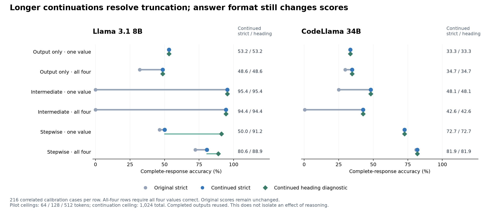
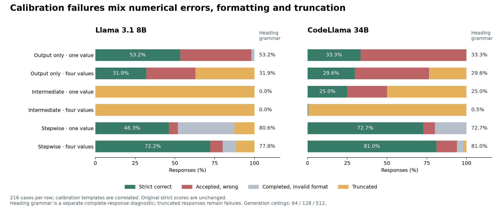
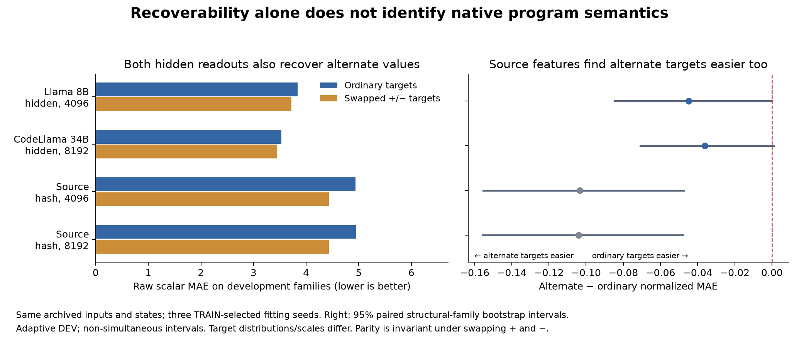

# Master research document

November 1 endpoint/baseline check: [TRAIN-only prior and penalty diagnostics](arithmetic_conditional_prior_diagnostics_20261101_v1.md) · [next-wave design](arithmetic_conditional_next_wave_20261101_v1.md). All eight ridge cells chose the grid maximum alpha 10,000, so their penalty search is not settled. Constant zero/median computed MAE is **5.331**, worse than joint **4.986 / 4.944**, but zero exact accuracy is **8.90%**, better than joint **6.68% / 6.00%**. The supported gain is numerical proximity relative to the tested controls; exact state recovery remains unestablished. These postrun diagnostics estimated priors on TRAIN only, with no new ridge fits or language-model calls. The next planned wave extends the penalty path while reusing old CV banks and reporting endpoint-specific priors; it is not yet submitted.

November 1 completed conditional probes: [findings](arithmetic_conditional_findings_20261101_v1.md) · [240-bank numerical audit](arithmetic_conditional_postrun_review_20261101_v1.md). Computed-value MAE is **4.986 Llama / 4.944 CodeLlama** for joint source-plus-hidden features, versus **5.165** source 1024, **5.179** source 2048, and **5.170 / 5.183** shuffled-joint controls. Joint gains over hidden-only are small (**−0.020 / −0.028 MAE**) with descriptive intervals crossing zero. Computed rounded exact accuracy remains **6.68% / 6.00%**. This supports modest predictive usability beyond these finite source controls, not a recovered complete numeric state or causal execution.

The [new matched overwrite review](arithmetic_calibration_retention_review_20261101_v1.md) covers 36 literal/copy/arithmetic calibration source pairs in eight closed components. Under the separate heading grammar, the pooled retained target is less accurate after an operand overwrite than after its matched irrelevant overwrite in all 12 model/protocol/scope cells. Arithmetic-only strata show that direction in 11 of 12 cells; Llama output-only/all is the small reverse case (19 versus 18 correct targets across 54 pairs). Some wrong answers uniquely match current-operand recomputation among the stored finite candidates. Repeated wording/seed contexts are correlated; these are exploratory behavior patterns requiring formal-family replication, not identified internal mechanisms.

November 1 conditional-probe wave: [frozen recipe](arithmetic_conditional_plan_20261101_v1.md) · [execution handoff](arithmetic_conditional_launch_20261101_v1.md) · [live status](arithmetic_conditional_status_20261101_v1.md). Eight source/hidden/control cells add **240 CPU readout fits** using archived captures and zero new language-model calls. Source-only 1024/2048, hidden-only 1024, joint 2048 and independently TRAIN-selected shuffled-hidden controls test predictive gain within finite feature classes. All **42 focused tests** and all **2,654 full regression tests** passed; all eight cells and report **488221** completed. The [independent numerical audit](arithmetic_conditional_postrun_review_20261101_v1.md) checked all 240 banks and replayed **2,135,808** prediction coordinates exactly.

The continuation calibration and cached probe study use different cohorts; these results do not establish a per-case knowledge/output dissociation.

November 1 completed continuation: [interpretation and next decisions](arithmetic_continuation_decisions_20261101_v1.md) · [Llama native-token audit](arithmetic_paired_llama8b_postrun_20261101_v1.md) · [CodeLlama native-token audit](arithmetic_paired_codellama34b_postrun_20261101_v1.md). All **941 continuations** and **2,592 merged responses** are accounted for, with no remaining truncation. Llama intermediate-query strict accuracy rises from 0% at 128 tokens to **95.37% single / 94.44% all-four** after continuation. CodeLlama stepwise strict accuracy is **72.69% single / 81.94% all-four**; its intermediate-query results remain weaker. Llama stepwise single is **50.00% strict / 91.20%** under the separate heading diagnostic. The same-target scope contrasts and their formatting limitations are in the checkpoint audits. Original pilot scores and failed output-only gates remain unchanged; these findings are exploratory protocol sensitivities.

[Editable figure](figures/arithmetic_calibration_continuation_v1.svg) · [PDF](figures/arithmetic_calibration_continuation_v1.pdf). Inputs and plotting utility are hash-pinned in `continuation_figure_review_v1.json`.

November 1 exploratory follow-up: [declared experiments and eight next branches](arithmetic_paired_exploration_plan_20261101_v2.md) · [execution handoff](arithmetic_paired_exploration_launch_20261101_v2.md) · [live status](arithmetic_paired_exploration_status_20261101_v2.md). The separate frozen suite passed **42 focused tests** and all **2,612 full regression tests** (job **488060**). It audits all calibration responses, preserves original scores, compares query scopes on the same target, and continues every truncated response to a common 1,024-token total: **564 / 377** continuations, reusing **732 / 919** completed responses. Both gates passed; continuation jobs **488076 / 488077**, final report **488129** and token audits **488125 / 488126** completed successfully. Continued results and interpretation appear above. The [completed metadata-only capture inventory](arithmetic_capture_preparation_20261101_v1.md) found 165,888 formal site rows map to 50,688 unique native prefixes per model (3.27× potential vector reuse), with no audited prefix sharing across TRAIN/DEV. Numerical activation-equivalence checks remain required. No formal inference, probe fitting, causal claim or sealed-final access is added.

The [completed independent calibration audit](arithmetic_paired_error_audit_20261101_v2.md) replayed all original scores and source joins. Llama stepwise single-value accuracy is **46.30% strict versus 80.56%** under a separate explicit Markdown-heading grammar; neither original scores nor competence gates changed. Among output-only all-variable cases, **36 Llama / 11 CodeLlama** responses already contained the correct explicit answer before truncation. These are diagnostic sensitivities, not new confirmation or evidence of an internal mechanism.

[Editable figure](figures/arithmetic_calibration_error_audit_v1.svg) · [PDF](figures/arithmetic_calibration_error_audit_v1.pdf). Each row contains 216 correlated calibration cases; strict scores, completed-response diagnostic scores and truncation stay separate.

November 1 paired follow-up: [execution handoff](arithmetic_paired_launch_20261101_v1.md) · [frozen protocol](arithmetic_paired_plan_20261101_v1.md) · [live status](arithmetic_paired_status_20261101_v1.md). All 2,570 regression tests passed. Two execution implementations agree on 27,864 source rows: 27,648 formal rows in 96 TRAIN / 32 DEV components, plus 216 calibration rows. Retention and same-bag binding checks passed. Both tokenizers validated 45,360 layouts each, with distinct RHS/newline sites and matched earlier query/protocol prefixes. GPU calibration jobs 487742 / 487743 and report 487935 completed: 2,592 responses in total. Both models failed the fixed output-only competence gates. All-four joint accuracy is 31.94% / 29.63% output-only and 72.22% / 81.02% stepwise; unequal generation ceilings, truncation and formatting prevent attributing this gap specifically to reasoning. [Complete calibration results](arithmetic_paired_calibration_findings_20261101_v1.md). Simple copy/literal controls remain calibration-only to prevent structural leakage. Formal model inference remains unscheduled pending calibration review.

October 31 completed global-state study: [all-variable and direct-relationship results](arithmetic_global_state_findings_v1.md) · [computed/untouched and queried/unqueried breakdown](arithmetic_global_state_strata_v1.md) · [execution handoff](arithmetic_global_state_launch_v1.md) · [frozen protocol](arithmetic_global_state_plan_v1.md) · [completed status](arithmetic_global_state_status_v1.md). All seven CPU cells finished. At full width, categorical all-four accuracy is 0.15% / 0.46% for Llama / CodeLlama versus 1.62% / 1.70% for matched source baselines; computed-value categorical accuracy remains 8.38% / 8.54%. Direct relation BA is 55.25% / 56.74%, versus 54.64% / 54.60% for source. These are adaptive discovery results from single-variable prompts, not causal-use or representation-absence evidence. Width mainly improves untouched-value decoding here; paired timing/overwrite/query-scope data are the next priority.

Validation: all 2,533 frozen regression tests passed. The [independent semantic-control audit](arithmetic_semantic_postrun_review_v1.md) replayed 21 selected banks and 9,629,928 scores exactly, verified 108 CV banks, and checked 231,228 parity-invariant coordinates. New global banks also passed coefficient save/reload checks, and their DEV metrics were replayed from saved scores before reporting. All new large payloads stayed on scratch; this wave used no new model queries. This completes Run 1 below; later dataset and GPU stages remain planned.

October 31 semantic-control results: [completed findings](arithmetic_semantic_controls_findings_v2.md) · [original launch](arithmetic_semantic_controls_launch_v2.md) · [frozen protocol](arithmetic_semantic_controls_plan_v2.md). Ordinary and swapped-operator values have similar recovery; swapped scalar targets have slightly lower raw MAE and source features also find the swapped task easier. A source-corrected normalized-MAE interaction is exploratory and does not establish ordinary-semantic preference or causal execution. Addition and subtraction agree modulo two, so identical parity scores are a mathematical sanity check. The 23-paper review/register remain pinned, and all-variable/version/relation oracle labels are available for the new assay.

The [editable vector figure](figures/arithmetic_semantic_controls_v3.svg) and [PDF](figures/arithmetic_semantic_controls_v3.pdf) are generated from the saved fit banks and report contrasts. Raw MAE is averaged over fitting seeds; the interval panel bootstraps structural families after averaging seeds. These are existing adaptive DEV results, not new confirmation data.

October 31 literature search: [23-paper probing methods review and ranked experiments](probing_literature_review_20261031_v1.md). Priorities are alternative-semantic controls on fixed states, conditional probing beyond source cues, and global state versus query-dependent retrieval. Shared structured readouts, learning-effort measures and gated causal model comparison follow. These additions are proposals, not submitted jobs.

October 31 methods upgrade: [competing mechanisms and advanced methods](advanced_methods_20261031_v1.md) · [submitted geometry wave](arithmetic_numeric_geometry_launch_v1.md) · [controlled protocol](arithmetic_numeric_geometry_plan_v1.md). New code tests circular decimal/residue geometry against dimension-matched permutations and prepares native final-query vectors. This targeted addendum precedes the broader global-state fits below; shared slots, calibrated MDL and causal alignment remain proposed follow-ups.

October 31 next-run planning: [latest results snapshot](arithmetic_results_for_next_runs_v1.md) · [ordered run plan](arithmetic_next_runs_20261031_plan_v1.md). The planning document preserves its original not-submitted status; the global-state protocol and launch above now execute its first stage. Paired timing/overwrite/retention data preparation follows. Canonical grouping, native token sites and scratch-storage checks precede new GPU work.

October 31 completed compression/encoding wave: [audited review and figure](arithmetic_numeric_postrun_review_v1.md) · [full findings](arithmetic_numeric_exploration_findings_v1.md). All six workers and the report finished. The independent postrun audit verified saved banks, TRAIN selections, selected parameter replay and numeric metrics. Wider hidden features improve computed-value readouts within this assay, while exact computed-value recovery remains weak. [Terminal suite status](arithmetic_numeric_exploration_status_v1.md).

October 31 storage recovery: numeric exploration passed2,467 regression tests and all cache stages, then hit a `/work` quota failure. [Verified relocation and resume](arithmetic_numeric_storage_recovery_20261031_v1.md) moved feature arrays and future readout outputs to scratch, preserved65 committed banks and recovered one saved bank without refitting. The restarted worker advanced beyond that prefix; the controller is restored.

October 31, next wave: [compression and numeric encoding submitted](arithmetic_numeric_exploration_launch_v1.md). A fixed-layer, role-specific grid compares 64/256/1024/uncompressed features and numeric component encodings with shared source controls. Targeted checks passed; full frozen regression gates the CPU experiment DAG. [Live status](arithmetic_numeric_exploration_status_v1.md).

October 31: the [completed current-state follow-up](arithmetic_current_state_findings_v1.md) finds weak computed-value recovery and near-chance derived relationships despite strong local parent decoding. The [exploratory roadmap](arithmetic_exploration_20261031_plan_v1.md) separates compression, numeric encoding, temporal sites, binding/arithmetic, direct relations, behavior prediction and causal tests. Its [completed first diagnostic](arithmetic_measurement_diagnostics_v2.md) reuses saved predictions with family-cluster uncertainty and explicit oracle substitutions; local hidden-minus-source contrasts are positive in both checkpoints, while oracle routing still leaves numeric-state recovery weak.

October 30 evening: the [audited local-dependency results and figure](arithmetic_local_dependency_findings_v1.md) show 86.72% / 83.43% parent accuracy and 41.46% / 34.54% complete graphs. Both checkpoints passed exact replay of all saved readouts. Complete numeric states and natural causal use remain unestablished. The [validated follow-up release](arithmetic_state_followup_launch_v2.md) queues matched-capacity controls, current binding lookup and numeric/algebraic decoding without new language-model calls.

October30 probe revision: [implementation, source expansion and submitted experiments](arithmetic_probe_improvement_launch_v1.md). TRAIN-only layer/regularization/rank selection and shared local dependency scorers are implemented; original negative findings remain preserved.

The [completed archived-feature revision and comparison figure](arithmetic_probe_selection_findings_v2.md) retain zero complete graphs, with modestly lower numeric error. The larger local-dependency experiment passed 2,408 software tests and both native layout checks before capture submission.

October30 operational follow-up: [debug pass and scheduled monitoring](operations_debug_20261030_v1.md). Saved readout and prompt-control artifacts passed their audits; logger freshness detection was fixed and verified with 54 tests.

Morning follow-up, October30: [review and next decisions](arithmetic_graph_morning_decision_v1.md), [probe TRAIN/DEV audit](arithmetic_graph_morning_review_v2.md), and [completed printed-query controls](arithmetic_prompt_control_findings_v1.md). The replay is exact; probe generalization and arithmetic competence remain unresolved.

[GitHub-friendly master document](../../docs/binding/MASTER_REPORT.md)

[Open the complete master report with embedded figures](master_research_report_v4.html) · [Read the Markdown edition](master_research_report_v4.md)

Updated October 29, 2026. This is the current entry point for the variable-binding study proposed in dependvar.txt.

Overnight follow-up, October29–30: [new arithmetic dependency/relationship findings](arithmetic_graph_overnight_findings_v1.md) · [plan](arithmetic_graph_overnight_20261029_plan_v3.md) · [execution](arithmetic_graph_overnight_20261029_status_v3.md). The first suite completed: 9,216 captures, 2,304 generated answers and 36 readout fits. Answer-preparation relation balanced accuracy is 54.61% / 54.04% (8B / 34B), with zero complete eight-parent graphs recovered. Arithmetic-written DEV answers are 22/216 correct for each model. These are exploratory negative findings under the tested readouts, not evidence of representational absence.

The report includes the original question and full plan, milestones M0–M6, all ten authorized experiments, datasets and checkpoint identities, behavioral/probe/intervention/relationship/prediction results, 19 central figures, including four conceptual illustrations, all 41 PNG figure revisions with historical corrections labeled, a 239-report archive index, the remaining nine scientific decisions, and an ordered next-experiment plan.

Start with sections 1 (current findings), 3 (milestones), 12 (every original branch), and 14 (next work). The main causal mechanism and untouched unfamiliar-program validation remain unfinished; engineering completion and scoped discovery findings are tracked separately.

Reproduction and source/figure hashes: [publication evidence](../../artifacts/binding/master_report/20261029_v3/publication_review_v1.json) and [reproduction helper](../../artifacts/binding/master_report/20261029_v3/reproduce_master_report_v3.py).

New visual primer: [binding/overwrite timeline](figures/concept_binding_timeline_v1.svg), [binding versus dependency versus algebraic relation](figures/concept_relationship_types_v1.svg), and [readout → causal use → prediction](figures/concept_evidence_ladder_v1.svg). The [interactive walkthrough](master_research_report_v4.html#binding-stepper) lets you advance one assignment at a time. All three figures are conceptual illustrations rather than experimental measurements.

The [master conceptual figure](figures/variable_binding_master_v1.png) combines the program, language model and structured readout targets in one view. [Editable SVG](figures/variable_binding_master_v1.svg) · [Vector PDF](figures/variable_binding_master_v1.pdf). The earlier v3 publication proof above remains the scientific report’s base edition; the [figure-addition proof](../../reproducibility/figure_updates/master_concept_publication_v1.json) records v4.
