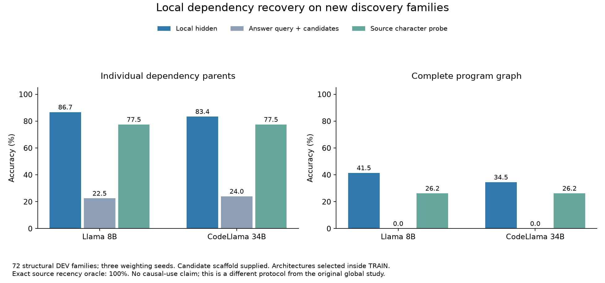

# Local dependency readouts: completed discovery results

Both checkpoints completed 5,292 causal local captures and 5,508 short-arithmetic answers. All 54 post-selection readouts per checkpoint were independently reapplied from saved parameters. The audit checked capture checksums, native point identities, independent source read-time traces, grouped TRAIN selection, strict response parsing and saved dependency decisions. No audit fits or language-model calls were made.

| Model | Backend | Selected architecture | Family-macro parent accuracy | Whole-program graph | Random-family control |
|---|---|---|---:|---:|---:|
| llama8b | hidden_local | bilinear | 86.72% | 41.46% | 18.86% |
| llama8b | hidden_global | linear | 22.49% | 0.00% | 18.76% |
| llama8b | source_local | bilinear | 77.53% | 26.23% | 20.11% |
| codellama34b | hidden_local | mlp | 83.43% | 34.54% | 18.79% |
| codellama34b | hidden_global | bilinear | 24.03% | 0.00% | 19.51% |
| codellama34b | source_local | bilinear | 77.53% | 26.23% | 20.11% |

Whole graphs have four/eight/twelve ordered parents at depths two/four/six. All metrics above are on the new 72-family development cohort, averaged over the three weighting seeds. The answer-query backend also receives earlier candidate-definition states, so it is not a probe of one final vector alone. Every backend receives candidate boundaries and statement/side coordinates. Exact source-name/recency parsing recovers 100%; the hashed character comparator is a limited learned source baseline. Selected architectures differ, and capacity-matched counterparts are a separately declared follow-up.

This study changes data diversity, decoder architecture, candidate constraints and token access relative to the original global study. Its gains cannot be attributed solely to localization, and they do not establish causal use or a maintained complete numeric state. These are adaptive discovery findings.

| Model | Training structures | Local hidden parents | Source parents | Local hidden complete graph |
|---|---:|---:|---:|---:|
| llama8b | 54 | 83.22% | 63.62% | 36.45% |
| llama8b | 108 | 85.77% | 73.03% | 39.33% |
| llama8b | 216 | 86.72% | 77.53% | 41.46% |
| codellama34b | 54 | 80.14% | 63.62% | 30.99% |
| codellama34b | 108 | 82.45% | 73.03% | 33.90% |
| codellama34b | 216 | 83.43% | 77.53% | 34.54% |

| Model | Instruction | Cohort | Depth | Query type | Correct / cases | Invalid | Accuracy |
|---|---:|---|---:|---|---:|---:|---:|
| llama8b | I0 | calibration | 1 | arithmetic_written | 40/108 | 8 | 37.04% |
| llama8b | I0 | development | 2 | arithmetic_written | 63/240 | 7 | 26.25% |
| llama8b | I0 | development | 2 | untouched_literal | 177/192 | 1 | 92.19% |
| llama8b | I1 | calibration | 1 | arithmetic_written | 70/108 | 6 | 64.81% |
| llama8b | I1 | development | 2 | arithmetic_written | 69/240 | 10 | 28.75% |
| llama8b | I1 | development | 2 | untouched_literal | 178/192 | 1 | 92.71% |
| llama8b | I2 | calibration | 1 | arithmetic_written | 26/108 | 51 | 24.07% |
| llama8b | I2 | development | 2 | arithmetic_written | 54/240 | 93 | 22.50% |
| llama8b | I2 | development | 2 | untouched_literal | 10/192 | 178 | 5.21% |
| codellama34b | I0 | calibration | 1 | arithmetic_written | 82/108 | 0 | 75.93% |
| codellama34b | I0 | development | 2 | arithmetic_written | 75/240 | 0 | 31.25% |
| codellama34b | I0 | development | 2 | untouched_literal | 177/192 | 0 | 92.19% |
| codellama34b | I1 | calibration | 1 | arithmetic_written | 29/108 | 68 | 26.85% |
| codellama34b | I1 | development | 2 | arithmetic_written | 72/240 | 2 | 30.00% |
| codellama34b | I1 | development | 2 | untouched_literal | 170/192 | 1 | 88.54% |
| codellama34b | I2 | calibration | 1 | arithmetic_written | 75/108 | 0 | 69.44% |
| codellama34b | I2 | development | 2 | arithmetic_written | 78/240 | 0 | 32.50% |
| codellama34b | I2 | development | 2 | untouched_literal | 182/192 | 0 | 94.79% |

Arithmetic-written answers remain unreliable and sensitive to wording. All three instructions and invalid responses are retained. Representation captures use I0 only; no cross-instruction hidden-state comparison is implied. Calibration families never enter probe fits. Next steps test current-definition lookup, role-conditioned numeric decoding and algebraic relations derived from predicted states, using the saved activations.

