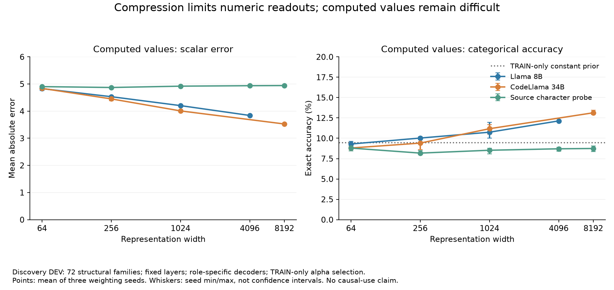

# Numeric exploration: audited completion review

All six workers and the report completed. The no-fit postrun audit verified **918 unique fit banks**, recomputed TRAIN selections and replayed **216 selected scorers** over **2,151,139,032 score values**. Maximum replay difference: **0**. Independent metric checks covered real, coherent-family-control and TRAIN-prior panels. CV payloads/metadata were verified; CV scores were not reapplied. The source regression passed 2,467 tests.

Within the fixed-layer role-specific assay, wider hidden features reduce computed-value error and improve categorical exact accuracy. Literal copying controls reach very high accuracy. Computed results remain difficult; component/digit decoding does not establish complete execution-state recovery. The limited source-character comparator, supplied site/statement scaffold and increased decoder capacity remain explicit. This is adaptive discovery on already-inspected DEV, not new-family confirmation or causal-use evidence.

| Worker / role | Width | Encoding | DEV exact | DEV MAE | Shuffled exact | TRAIN prior exact |
|---|---:|---|---:|---:|---:|---:|
| llama8b_root_definition | 64 | scalar | 34.86% | 0.972 | 8.40% | 7.91% |
| llama8b_root_definition | 64 | categorical | 99.56% | 0.029 | 7.80% | 7.47% |
| llama8b_root_definition | 64 | digits_joint | 99.95% | 0.002 | 7.83% | 8.10% |
| llama8b_root_definition | 4096 | scalar | 98.58% | 0.066 | 7.75% | 7.91% |
| llama8b_root_definition | 4096 | categorical | 100.00% | 0.000 | 7.43% | 7.47% |
| llama8b_root_definition | 4096 | digits_joint | 100.00% | 0.000 | 7.65% | 8.10% |
| llama8b_computed_definition | 64 | scalar | 7.11% | 4.830 | 7.73% | 9.44% |
| llama8b_computed_definition | 64 | categorical | 9.30% | 5.159 | 7.29% | 9.44% |
| llama8b_computed_definition | 64 | digits_joint | 5.48% | 5.043 | 4.74% | 5.07% |
| llama8b_computed_definition | 4096 | scalar | 9.96% | 3.841 | 7.06% | 9.44% |
| llama8b_computed_definition | 4096 | categorical | 12.13% | 4.404 | 6.54% | 9.44% |
| llama8b_computed_definition | 4096 | digits_joint | 10.07% | 4.780 | 4.30% | 5.07% |
| codellama34b_root_definition | 64 | scalar | 27.58% | 1.191 | 8.09% | 7.91% |
| codellama34b_root_definition | 64 | categorical | 98.99% | 0.064 | 7.72% | 7.47% |
| codellama34b_root_definition | 64 | digits_joint | 99.73% | 0.008 | 7.87% | 8.10% |
| codellama34b_root_definition | 8192 | scalar | 99.31% | 0.044 | 7.88% | 7.91% |
| codellama34b_root_definition | 8192 | categorical | 100.00% | 0.000 | 7.43% | 7.47% |
| codellama34b_root_definition | 8192 | digits_joint | 100.00% | 0.000 | 7.05% | 8.10% |
| codellama34b_computed_definition | 64 | scalar | 6.96% | 4.839 | 7.69% | 9.44% |
| codellama34b_computed_definition | 64 | categorical | 8.80% | 5.194 | 7.18% | 9.44% |
| codellama34b_computed_definition | 64 | digits_joint | 5.00% | 5.000 | 4.60% | 5.07% |
| codellama34b_computed_definition | 8192 | scalar | 11.48% | 3.527 | 6.55% | 9.44% |
| codellama34b_computed_definition | 8192 | categorical | 13.13% | 4.223 | 6.05% | 9.44% |
| codellama34b_computed_definition | 8192 | digits_joint | 10.64% | 4.202 | 4.26% | 5.07% |
| source_root_definition | 64 | scalar | 27.03% | 1.284 | 8.05% | 7.91% |
| source_root_definition | 64 | categorical | 97.80% | 0.103 | 7.37% | 7.47% |
| source_root_definition | 64 | digits_joint | 91.79% | 0.257 | 7.60% | 8.10% |
| source_root_definition | 4096 | scalar | 100.00% | 0.000 | 8.15% | 7.91% |
| source_root_definition | 4096 | categorical | 100.00% | 0.000 | 7.63% | 7.47% |
| source_root_definition | 4096 | digits_joint | 100.00% | 0.000 | 7.92% | 8.10% |
| source_root_definition | 8192 | scalar | 100.00% | 0.000 | 8.15% | 7.91% |
| source_root_definition | 8192 | categorical | 100.00% | 0.000 | 7.56% | 7.47% |
| source_root_definition | 8192 | digits_joint | 100.00% | 0.000 | 7.89% | 8.10% |
| source_computed_definition | 64 | scalar | 6.23% | 4.904 | 6.99% | 9.44% |
| source_computed_definition | 64 | categorical | 8.80% | 5.017 | 8.89% | 9.44% |
| source_computed_definition | 64 | digits_joint | 6.31% | 4.972 | 4.11% | 5.07% |
| source_computed_definition | 4096 | scalar | 6.66% | 4.938 | 6.86% | 9.44% |
| source_computed_definition | 4096 | categorical | 8.71% | 5.278 | 6.50% | 9.44% |
| source_computed_definition | 4096 | digits_joint | 6.32% | 5.008 | 4.24% | 5.07% |
| source_computed_definition | 8192 | scalar | 6.64% | 4.943 | 6.91% | 9.44% |
| source_computed_definition | 8192 | categorical | 8.74% | 5.273 | 6.57% | 9.44% |
| source_computed_definition | 8192 | digits_joint | 6.30% | 5.019 | 4.31% | 5.07% |

All declared widths, ten encodings, individual seeds, alpha choices, class support, invalid digit configurations, strata and parameter counts remain in the [full findings](arithmetic_numeric_exploration_findings_v1.md) and machine-readable results. Large artifacts use verified scratch storage after the [quota recovery](arithmetic_numeric_storage_recovery_20261031_v1.md). No postrun fits, model calls or sealed-final access occurred.

Next: prepare separately declared later-token captures and matched arithmetic/binding/retention datasets. Freeze a primary measurement before independent-family confirmation. Existing final outcomes stay sealed.
