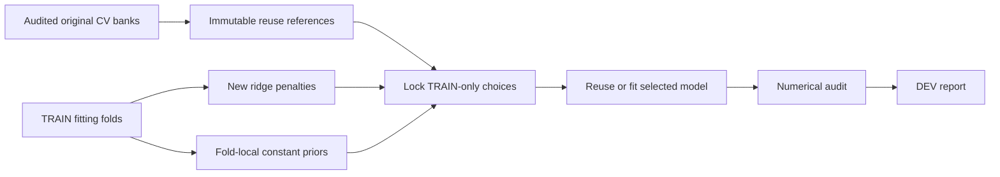

# Extended penalty path: execution handoff

[Frozen protocol](arithmetic_penalty_path_plan_20261101_v1.md) · [Live status](arithmetic_penalty_path_status_20261101_v1.md) · [Original conditional findings](arithmetic_conditional_findings_20261101_v1.md).

Completed: [audited findings](arithmetic_penalty_path_findings_20261101_v1.md) · [postrun review](arithmetic_penalty_path_postrun_20261101_v1.md) · [exact-value diagnostic](arithmetic_exact_value_diagnostic_20261101_v1.md). All stages completed, including numerical audit **488416**, report **488423** and terminal controller **488422**. Actual counts: **216 new CV fits, 216 reused CV banks, 24 reused selected banks, zero new selected fits**. All eight choices stay at 10,000, now interior. The automatic controller stopped after terminal completion.

The original eight cells all selected the largest tested penalty. This follow-up extends that range and includes loss-appropriate priors in TRAIN-fold selection. The original experiment, numerical audit and postrun prior results are preserved.

- Frozen snapshot **98bd03c707756b99c11c0391**; code SHA **34c61d4f88554a6d59319b9c2a92ca99c8ee4d3713440d4d5f09267f0abffab2**.
- Suite: `configs/binding/arithmetic_penalty_path_20261101_v1/suite.json`.
- **43 focused tests passed**. Full **2,697-test** regression **488331 passed** (655.85 seconds of tests), gating all scientific stages.
- Initial durable controller **488330**, with ten-minute successors on `dev,normal`. Shared-prior job **488375 completed**; eight worker jobs **488405–488412** were submitted after its immutable completion hashes passed. Owned pending controller start times were advanced after prerequisite checks; dependencies were preserved in numbered operation receipts.
- Shared prior preparation fits mean, median and computed-family median inside each TRAIN fitting fold and full TRAIN. Zero is fixed. **36 four-slot prior-statistic vectors** are estimated; full-TRAIN priors are not evaluated on DEV during preparation.
- Eight cells reuse **216 original CV banks** and fit **216 new CV banks** at 100,000 / 1,000,000 / 10,000,000. The original 1/100/10,000 path is referenced, not repeated. Selected old full-TRAIN models are reused when applicable; otherwise at most 24 new selected models are fitted.
- Reuse checks old ownership/configuration and exact ordered TRAIN feature/target/weight/donor fingerprints. Wrappers retain the original bank/source/configuration; original coefficient and score files are not modified.
- Lock the best ridge penalty and the best predictor class including constants using TRAIN folds only. A no-refit numerical audit of all 432 CV banks and 24 selected ridge banks gates the final report. No new language-model calls, backbone training or sealed-final access.

The cohort, layers 24/36, fitting/projection seeds 11/29/47, feature blocks and structural folds match the original study. This isolates penalty continuation and predictor-class selection rather than changing the assay. An interior optimum is interior to this finite grid; any remaining boundary or constant preference stays explicit. MAE and exact integer recovery remain separate outcomes.

CPU allocations use 16 cores / 32GiB per worker on `dev,normal`, with scratch-first model/score arrays at `/scratch/juno/jvl210002/codecue/arithmetic_penalty_path/20261101_v1` and immutable work links. Controller retries preserve committed banks. Shared priors use 8 cores / 16GiB; QA uses8 cores / 24GiB. Existing jobs and the editor allocation are preserved. The pinned literature review/register, automatic event journal and publication inventories remain enabled. There is no cumulative compute allowance.
