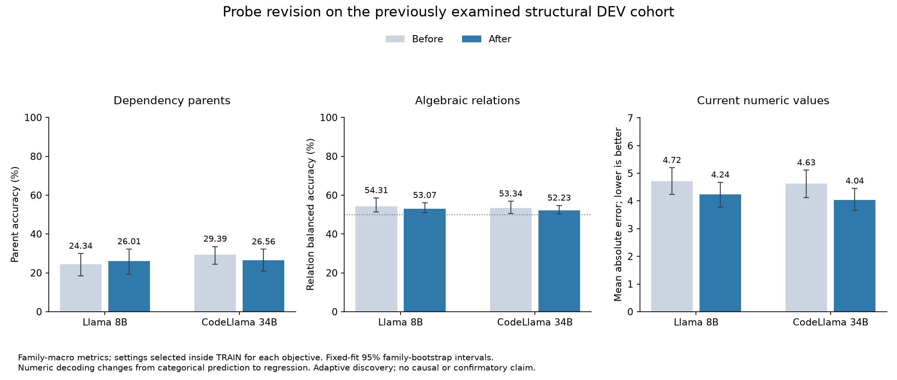

# Archived-feature probe revision: findings

Settings were selected using grouped TRAIN validation and locked before scoring the previously examined DEV cohort. All original CV banks were reused under verified identical mathematics. No new language-model calls or CV fits were made during recovery. Selected settings were refitted on all TRAIN with three weighting seeds.

| Model | Features | Parent accuracy before → after | Relation balanced accuracy before → after | Value MAE before → after | Whole graph after |
|---|---|---|---|---|---|
| llama8b | hidden | 24.34% → 26.01% | 54.31% → 53.07% | 4.72 → 4.24 | 0.00% |
| llama8b | source | 22.16% → 22.16% | 51.86% → 51.44% | 4.94 → 4.36 | 0.00% |
| codellama34b | hidden | 29.39% → 26.56% | 53.34% → 52.23% | 4.63 → 4.04 | 0.00% |
| codellama34b | source | 22.29% → 22.38% | 51.29% → 51.11% | 4.97 → 4.35 | 0.00% |

All table entries average weighting seeds within each of the same12 DEV families, then families equally. Relation figures therefore use family-macro balanced accuracy on both sides; the earlier pooled relation numbers have a different aggregation. Numeric MAE compares original categorical argmax values with continuous regression outputs. Whole-graph accuracy is from the dependency-selected decoder. Each objective has its own TRAIN-selected decoder; these are not three DEV-selected winners.

| Model | Backend | Selection objective | Layer/features | Rank | Alpha |
|---|---|---|---|---|---|
| llama8b | hidden | parent_accuracy | hidden_layer_16 | full | 100.0 |
| llama8b | hidden | relation_balanced_accuracy | hidden_layer_31 | full | 1.0 |
| llama8b | hidden | value_negative_mae | hidden_layer_24 | full | 10000.0 |
| llama8b | source | parent_accuracy | source_char | full | 100.0 |
| llama8b | source | relation_balanced_accuracy | source_char | 128 | 100.0 |
| llama8b | source | value_negative_mae | source_char | 32 | 10000.0 |
| codellama34b | hidden | parent_accuracy | hidden_layer_12 | full | 1.0 |
| codellama34b | hidden | relation_balanced_accuracy | hidden_layer_36 | full | 1.0 |
| codellama34b | hidden | value_negative_mae | hidden_layer_47 | full | 10000.0 |
| codellama34b | source | parent_accuracy | source_char | full | 10000.0 |
| codellama34b | source | relation_balanced_accuracy | source_char | full | 10000.0 |
| codellama34b | source | value_negative_mae | source_char | 32 | 10000.0 |

Intervals in the machine-readable review resample whole families conditional on fixed fits, after averaging seeds; they are exploratory and have no multiplicity correction. Source features receive their own TRAIN-only selection. All saved real/prior/shuffle outputs remain in the original result files. These findings cannot establish representational absence or natural causal use. The new local-dependency suite tests a different, distributed-accessibility question.

[Implementation and launch](arithmetic_probe_improvement_launch_v1.md) · [New local experiment](arithmetic_local_probe_plan_v1.md)
