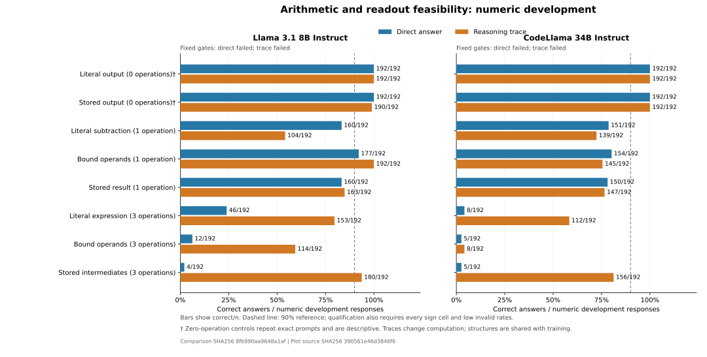

# Arithmetic/readout discovery decision

Both cached checkpoints completed and passed all artifact audits: **12,288 scored responses** from 3,072 independently checked sources, 384 numeric tuples and 192 mirrored numeric groups. All four fixed model/protocol reliability gates failed. Completed execution is separate from scientific qualification.

The source/configuration/dataset were frozen before model responses. Training calibration and numeric development have distinct nonzero-operation prompts, with every sign-reversed relative grouped. The two answer-copy controls repeat exact prompts and are excluded from qualification. Numeric development shares the same eight task structures; it is not a structural holdout.

## Complete protocol summaries

| Checkpoint | Protocol | Correct / n | Invalid | Training qualified | Numeric development qualified |
|---|---|---:|---:|---|---|
| Llama 3.1 8B | print_direct_v3 | 1893/3072 | 0 | False | False |
| Llama 3.1 8B | print_trace_long_v1 | 2573/3072 | 6 | False | False |
| CodeLlama 34B | print_direct_v3 | 1732/3072 | 11 | False | False |
| CodeLlama 34B | print_trace_long_v1 | 2207/3072 | 5 | False | False |

## All numeric-development forms

| Form | Llama direct | Llama trace | CodeLlama direct | CodeLlama trace |
|---|---:|---:|---:|---:|
| literal_output | 192/192 | 192/192 | 192/192 | 192/192 |
| stored_output | 192/192 | 190/192 | 192/192 | 192/192 |
| literal_one | 160/192 | 104/192 | 151/192 | 139/192 |
| bound_one | 177/192 | 192/192 | 154/192 | 145/192 |
| stored_result_one | 160/192 | 163/192 | 150/192 | 147/192 |
| literal_three | 46/192 | 153/192 | 8/192 | 112/192 |
| bound_three | 12/192 | 114/192 | 5/192 | 8/192 |
| stored_intermediates_three | 4/192 | 180/192 | 5/192 | 156/192 |

## Interpretation and next decision

Arithmetic composition and source/readout form both matter in this cohort. Direct-answer three-operation forms are substantially weaker than their folded one-operation counterparts. Trace prompting improves several three-operation forms, while its effects on one-operation forms depend on storage and checkpoint. A universal operation-count explanation is therefore insufficient. These observations do not identify an internal cause or a binding-specific mechanism.

The full six-sign-stratum matrices and every registered paired contrast, including null and reversed effects, remain in the [combined report](arithmetic_readout_results_v1.md) and individual reports. Bootstrap groups preserve numeric sign relatives; intervals are exploratory and unadjusted for multiplicity. Operand range, intermediate literal exposure, assignment count, source length and reasoning access differ across the declared factors.

The all-cell training-then-development rule remains in force: no favorable form/sign subset or alternate protocol rescues a failed gate. Any narrower arithmetic regime or equivalent-rendering diagnostic requires its own prospective design and fresh validation. The current result does not authorize computed causal interventions, optional checkpoint training, a mechanism C predictor or final-test evaluation. Original failed gates and final/extrapolation outcomes remain unchanged.

The [prior two-operation context](arithmetic_readout_prior_context.md) separately reproduces 768 already observed scores. Its different numeric bank and partly dead first operations prevent a clean two-versus-three-operation causal comparison.

## Software and resources

The arithmetic source passed 322 full regression tests. The subsequent forecasting-access maintenance passed 44 fitting/measurement checks. It rejects declared reserved paths/roles and dataset/checkpoint mismatches before reading response outcomes; untyped legacy response IDs still require strict checks after parsing. This maintenance fits no empirical forecaster and uses a separate frozen source pointer.

| Checkpoint | Allocated seconds | Engine load/warmup seconds | Generation seconds | Generation requests/s | Mean generation GPU utilization |
|---|---:|---:|---:|---:|---:|
| Llama 3.1 8B | 394 | 243.11 | 29.17 | 210.6 | 95.85% |
| CodeLlama 34B | 469 | 252.73 | 64.40 | 95.4 | 98.61% |

Both runs used H200s, BF16 and one continuously batched engine for the complete direct and trace cohorts. Generation rates/utilization exclude model loading and process startup; allocated seconds include them. Usage accounting is uncapped. No large checkpoint download or language-model training occurred.

[Plan](arithmetic_readout_plan.md) · [Completed status](arithmetic_readout_status_v1.md) · [Automatic experiment log](experiment_log.md)
