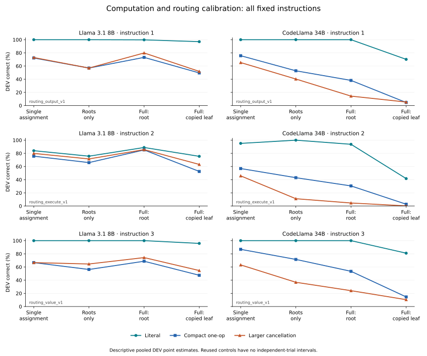

# Computation and routing discovery calibration

Both checkpoints completed and passed their artifact audits. **0/6 prospective instruction gates qualified.** Execution completion and scientific qualification are separate.

Each model generated 20,100 unique scored responses from 6,700 sources under three fixed instructions. These map to 20,736 logical responses from 6,912 logical source views. Every reused response retains its explicit membership; logical views are dependent.

| Model | Unique correct / n | Invalid | Confirmed warm-ups | New model requests |
|---|---:|---:|---:|---:|
| Llama 3.1 8B | 15,006/20,100 | 671 | 8 | 20108 |
| CodeLlama 34B | 8,926/20,100 | 429 | 8 | 20108 |

A gate requires at least 24 evaluated and 24 unique prompts, at least 90% accuracy and at most 5% invalid in every registered form × question × operator × answer-sign cell, first on TRAIN and then DEV. Query slots, copy depths/topologies and lexical forms are pooled prospectively. Only repeated literal single-assignment controls are excluded. All three instructions remain reported; no fallback is selected.

| Model | Instruction | TRAIN qualified | DEV cells passed | TRAIN→DEV qualified | Failed TRAIN / DEV cells |
|---|---|---|---|---|---:|
| Llama 3.1 8B | routing_output_v1 | False | False | False | 17/44 / 18/44 |
| Llama 3.1 8B | routing_execute_v1 | False | False | False | 29/44 / 30/44 |
| Llama 3.1 8B | routing_value_v1 | False | False | False | 20/44 / 21/44 |
| CodeLlama 34B | routing_output_v1 | False | False | False | 30/44 / 32/44 |
| CodeLlama 34B | routing_execute_v1 | False | False | False | 36/44 / 36/44 |
| CodeLlama 34B | routing_value_v1 | False | False | False | 30/44 / 30/44 |

The single-assignment condition (`arithmetic_only`) assigns the queried expression to a variable and reads it. Roots-only adds the three literal distractor roots. Full-root and full-leaf have the same four roots, four copies and correct answer; the final queried identifier changes. Recency and query selection still differ. Compact and larger expressions both use one operation; their operand ranges partly overlap, and magnitude, cancellation extent and tokenization change together.

The table reports DEV correct/logical n; invalid answers count as wrong. Full-context points pool depths 1, 2 and 4. All TRAIN and DEV counts, invalids, unique prompt support and token geometry are retained in [form_cells_v1.csv](../../artifacts/binding/computation_routing/20261028_v1/form_cells_v1.csv).

| Model | Instruction | Root form | Single assignment | Roots only | Full: root | Full: copied leaf |
|---|---|---|---:|---:|---:|---:|
| Llama 3.1 8B | routing_output_v1 | Literal | 144/144 (100.0%) | 144/144 (100.0%) | 431/432 (99.8%) | 419/432 (97.0%) |
| Llama 3.1 8B | routing_output_v1 | Compact one-op | 104/144 (72.2%) | 82/144 (56.9%) | 316/432 (73.1%) | 214/432 (49.5%) |
| Llama 3.1 8B | routing_output_v1 | Larger cancellation | 105/144 (72.9%) | 82/144 (56.9%) | 345/432 (79.9%) | 224/432 (51.9%) |
| Llama 3.1 8B | routing_execute_v1 | Literal | 121/144 (84.0%) | 109/144 (75.7%) | 384/432 (88.9%) | 326/432 (75.5%) |
| Llama 3.1 8B | routing_execute_v1 | Compact one-op | 109/144 (75.7%) | 95/144 (66.0%) | 368/432 (85.2%) | 227/432 (52.5%) |
| Llama 3.1 8B | routing_execute_v1 | Larger cancellation | 115/144 (79.9%) | 103/144 (71.5%) | 370/432 (85.6%) | 273/432 (63.2%) |
| Llama 3.1 8B | routing_value_v1 | Literal | 144/144 (100.0%) | 144/144 (100.0%) | 432/432 (100.0%) | 414/432 (95.8%) |
| Llama 3.1 8B | routing_value_v1 | Compact one-op | 96/144 (66.7%) | 81/144 (56.2%) | 297/432 (68.8%) | 205/432 (47.5%) |
| Llama 3.1 8B | routing_value_v1 | Larger cancellation | 96/144 (66.7%) | 93/144 (64.6%) | 321/432 (74.3%) | 236/432 (54.6%) |
| CodeLlama 34B | routing_output_v1 | Literal | 144/144 (100.0%) | 144/144 (100.0%) | 432/432 (100.0%) | 303/432 (70.1%) |
| CodeLlama 34B | routing_output_v1 | Compact one-op | 109/144 (75.7%) | 76/144 (52.8%) | 165/432 (38.2%) | 20/432 (4.6%) |
| CodeLlama 34B | routing_output_v1 | Larger cancellation | 94/144 (65.3%) | 58/144 (40.3%) | 62/432 (14.4%) | 23/432 (5.3%) |
| CodeLlama 34B | routing_execute_v1 | Literal | 137/144 (95.1%) | 144/144 (100.0%) | 405/432 (93.8%) | 180/432 (41.7%) |
| CodeLlama 34B | routing_execute_v1 | Compact one-op | 82/144 (56.9%) | 62/144 (43.1%) | 132/432 (30.6%) | 12/432 (2.8%) |
| CodeLlama 34B | routing_execute_v1 | Larger cancellation | 66/144 (45.8%) | 16/144 (11.1%) | 20/432 (4.6%) | 1/432 (0.2%) |
| CodeLlama 34B | routing_value_v1 | Literal | 144/144 (100.0%) | 144/144 (100.0%) | 432/432 (100.0%) | 350/432 (81.0%) |
| CodeLlama 34B | routing_value_v1 | Compact one-op | 125/144 (86.8%) | 103/144 (71.5%) | 231/432 (53.5%) | 63/432 (14.6%) |
| CodeLlama 34B | routing_value_v1 | Larger cancellation | 91/144 (63.2%) | 53/144 (36.8%) | 104/432 (24.1%) | 45/432 (10.4%) |

Every model retains all **108 primary DEV full-leaf minus full-root contrasts**, separately by instruction, root form, operator, answer sign and copy depth. Their saved 95% exploratory intervals use 2,000 whole root-order-cluster bootstraps (seed 913; 12 DEV clusters). No refit, new bootstrap or multiplicity adjustment was performed for this publication. [contrasts_v1.csv](../../artifacts/binding/computation_routing/20261028_v1/contrasts_v1.csv) retains all 216 primary DEV contrasts plus 432 TRAIN/all descriptive-context rows. No binomial intervals are assigned to reused control views.

Each instruction maps 6,700 physical sources to 6,912 logical views: 212 additional memberships, 116 sources with multiple memberships and 68 literal isolated controls shared across splits. These repeated controls do not establish independent generalization. A failure in a larger context does not identify whether arithmetic, copying or selection caused the response; separate invalid counts preserve interface failures.

| Model | GPU | Load + warm-up (s) | Timed generation (s) | Generation requests/s | Mean generation GPU util. |
|---|---|---:|---:|---:|---:|
| Llama 3.1 8B | NVIDIA H100 80GB HBM3 | 240.26 | 16.75 | 1199.9 | 84.47% |
| CodeLlama 34B | NVIDIA H100 80GB HBM3 | 248.27 | 89.91 | 223.6 | 96.70% |

Generation timing/utilization covers the monitored generation loop and excludes model loading. Device-memory metadata includes allocator reservations and KV cache. These figures are workload-specific.

This is a narrower adaptive discovery calibration on familiar forms. Numeric, lexical, topology and instruction relatives are not independent structural replications. No general arithmetic guarantee, causal owner/version mechanism, new scientific model family or unfamiliar-program prediction is established. Historical gates and sealed outcomes remain unchanged.

The publisher reads only completed receipts, SHA-pinned reviews, frozen profiles and audited preparation/runtime/summary metadata. It opens no raw responses, prepared/source JSONL, activation arrays or model. [comparison_v1.json](../../artifacts/binding/computation_routing/20261028_v1/comparison_v1.json) contains the consolidated values and input pins; [publication_review_v1.json](../../artifacts/binding/computation_routing/20261028_v1/publication_review_v1.json) pins every output.
