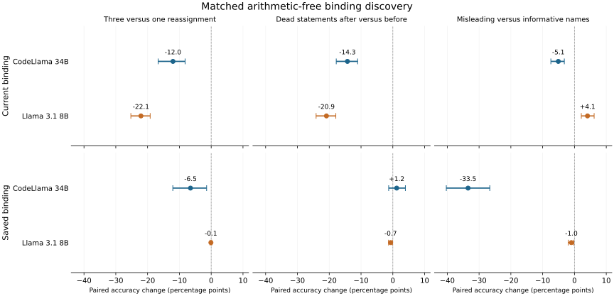

# Decision after arithmetic-free competition discovery

The four-model feasibility program and both Llama completion-interface follow-ups are complete and audited. The interface follow-up confirms that most of the very low native-chat CRUXEval scores reflected formatting: Llama 3.1 8B literal correctness changes from 21/800 to 305/800 for direct prompts and 48/800 to 364/800 for CoT. Llama 3.2 3B changes from 0/800 to 239/800 and 18/800 to 262/800. Both literal scoring methods and paired outcomes remain in the [interface report/artifact](llama_serialization_results.md). These are not official execution pass@k scores or an isolated gain in underlying reasoning.

CodeLlama 34B and Llama 3.1 8B passed the saved elementary arithmetic-free gate; no computed-arithmetic candidate passed numeric validation. Their new literal/copy discovery experiment completed 9,984 responses each with full semantic, token and score audits. Its [paired results](competition_results.md) hold final states, literal exposure, statement counts and prompt lengths fixed for the main version and query-distance contrasts.

Three versus one reassignment reduced current-value accuracy by 12.02 percentage points in CodeLlama 34B and 22.09 points in Llama 3.1 8B. Moving the same dead statements after the final current assignment reduced that readout by 14.28 and 20.88 points, respectively. Llama's saved-value readout was nearly unchanged by version count (-0.09 points). All four ownership-query/swap responses were correct in every group in both models.

The figure includes all twelve model/query/contrast combinations. Intervals resample 24 structural components and are exploratory, with no multiple-comparison claim. All values come from the audited paired artifact; reproduce with `scripts/109_binding_discovery_figure.py configs/binding/competition/figure_v1.json`.

Naming is not a uniform effect: misleading names reduced CodeLlama's saved-value accuracy by 33.46 points, while improving Llama's current-value accuracy by 4.10 points. Preserve this difference instead of selecting a universal naming-interference story. All fixed contrasts, invalid counts, overlapping wrong-binding/version labels and exploratory structural-component bootstrap intervals are retained. These are discovery results under one readout and two lexical realizations; robustness and an internal causal explanation remain unestablished.

The previously nominated smaller Llama 3.1 8B checkpoint completed its [state/query captures](state_capture_plan.md), including 9,216 backend-specific answers and the full tensor audit. Its earlier software check passed 128/128 matching correct answers and exact pre-query invariance at three blocks. The first neutral-training readouts show strong boundary dependence: apparent current-value recovery largely depends on whether that literal ends the state prefix. Identifier controls outperform value heads, but a subsequent audit found only two control labels per canonical head versus 32 value labels. Their easier target task prevents a decisive selectivity conclusion. These classifiers do not establish a general binding register or information absence.

The [measurement-control follow-up](readout_protocol.md) is complete: all 9,216 next-token consistency checks passed, followed by both all-slot and queried-value fits. At block 31, neutral-development queried-value accuracy is 6.4% at the query-line boundary and 87.9% at answer preparation, averaged across three fit-weighting seeds. The corresponding pre-answer surface comparator reaches 9.1%. Recovery therefore depends on the measured site and target; it does not establish causal use. All primary fits and hardware-specific answer differences remain recorded. The latest regression suite passed 217 tests.

The subsequent [literal-value transfer assay](value_transfer_decision.md) completed its own validated baseline, token layouts and same-answer, wrong-owner/version, reciprocal and effective-norm controls. Its first run exposed a formatting-space measurement error, preserved in a separate diagnostic. The corrected digit-aligned run completed 20,160 forwards. At block 0, the replacement digit appears on 144/144 affected version queries and 0/144 unchanged-answer controls; ownership transfer is less specific across all cases (81.94% versus 18.75%). All 576 final-answer vector controls copy the donor digit. These are local literal-routing effects in a small discovery family, not a general binding register or a validated explanation of the competition errors. No final-test forecast is registered. Keep the original seven-billion-parameter failed gates and all generated final outcomes unchanged.

The latest [computed-expression and late-reference continuation](routing_extension_decision.md) completed 1,008 baselines and 15,120 next-token intervention forwards. Both computed families failed the registered per-cell gate, so computed interventions were skipped. The late reset-reference contrast did not repair swap failures (15/54 versus 9/54), and targeted reference transfers did not consistently outperform matched controls. All analytic controls on the executed intervention assay passed. This narrows the next test to the earlier relevant temporary-to-second-variable copy; final/extrapolation outcomes remain sealed.

The [explicit query-timing and earlier-copy continuation](timing_and_copy_decision.md) completed 4,536 baselines and 90,720 interventions with three instruction variants and 223 passing tests. Moving the query later improved aggregate accuracy but showed cell-specific reversals. Equivalent statement reordering improved joint query correctness while changing the distribution of wrong-owner and duplicated-value answers. Copy-end transfers reveal reciprocal, other-query tradeoffs; a general binding mechanism, equivalence method and final-test predictor remain unestablished.

The [fresh ownership and common-final-query continuation](mechanism_followup_decision.md) and [frequency-matched probe controls](matched_probe_controls_decision.md) are now complete. The former adds 7,776 baselines and 96,768 interventions; candidate-site effects remain weak/nonselective, and an identical final query reduces the late-cue advantage from 13.04 to 1.70 percentage points. The latter adds 75 audited CPU fits and reproduces all 967,680 original value predictions with matched control class frequencies. All 234 tests pass. No causal binding account or final forecast is established.

The [computed retention-frontier study](live_load_decision.md) completed 76,032 predictions over a bank with 2/3/4 true live bindings and a constant eight defined variables. Both cached models failed arithmetic/clean-program reliability, so its small exploratory contrasts do not qualify a causal binding account. Independent exact-input replays and 24 uncached controls are complete; a prompt/completion stop-boundary bug in the initial Transformers diagnostic was corrected and archived. All 247 tests pass; original final outcomes remain sealed.
