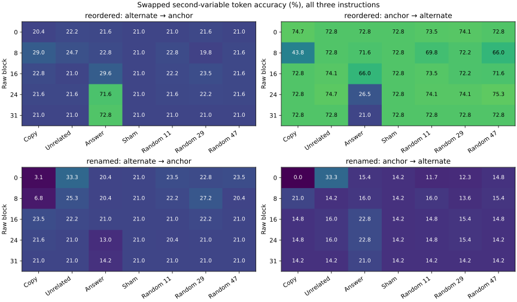

# Earlier copy-site transfer under equivalent source transformations

Audited 1,944 complete baseline responses (1578 correct), with 90,720 intervention forwards. All three instruction variants, two lexical realizations and all registered cases remain included. These are discovery data; final/extrapolation outcomes remain sealed.

| Instruction | Family | Mapping | Query | Form | Correct / n | Invalid |
|---:|---|---:|---:|---|---:|---:|
| 0 | ownership | 0 | 0 | anchor | 54/54 | 0 |
| 0 | ownership | 0 | 0 | reordered | 54/54 | 0 |
| 0 | ownership | 0 | 0 | renamed | 54/54 | 0 |
| 0 | ownership | 0 | 1 | anchor | 54/54 | 0 |
| 0 | ownership | 0 | 1 | reordered | 54/54 | 0 |
| 0 | ownership | 0 | 1 | renamed | 54/54 | 0 |
| 0 | ownership | 1 | 0 | anchor | 54/54 | 0 |
| 0 | ownership | 1 | 0 | reordered | 37/54 | 0 |
| 0 | ownership | 1 | 0 | renamed | 54/54 | 0 |
| 0 | ownership | 1 | 1 | anchor | 14/54 | 0 |
| 0 | ownership | 1 | 1 | reordered | 33/54 | 0 |
| 0 | ownership | 1 | 1 | renamed | 0/54 | 0 |
| 1 | ownership | 0 | 0 | anchor | 54/54 | 0 |
| 1 | ownership | 0 | 0 | reordered | 54/54 | 0 |
| 1 | ownership | 0 | 0 | renamed | 54/54 | 0 |
| 1 | ownership | 0 | 1 | anchor | 54/54 | 0 |
| 1 | ownership | 0 | 1 | reordered | 54/54 | 0 |
| 1 | ownership | 0 | 1 | renamed | 54/54 | 0 |
| 1 | ownership | 1 | 0 | anchor | 54/54 | 0 |
| 1 | ownership | 1 | 0 | reordered | 33/54 | 0 |
| 1 | ownership | 1 | 0 | renamed | 54/54 | 0 |
| 1 | ownership | 1 | 1 | anchor | 0/54 | 0 |
| 1 | ownership | 1 | 1 | reordered | 35/54 | 0 |
| 1 | ownership | 1 | 1 | renamed | 0/54 | 0 |
| 2 | ownership | 0 | 0 | anchor | 54/54 | 0 |
| 2 | ownership | 0 | 0 | reordered | 54/54 | 0 |
| 2 | ownership | 0 | 0 | renamed | 54/54 | 0 |
| 2 | ownership | 0 | 1 | anchor | 54/54 | 0 |
| 2 | ownership | 0 | 1 | reordered | 54/54 | 0 |
| 2 | ownership | 0 | 1 | renamed | 54/54 | 0 |
| 2 | ownership | 1 | 0 | anchor | 54/54 | 0 |
| 2 | ownership | 1 | 0 | reordered | 37/54 | 0 |
| 2 | ownership | 1 | 0 | renamed | 54/54 | 0 |
| 2 | ownership | 1 | 1 | anchor | 20/54 | 0 |
| 2 | ownership | 1 | 1 | reordered | 50/54 | 0 |
| 2 | ownership | 1 | 1 | renamed | 23/54 | 0 |

Paired changes use late-query prompts as the timing reference, and original programs as the copy-study reference.

| Instruction | Family | Mapping | Query | Alternate | n | Both correct | Reference only | Alternate only | Both wrong |
|---:|---|---:|---:|---|---:|---:|---:|---:|---:|
| 0 | ownership | 0 | 0 | reordered | 54 | 54 | 0 | 0 | 0 |
| 0 | ownership | 0 | 0 | renamed | 54 | 54 | 0 | 0 | 0 |
| 0 | ownership | 0 | 1 | reordered | 54 | 54 | 0 | 0 | 0 |
| 0 | ownership | 0 | 1 | renamed | 54 | 54 | 0 | 0 | 0 |
| 0 | ownership | 1 | 0 | reordered | 54 | 37 | 17 | 0 | 0 |
| 0 | ownership | 1 | 0 | renamed | 54 | 54 | 0 | 0 | 0 |
| 0 | ownership | 1 | 1 | reordered | 54 | 12 | 2 | 21 | 19 |
| 0 | ownership | 1 | 1 | renamed | 54 | 0 | 14 | 0 | 40 |
| 1 | ownership | 0 | 0 | reordered | 54 | 54 | 0 | 0 | 0 |
| 1 | ownership | 0 | 0 | renamed | 54 | 54 | 0 | 0 | 0 |
| 1 | ownership | 0 | 1 | reordered | 54 | 54 | 0 | 0 | 0 |
| 1 | ownership | 0 | 1 | renamed | 54 | 54 | 0 | 0 | 0 |
| 1 | ownership | 1 | 0 | reordered | 54 | 33 | 21 | 0 | 0 |
| 1 | ownership | 1 | 0 | renamed | 54 | 54 | 0 | 0 | 0 |
| 1 | ownership | 1 | 1 | reordered | 54 | 0 | 0 | 35 | 19 |
| 1 | ownership | 1 | 1 | renamed | 54 | 0 | 0 | 0 | 54 |
| 2 | ownership | 0 | 0 | reordered | 54 | 54 | 0 | 0 | 0 |
| 2 | ownership | 0 | 0 | renamed | 54 | 54 | 0 | 0 | 0 |
| 2 | ownership | 0 | 1 | reordered | 54 | 54 | 0 | 0 | 0 |
| 2 | ownership | 0 | 1 | renamed | 54 | 54 | 0 | 0 | 0 |
| 2 | ownership | 1 | 0 | reordered | 54 | 37 | 17 | 0 | 0 |
| 2 | ownership | 1 | 0 | renamed | 54 | 54 | 0 | 0 | 0 |
| 2 | ownership | 1 | 1 | reordered | 54 | 20 | 0 | 30 | 4 |
| 2 | ownership | 1 | 1 | renamed | 54 | 14 | 6 | 9 | 25 |

The primary intervention is at the end of the earlier assignment that restores the second variable from the temporary. Source forms preserve the complete canonical final state, literal exposure and measurement positions. No correct/error cases are selected; complete instruction-specific mapping/query controls and all seven conditions are in the JSON artifact. The table below shows the previously nominated swapped second-variable cell, with both donor directions.

| Form | Instruction | Donor → recipient | Block | n | Unpatched (%) | Primary (%) | Unrelated (%) | Random range (%) |
|---|---:|---|---:|---:|---:|---:|---:|---:|
| reordered | 0 | alternate → anchor | 0 | 54 | 25.93 | 25.93 | 24.07 | 25.93–27.78 |
| reordered | 0 | alternate → anchor | 8 | 54 | 25.93 | 27.78 | 29.63 | 18.52–27.78 |
| reordered | 0 | alternate → anchor | 16 | 54 | 25.93 | 27.78 | 25.93 | 25.93–27.78 |
| reordered | 0 | alternate → anchor | 24 | 54 | 25.93 | 25.93 | 25.93 | 25.93–25.93 |
| reordered | 0 | alternate → anchor | 31 | 54 | 25.93 | 25.93 | 25.93 | 25.93–25.93 |
| reordered | 0 | anchor → alternate | 0 | 54 | 61.11 | 66.67 | 61.11 | 61.11–62.96 |
| reordered | 0 | anchor → alternate | 8 | 54 | 61.11 | 31.48 | 59.26 | 51.85–64.81 |
| reordered | 0 | anchor → alternate | 16 | 54 | 61.11 | 62.96 | 64.81 | 59.26–64.81 |
| reordered | 0 | anchor → alternate | 24 | 54 | 61.11 | 62.96 | 66.67 | 64.81–68.52 |
| reordered | 0 | anchor → alternate | 31 | 54 | 61.11 | 61.11 | 61.11 | 61.11–61.11 |
| reordered | 1 | alternate → anchor | 0 | 54 | 0.00 | 0.00 | 0.00 | 0.00–0.00 |
| reordered | 1 | alternate → anchor | 8 | 54 | 0.00 | 1.85 | 0.00 | 1.85–1.85 |
| reordered | 1 | alternate → anchor | 16 | 54 | 0.00 | 0.00 | 0.00 | 0.00–0.00 |
| reordered | 1 | alternate → anchor | 24 | 54 | 0.00 | 0.00 | 0.00 | 0.00–0.00 |
| reordered | 1 | alternate → anchor | 31 | 54 | 0.00 | 0.00 | 0.00 | 0.00–0.00 |
| reordered | 1 | anchor → alternate | 0 | 54 | 64.81 | 64.81 | 64.81 | 64.81–66.67 |
| reordered | 1 | anchor → alternate | 8 | 54 | 64.81 | 24.07 | 66.67 | 53.70–64.81 |
| reordered | 1 | anchor → alternate | 16 | 54 | 64.81 | 62.96 | 64.81 | 62.96–62.96 |
| reordered | 1 | anchor → alternate | 24 | 54 | 64.81 | 62.96 | 64.81 | 64.81–64.81 |
| reordered | 1 | anchor → alternate | 31 | 54 | 64.81 | 64.81 | 64.81 | 64.81–64.81 |
| reordered | 2 | alternate → anchor | 0 | 54 | 37.04 | 35.19 | 42.59 | 37.04–37.04 |
| reordered | 2 | alternate → anchor | 8 | 54 | 37.04 | 57.41 | 44.44 | 37.04–44.44 |
| reordered | 2 | alternate → anchor | 16 | 54 | 37.04 | 40.74 | 37.04 | 38.89–42.59 |
| reordered | 2 | alternate → anchor | 24 | 54 | 37.04 | 38.89 | 38.89 | 38.89–40.74 |
| reordered | 2 | alternate → anchor | 31 | 54 | 37.04 | 37.04 | 37.04 | 37.04–37.04 |
| reordered | 2 | anchor → alternate | 0 | 54 | 92.59 | 92.59 | 92.59 | 92.59–92.59 |
| reordered | 2 | anchor → alternate | 8 | 54 | 92.59 | 75.93 | 92.59 | 87.04–92.59 |
| reordered | 2 | anchor → alternate | 16 | 54 | 92.59 | 92.59 | 92.59 | 92.59–92.59 |
| reordered | 2 | anchor → alternate | 24 | 54 | 92.59 | 92.59 | 92.59 | 92.59–92.59 |
| reordered | 2 | anchor → alternate | 31 | 54 | 92.59 | 92.59 | 92.59 | 92.59–92.59 |
| renamed | 0 | alternate → anchor | 0 | 54 | 25.93 | 7.41 | 29.63 | 27.78–31.48 |
| renamed | 0 | alternate → anchor | 8 | 54 | 25.93 | 5.56 | 29.63 | 25.93–33.33 |
| renamed | 0 | alternate → anchor | 16 | 54 | 25.93 | 27.78 | 25.93 | 25.93–25.93 |
| renamed | 0 | alternate → anchor | 24 | 54 | 25.93 | 25.93 | 25.93 | 25.93–25.93 |
| renamed | 0 | alternate → anchor | 31 | 54 | 25.93 | 25.93 | 25.93 | 25.93–25.93 |
| renamed | 0 | anchor → alternate | 0 | 54 | 0.00 | 0.00 | 12.96 | 0.00–1.85 |
| renamed | 0 | anchor → alternate | 8 | 54 | 0.00 | 3.70 | 0.00 | 1.85–1.85 |
| renamed | 0 | anchor → alternate | 16 | 54 | 0.00 | 0.00 | 0.00 | 0.00–0.00 |
| renamed | 0 | anchor → alternate | 24 | 54 | 0.00 | 0.00 | 0.00 | 0.00–0.00 |
| renamed | 0 | anchor → alternate | 31 | 54 | 0.00 | 0.00 | 0.00 | 0.00–0.00 |
| renamed | 1 | alternate → anchor | 0 | 54 | 0.00 | 1.85 | 24.07 | 1.85–5.56 |
| renamed | 1 | alternate → anchor | 8 | 54 | 0.00 | 0.00 | 0.00 | 0.00–5.56 |
| renamed | 1 | alternate → anchor | 16 | 54 | 0.00 | 0.00 | 0.00 | 0.00–0.00 |
| renamed | 1 | alternate → anchor | 24 | 54 | 0.00 | 0.00 | 0.00 | 0.00–0.00 |
| renamed | 1 | alternate → anchor | 31 | 54 | 0.00 | 0.00 | 0.00 | 0.00–0.00 |
| renamed | 1 | anchor → alternate | 0 | 54 | 0.00 | 0.00 | 14.81 | 1.85–1.85 |
| renamed | 1 | anchor → alternate | 8 | 54 | 0.00 | 3.70 | 0.00 | 1.85–1.85 |
| renamed | 1 | anchor → alternate | 16 | 54 | 0.00 | 0.00 | 0.00 | 0.00–0.00 |
| renamed | 1 | anchor → alternate | 24 | 54 | 0.00 | 0.00 | 0.00 | 0.00–0.00 |
| renamed | 1 | anchor → alternate | 31 | 54 | 0.00 | 0.00 | 0.00 | 0.00–0.00 |
| renamed | 2 | alternate → anchor | 0 | 54 | 37.04 | 0.00 | 46.30 | 33.33–38.89 |
| renamed | 2 | alternate → anchor | 8 | 54 | 37.04 | 14.81 | 46.30 | 29.63–44.44 |
| renamed | 2 | alternate → anchor | 16 | 54 | 37.04 | 42.59 | 40.74 | 37.04–40.74 |
| renamed | 2 | alternate → anchor | 24 | 54 | 37.04 | 38.89 | 37.04 | 35.19–37.04 |
| renamed | 2 | alternate → anchor | 31 | 54 | 37.04 | 37.04 | 37.04 | 37.04–37.04 |
| renamed | 2 | anchor → alternate | 0 | 54 | 42.59 | 0.00 | 72.22 | 33.33–42.59 |
| renamed | 2 | anchor → alternate | 8 | 54 | 42.59 | 55.56 | 42.59 | 37.04–44.44 |
| renamed | 2 | anchor → alternate | 16 | 54 | 42.59 | 44.44 | 48.15 | 44.44–46.30 |
| renamed | 2 | anchor → alternate | 24 | 54 | 42.59 | 44.44 | 48.15 | 42.59–46.30 |
| renamed | 2 | anchor → alternate | 31 | 54 | 42.59 | 42.59 | 42.59 | 42.59–42.59 |

Analytic controls passed: 2592 donor answer copies, 12960 final-block earlier-token controls and 12960 identity shams. Maximum relative effective-norm mismatch: 2.1978% (allowed 3%). Answer-vector transfers are software controls for copying an answer, not binding-mechanism evidence.

Instruction, numeric and lexical variants are not independent structural replications. Paired counts are descriptive; no confirmatory significance or best-layer claim is made. Query timing can alter attention or task strategy. A successful local patch does not establish natural causal use, a general binding register or a validated explanation-transfer method. No optional language-model training, unlearning or separate-paper project was started.

Audit: `artifacts/binding/timing_and_copy/copy_path/llama31_8b_v1/interventions/audit.json`. [Design](timing_and_copy_plan.md). Reproduce with `PYTHONPATH=src ../envs/probe-cu129/bin/python scripts/113_binding_timing_and_copy.py review configs/binding/competition/copy_path_v1.json`.
