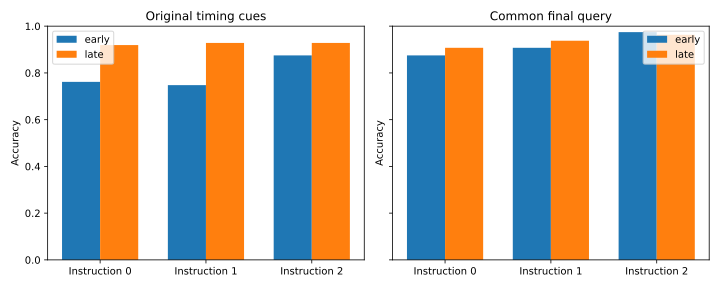

# Query timing with an identical final query cue

Early/late query cues crossed with a common final query. Descriptive recency control; no reconstruction or tracking algorithm established.

All 5184 baseline cases retained; 4633 correct. Generated final/extrapolation holdouts remain sealed.

| Common final cue | Early correct | Late correct | Late − early |
|---|---:|---:|---:|
| False | 1030/1296 | 1199/1296 | +13.04% |
| True | 1191/1296 | 1213/1296 | +1.70% |

Difference in differences: -11.34%. This is a descriptive prompt-control contrast, not an estimate of a tracking algorithm.
Identical original-input first tokens replayed in 2560/2592 cases across the changed batch/hardware profile.

All instruction/family/mapping/query cells and paired flips are saved in the review artifact. Earlier-prefix invariance is enforced by the capture audit.

