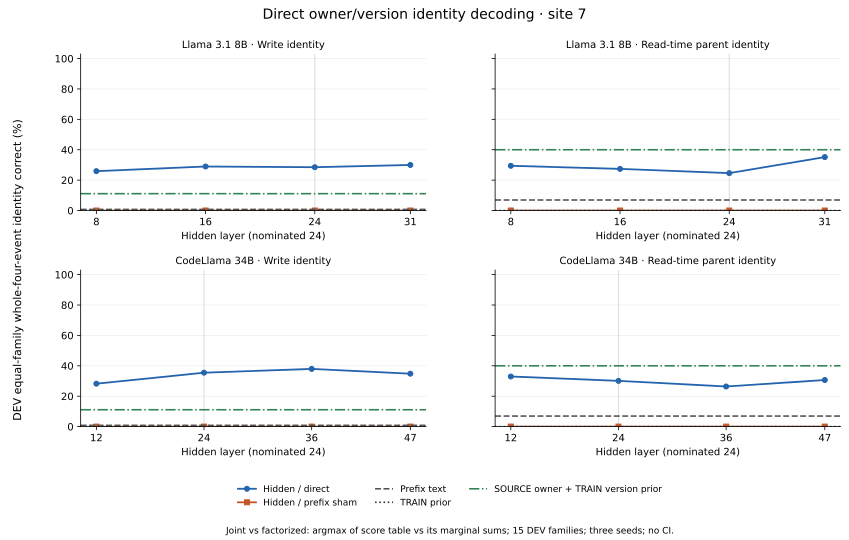

# Direct owner and version identity decoding

Both checkpoints completed all fixed CPU readouts and passed saved-parameter, scientific-metric and control-marginal replay audits. Joint predictions decode using the global owner/version codebook, without a per-program source map after prediction. These are adaptive accessibility measurements, not a causal binding mechanism.

The unchanged captures contain 5,760 source cases per model: 4,320 TRAIN rows in 45 families and 1,440 DEV rows in 15 families, each with 96 dependent relatives. No new model query, tokenizer load, response or capture was needed. Site 3 precedes every copy and has no defined event target; only sites 7/8 were fitted. Sixty actual banks and 345,600 parameter-row replays are retained.

The fixed primary is layer 24/site 7, averaging weighting seeds 17/29/43. Each whole task requires all four copy-event identities correct. The table retains row and equal-family estimates; equal family sizes make them agree, and both are checked.

| Model | Features/method | Write joint: row / equal-family | Parent joint: row / equal-family | All-eight joint | All-eight factorized |
|---|---|---:|---:|---:|---:|
| Llama 3.1 8B | hidden / direct | 28.519% / 28.519% | 24.630% / 24.630% | 6.019% | 8.796% |
| Llama 3.1 8B | hidden / training_prior | 0.000% / 0.000% | 0.000% / 0.000% | 0.000% | 0.000% |
| Llama 3.1 8B | hidden / random_prefix_control | 0.000% / 0.000% | 0.000% / 0.000% | 0.000% | 0.000% |
| Llama 3.1 8B | hidden / source_owner_version_prior | 11.111% / 11.111% | 40.000% / 40.000% | 2.222% | 2.222% |
| Llama 3.1 8B | surface / direct | 0.741% / 0.741% | 6.944% / 6.944% | 0.000% | 0.000% |
| Llama 3.1 8B | surface / training_prior | 0.000% / 0.000% | 0.000% / 0.000% | 0.000% | 0.000% |
| Llama 3.1 8B | surface / random_prefix_control | 0.000% / 0.000% | 0.000% / 0.000% | 0.000% | 0.000% |
| Llama 3.1 8B | surface / source_owner_version_prior | 11.111% / 11.111% | 40.000% / 40.000% | 2.222% | 2.222% |
| CodeLlama 34B | hidden / direct | 35.463% / 35.463% | 30.093% / 30.093% | 13.056% | 27.778% |
| CodeLlama 34B | hidden / training_prior | 0.000% / 0.000% | 0.000% / 0.000% | 0.000% | 0.000% |
| CodeLlama 34B | hidden / random_prefix_control | 0.000% / 0.000% | 0.000% / 0.000% | 0.000% | 0.000% |
| CodeLlama 34B | hidden / source_owner_version_prior | 11.111% / 11.111% | 40.000% / 40.000% | 2.222% | 2.222% |
| CodeLlama 34B | surface / direct | 0.833% / 0.833% | 6.944% / 6.944% | 0.000% | 0.000% |
| CodeLlama 34B | surface / training_prior | 0.000% / 0.000% | 0.000% / 0.000% | 0.000% | 0.000% |
| CodeLlama 34B | surface / random_prefix_control | 0.000% / 0.000% | 0.000% / 0.000% | 0.000% | 0.000% |
| CodeLlama 34B | surface / source_owner_version_prior | 11.111% / 11.111% | 40.000% / 40.000% | 2.222% | 2.222% |

The four panels show all four hidden layers for direct and coherent prefix-sham tasks, exact-prefix character features, the TRAIN label prior and the stronger syntax-owner plus TRAIN conditional-version prior. The nominated layer is marked at 24. No interval or favorable layer selection is introduced.

The syntax-owner comparator parses SOURCE left/right names through the supplied slot convention and estimates version probabilities using weighted TRAIN labels only. It never obtains DEV versions from SSA or target fields. Explicit source syntax already exposes owner identities. Its first-write (version 2) and first-parent (version 1) joint heads are perfect sanity controls; high scores there do not demonstrate tracking.

Direct joint heads have 16 nominal outputs per event, versus 8 component outputs. Because all columns use identical linear-ridge features, weights, alpha and masks, owner/version scores are row/column sums of the joint score table, up to floating-point tolerance. Joint versus factorized argmax compares a table decision with decisions from those marginal sums; it does not compare independent representations or provide a clean capacity test. These ridge scores are not calibrated probabilities. The supplementary JSON preserves combined-eight, factorized, scalar linearity, per-event/class/profile/group and underlying-source capture-status diagnostics for all methods, wherever provided by the audited runner. Parent labels refer to the definition read before the consumer, even when obsolete at capture; status strata describe the underlying real source context, not a lawful random sham identity.

All 192 columns, 24 heads and declared classes remain evaluated. Observed write joint domains contain 4/8/12/12 classes across the four events, and parent domains contain 4/8/12/16. Last-parent version 4 has only two TRAIN graph families per owner and one DEV family (96 DEV rows total). It fails the unchanged three-family support diagnostic and is retained without a qualification claim.

The [CSV](../../artifacts/binding/direct_identity/20261028_v1/form_cells_v1.csv) retains all 1,440 feature/site/layer/seed/method/task cells and their full categorical class/group counts. [Comparison JSON](../../artifacts/binding/direct_identity/20261028_v1/comparison_v1.json) retains supplementary comparisons and source/support metadata. The [publication review](../../artifacts/binding/direct_identity/20261028_v1/publication_review_v1.json) pins inputs and outputs.

- Adaptive direct categorical decoding on consumed discovery structures; no independent replication or new interval.
- Global 16-class predictions use no per-case source/SSA map. Source oracles supply supervised targets and evaluation strata only.
- Owners are visible in SOURCE left/right variable names. The stronger syntax-owner plus weighted TRAIN version-prior comparator has explicit source access.
- The first write version is always 2 and first parent version always 1; these are sanity controls, not version-tracking evidence.
- Joint heads have 16 nominal outputs versus 8 component outputs. With identical linear-ridge X/weights/alpha/masks, component scores are marginal sums of the joint score table; these are not independent representations or a clean capacity test.
- Final-parent version 4 has only two TRAIN graph families per owner and one DEV family; the three-family support diagnostic fails and these classes remain scored.
- Prefix-sham joint/component labels are coherent within an event, but change class marginals and constant-version difficulty and need not form lawful multi-event graphs.
- Character features see the exact visible prefix; the full source determines all labels. A hidden advantage is specific to the tested decoders.
- Fifteen DEV families have 96 dependent relatives each; weighting seeds are dependent estimator variants. All fixed layers, heads and classes remain reported.
- Current/obsolete strata refer to underlying source definitions at capture. Parent identity truth uses pre-consumer read time, even if obsolete later.
- Site 3 has no visible copy targets and no fitted bank. Only sites 7/8 supply 60 actual banks across both checkpoints.
- No new model capture or generated-answer behavior is measured; failed gates, sealed outcomes, optional training and causal/predictive decisions remain unchanged.
