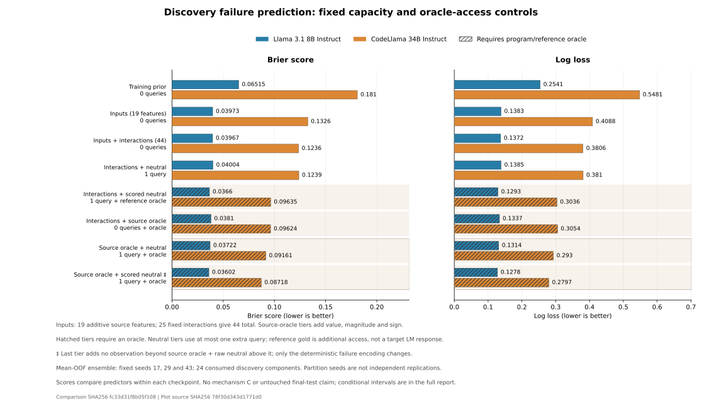

# Capacity and oracle-access control decision

Completed **5,292 regularized logistic fits** across eight fixed tiers on the same **12,288 consumed discovery targets**. All seven CPU collection/fitting/comparison/figure/anchor jobs completed. The full regression suite passed **421 tests**. These controls add no language-model query and do not establish final validation or a mechanism.

The original prior and additive input baselines reproduce exactly: target identities, labels, references, original features, all outer/inner folds, penalties, normalizers, weights and OOF probabilities match the first analysis. The maximum recorded difference is zero for both checkpoints.

## All mean-OOF ensemble scores

Lower losses are better within a checkpoint. Different failure prevalence prevents using absolute losses to rank the underlying language models. All three fixed partition seeds and every descriptive cell remain in the full reports.

| Tier | Llama Brier | Llama log loss | CodeLlama Brier | CodeLlama log loss |
|---|---:|---:|---:|---:|
| A_input | 0.039731 | 0.138343 | 0.132585 | 0.408816 |
| A_interactions | 0.039673 | 0.137222 | 0.123574 | 0.380577 |
| A_interactions_neutral_raw | 0.040037 | 0.138487 | 0.123861 | 0.381025 |
| A_interactions_neutral_scored | 0.036599 | 0.129256 | 0.096350 | 0.303570 |
| A_interactions_oracle | 0.038100 | 0.133688 | 0.096237 | 0.305361 |
| A_interactions_oracle_neutral_raw | 0.037215 | 0.131400 | 0.091608 | 0.293049 |
| A_interactions_oracle_neutral_scored | 0.036016 | 0.127793 | 0.087180 | 0.279734 |
| prior | 0.065153 | 0.254100 | 0.180960 | 0.548053 |



## What the controls resolve

Fixed source interactions improve CodeLlama prediction over the original additive input model. Llama changes little under the same expansion. Raw neutral-response properties still have no clear Brier increment when added to the stronger oracle-free source baseline. The source-only model class therefore matters, and the earlier additive comparison was not an exhaustive input baseline.

Source-oracle value/magnitude/sign descriptors improve both checkpoints under these conditional comparisons. On CodeLlama, oracle-only input and the scored-neutral tier without explicit oracle values have nearly identical Brier point scores. This is a descriptive point comparison, not a registered equivalence test. It shows why reference-oracle access must be separated from additional neutral behavior.

The neutral query retains a conditional predictive increment for CodeLlama when added to oracle-assisted input; the corresponding Llama interval crosses zero. The explicit neutral-failure flag then improves CodeLlama further, even though it adds no observation. This final increment is useful feature encoding/model capacity, not independent information or a binding-specific measurement.

The exact relation checked on every target/reference pair is:

```python
neutral_failure = int(not neutral_valid or neutral_prediction_value != oracle_answer_value)
```

The program oracle is not the target language model response. Its value is provided only to declared oracle-assisted tiers; target model answers, validity and correctness are excluded from all feature vectors. Once oracle value, neutral prediction and validity are available, the flag is deterministic.

## All registered non-prior increments

Positive loss(left) minus loss(right) favors the right tier. Conditional 95% intervals resample all 24 structural components together without refitting and have no multiplicity adjustment. All seven prior comparisons also remain in the full reports.

| Checkpoint | Left | Right | Brier improvement [95%] | Log-loss improvement [95%] |
|---|---|---|---|---|
| Llama 3.1 8B | A_input | A_interactions | +0.000058 [-0.000431, +0.000529] | +0.001121 [-0.001357, +0.003776] |
| Llama 3.1 8B | A_interactions | A_interactions_neutral_raw | -0.000364 [-0.000899, +0.000100] | -0.001265 [-0.002463, -0.000098] |
| Llama 3.1 8B | A_interactions | A_interactions_neutral_scored | +0.003073 [+0.000728, +0.005558] | +0.007966 [+0.002350, +0.013678] |
| Llama 3.1 8B | A_interactions | A_interactions_oracle | +0.001573 [+0.000236, +0.002884] | +0.003534 [+0.000263, +0.006675] |
| Llama 3.1 8B | A_interactions_oracle | A_interactions_oracle_neutral_raw | +0.000885 [-0.000238, +0.002097] | +0.002288 [-0.000572, +0.005256] |
| Llama 3.1 8B | A_interactions_oracle_neutral_raw | A_interactions_oracle_neutral_scored | +0.001199 [-0.000267, +0.002593] | +0.003606 [-0.000326, +0.007471] |
| Llama 3.1 8B | A_interactions_neutral_raw | A_interactions_neutral_scored | +0.003437 [+0.001098, +0.005983] | +0.009230 [+0.003413, +0.015125] |
| Llama 3.1 8B | A_interactions_neutral_raw | A_interactions_oracle_neutral_raw | +0.002822 [+0.000957, +0.004949] | +0.007087 [+0.002700, +0.011982] |
| Llama 3.1 8B | A_interactions_neutral_scored | A_interactions_oracle_neutral_scored | +0.000583 [-0.000010, +0.001156] | +0.001463 [-0.000316, +0.003336] |
| CodeLlama 34B | A_input | A_interactions | +0.009011 [+0.004334, +0.014778] | +0.028239 [+0.013848, +0.043269] |
| CodeLlama 34B | A_interactions | A_interactions_neutral_raw | -0.000287 [-0.001259, +0.000583] | -0.000448 [-0.003207, +0.002110] |
| CodeLlama 34B | A_interactions | A_interactions_neutral_scored | +0.027224 [+0.019635, +0.034768] | +0.077007 [+0.056885, +0.097783] |
| CodeLlama 34B | A_interactions | A_interactions_oracle | +0.027336 [+0.018460, +0.037211] | +0.075216 [+0.049461, +0.103564] |
| CodeLlama 34B | A_interactions_oracle | A_interactions_oracle_neutral_raw | +0.004629 [+0.002014, +0.007164] | +0.012313 [+0.005490, +0.019363] |
| CodeLlama 34B | A_interactions_oracle_neutral_raw | A_interactions_oracle_neutral_scored | +0.004428 [+0.001863, +0.006908] | +0.013315 [+0.006581, +0.020185] |
| CodeLlama 34B | A_interactions_neutral_raw | A_interactions_neutral_scored | +0.027511 [+0.019774, +0.035021] | +0.077455 [+0.056764, +0.098082] |
| CodeLlama 34B | A_interactions_neutral_raw | A_interactions_oracle_neutral_raw | +0.032253 [+0.023493, +0.041874] | +0.087976 [+0.062590, +0.114261] |
| CodeLlama 34B | A_interactions_neutral_scored | A_interactions_oracle_neutral_scored | +0.009171 [+0.003850, +0.013950] | +0.023836 [+0.008639, +0.037905] |

## Scope and remaining work

The same 24 structural components, original labels and cached references are used throughout. Six outer/five inner folds, three fixed partition seeds, the penalty grid and training-only preprocessing remain unchanged. The strengthened source model adds 25 fixed products to the original 19 features; it is still a restricted logistic family, not an exhaustive nonlinear input baseline. Oracle-only prediction requires no neutral language-model query; neutral tiers allow at most one distinct reference query per target and reuse the existing cache.

All examples were previously observed discovery data. Original identifier-vocabulary boundaries are not preserved by the new CV folds. Repeated seeds are sensitivities, not independent replications; conditional bootstrap intervals omit pipeline-refitting/selection uncertainty. No confidence features, internal measurements, supported mechanism C, checkpoint training or original final/extrapolation outcomes are introduced.

Future confidence or internal-measurement predictors should face these stronger capacity/access controls. Exact-prefix, label-free confidence collection remains a separate unfinished step; genuine frozen unfamiliar-program validation also remains unfinished. The current result does not turn an engineered oracle comparison into a mechanistic explanation.

[All scores and per-checkpoint reports](discovery_controls_results_v1.md) · [Fixed analysis plan](discovery_controls_plan.md) · [Original baselines](discovery_prediction_decision.md) · [Automatic log](experiment_log.md)
