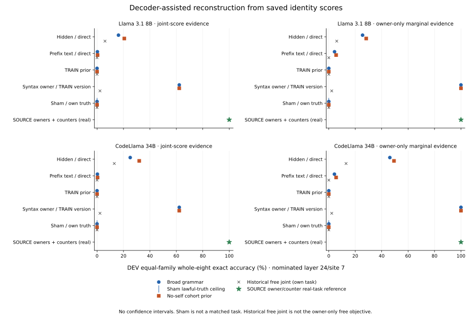

# Saved-score grammar reconstruction summary

Both completed grammar receipts and the actual new-score replay proof passed. The publisher read only bounded JSON/report metadata. It opened no score, activation, feature, parameter, prepared/source or response records and reran no decoder or fit.

The fixed grid retains 60 original banks, 345,600 original score case rows checked and 86,400 DEV bank-case rows. Four methods and four rules give 960 rule cells; the 1,382,400 case/method/rule evaluations are repeated views of those same cases. All layers and sites 7/8 remain in the CSV and the 60 immutable diagnostic JSONs.

| Model | Context | Historical free joint | Broad joint | No-self joint | Broad owner-only | No-self owner-only | Own-truth ceiling: broad / no-self |
|---|---|---:|---:|---:|---:|---:|---:|
| Llama 3.1 8B | Hidden / direct | 6.019% | 16.204% | 20.648% | 25.556% | 28.333% | 100.000% / 100.000% |
| Llama 3.1 8B | Prefix text / direct | 0.000% | 0.278% | 0.370% | 4.352% | 5.556% | 100.000% / 100.000% |
| Llama 3.1 8B | TRAIN prior | 0.000% | 0.000% | 0.000% | 0.000% | 0.000% | 100.000% / 100.000% |
| Llama 3.1 8B | Syntax owner / TRAIN version | 2.222% | 62.222% | 62.222% | 100.000% | 100.000% | 100.000% / 100.000% |
| Llama 3.1 8B | Sham / own truth | 0.000% | 0.000% | 0.000% | 0.000% | 0.000% | 0.000% / 0.000% |
| CodeLlama 34B | Hidden / direct | 13.056% | 25.093% | 31.944% | 46.204% | 49.352% | 100.000% / 100.000% |
| CodeLlama 34B | Prefix text / direct | 0.000% | 0.278% | 0.370% | 4.259% | 5.556% | 100.000% / 100.000% |
| CodeLlama 34B | TRAIN prior | 0.000% | 0.000% | 0.000% | 0.000% | 0.000% | 100.000% / 100.000% |
| CodeLlama 34B | Syntax owner / TRAIN version | 2.222% | 62.222% | 62.222% | 100.000% | 100.000% | 100.000% / 100.000% |
| CodeLlama 34B | Sham / own truth | 0.000% | 0.000% | 0.000% | 0.000% | 0.000% | 0.000% / 0.000% |

Every point averages all three fixed weighting seeds at the nominated layer 24/site 7. Whole-eight accuracy requires all four write and four parent identities correct. Each of 15 graph families contributes 96 dependent rows, so whole-endpoint row and equal-family means agree; conditional class/status denominators need not.

The panels cross models and evidence views. Broad self-copy grammar is primary; no-self is a separately named cohort prior. The green reference uses SOURCE owners plus external counters on real labels only. Sham points score their original own truth; ceiling ticks show the fraction of that truth which is globally lawful. A low constrained-sham score is not matched selectivity evidence. Historical factorized owner+version argmax and each exact same-evidence free objective remain separate in the CSV.

The decoder receives only saved joint tables and fixed flags, never a source program, query, actual profile or true identity. Raw ridge sums are uncalibrated utilities. Owner-only evidence sums over versions in the same joint table and lets the external grammar supply versions; it is not an independent representation. Validity and real whole-eight monotonicity are construction guarantees on finite cases, not learned competence.

All source, class, profile, owner/version, current/obsolete status, lawfulness, repair/harm and exact-objective details remain in the SHA-pinned per-bank diagnostic JSONs referenced by the [comparison](../../artifacts/binding/identity_grammar/20261028_v1/comparison_v1.json). The [full grid CSV](../../artifacts/binding/identity_grammar/20261028_v1/form_cells_v1.csv) and [publication proof](../../artifacts/binding/identity_grammar/20261028_v1/publication_review_v1.json) retain the complete declared scope. The runner's [original findings](identity_grammar_findings_v1.md) remain unchanged.

- Adaptive decoder-assisted reconstruction over the same consumed discovery cases; no maintained neural state or natural causal mechanism is established.
- The grammar externally computes versions from a candidate owner history. A correct source-owner sequence supplies a 100% counter-grammar reference without a neural version representation.
- Primary broad grammar allows self-copy; no-self is a separately named global cohort prior. No actual source, query, truth or per-case profile enters decoding.
- Joint and owner-marginal evidence are views of the same uncalibrated ridge table. Marginal sums are not independent representations or calibrated probabilities.
- Constrained validity is guaranteed by construction. For lawful real truth, non-decreasing whole-eight accuracy under the same evidence and fixed ties is a mathematical property, not learned skill.
- Historical joint/factorized references are distinct from the per-rule exact same-evidence free objective; owner-only improvements can be external counting.
- Sham truth is locally coherent but can be globally unlawful. Its lawfulness fraction bounds constrained exact accuracy; constrained-sham accuracy is not difficulty-matched selectivity.
- Fifteen DEV graph families have 96 dependent relatives each; three weighting seeds are dependent variants. No new interval or population confirmation is claimed.
- First write version 2/first parent version 1 are constants, source syntax exposes owners, and final-parent version4 has only 2 TRAIN graph families per owner.
- No new fit, parameter application, model query, response or capture. Old-value recovery, failed computed gates, selective causal use and untouched forecasting remain unresolved.
