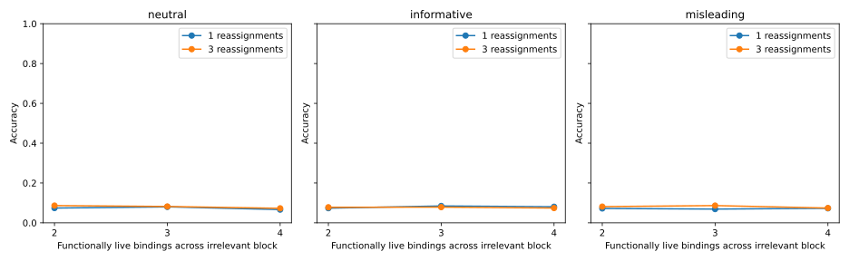

# Computed retention-frontier discovery: meta-llama/Llama-3.1-8B-Instruct

All 38,016 responses retained; 3,078 correct and 0 invalid. Reliability gate: **failed**. A failed gate does not remove behavioral results or qualify causal follow-up.

Scheduling changes true live bindings and computation/assignment distances together. Numeric literal values exclude computed magnitudes, not every digit subtoken. These are exploratory discovery results, not an isolated capacity or causal-mechanism test.

Predeclared primary exploratory contrasts: live4_minus_live2:neutral:updates3, naming_by_load_by_updates.

The same two independent subtractions move across an irrelevant eight-assignment block. The frontier contains 2, 3 or 4 functionally output-relevant bindings. Exact token and statement multisets, arithmetic counts, complete final states and answers are preserved within schedule contrasts. Controls without the block share one response per computation order rather than duplicate identical prompts. Informative/misleading lengths and reassignment-pair lengths match; neutral naming may differ.

| Calibration family | Correct / n | Invalid |
|---|---:|---:|
| decomposed_arithmetic | 65/768 | 0 |
| literal_arithmetic | 130/384 | 0 |
| retention_frontier | 2883/36864 | 0 |

| Contrast | Paired n | Components | Accuracy difference | Exploratory 95% interval |
|---|---:|---:|---:|---|
| live3_minus_live2:informative:updates1 | 1536 | 24 | +1.11% | [-0.39%, +2.48%] |
| live3_minus_live2:informative:updates3 | 1536 | 24 | +0.07% | [-1.43%, +1.69%] |
| live3_minus_live2:misleading:updates1 | 1536 | 24 | -0.33% | [-1.82%, +1.37%] |
| live3_minus_live2:misleading:updates3 | 1536 | 24 | +0.52% | [-0.91%, +2.02%] |
| live3_minus_live2:neutral:updates1 | 1536 | 24 | +0.59% | [-1.43%, +2.60%] |
| live3_minus_live2:neutral:updates3 | 1536 | 24 | -0.46% | [-1.69%, +0.85%] |
| live4_minus_live2:informative:updates1 | 1536 | 24 | +0.72% | [-0.33%, +1.69%] |
| live4_minus_live2:informative:updates3 | 1536 | 24 | -0.39% | [-1.63%, +0.91%] |
| live4_minus_live2:misleading:updates1 | 1536 | 24 | +0.07% | [-1.82%, +2.28%] |
| live4_minus_live2:misleading:updates3 | 1536 | 24 | -0.72% | [-2.21%, +0.65%] |
| live4_minus_live2:neutral:updates1 | 1536 | 24 | -0.78% | [-2.41%, +0.91%] |
| live4_minus_live2:neutral:updates3 | 1536 | 24 | -1.37% | [-2.86%, +0.26%] |
| misleading_minus_informative:updates1:live2 | 1536 | 24 | -0.13% | [-2.41%, +2.28%] |
| misleading_minus_informative:updates1:live3 | 1536 | 24 | -1.56% | [-3.84%, +0.72%] |
| misleading_minus_informative:updates1:live4 | 1536 | 24 | -0.78% | [-2.86%, +1.30%] |
| misleading_minus_informative:updates1:liveNone | 1536 | 24 | -1.04% | [-3.06%, +1.24%] |
| misleading_minus_informative:updates3:live2 | 1536 | 24 | +0.33% | [-1.50%, +2.34%] |
| misleading_minus_informative:updates3:live3 | 1536 | 24 | +0.78% | [-1.11%, +2.93%] |
| misleading_minus_informative:updates3:live4 | 1536 | 24 | +0.00% | [-1.69%, +1.95%] |
| misleading_minus_informative:updates3:liveNone | 1536 | 24 | +1.11% | [-0.91%, +3.39%] |
| naming_by_load:updates1 | 1536 | 24 | -0.65% | [-2.99%, +1.95%] |
| naming_by_load:updates3 | 1536 | 24 | -0.33% | [-2.21%, +1.63%] |
| naming_by_load_by_updates | 1536 | 24 | +0.33% | [-2.08%, +2.54%] |
| noise_minus_clean:live2:informative:updates1 | 1536 | 24 | -1.04% | [-2.41%, +0.26%] |
| noise_minus_clean:live2:informative:updates3 | 1536 | 24 | -0.39% | [-1.82%, +1.11%] |
| noise_minus_clean:live2:misleading:updates1 | 1536 | 24 | -0.13% | [-1.24%, +1.04%] |
| noise_minus_clean:live2:misleading:updates3 | 1536 | 24 | -1.17% | [-2.73%, +0.39%] |
| noise_minus_clean:live2:neutral:updates1 | 1536 | 24 | +0.46% | [-1.04%, +1.95%] |
| noise_minus_clean:live2:neutral:updates3 | 1536 | 24 | +0.07% | [-1.69%, +1.76%] |
| noise_minus_clean:live3:informative:updates1 | 1536 | 24 | +0.07% | [-0.98%, +1.17%] |
| noise_minus_clean:live3:informative:updates3 | 1536 | 24 | -0.33% | [-1.43%, +0.85%] |
| noise_minus_clean:live3:misleading:updates1 | 1536 | 24 | -0.46% | [-1.95%, +0.98%] |
| noise_minus_clean:live3:misleading:updates3 | 1536 | 24 | -0.65% | [-2.08%, +0.85%] |
| noise_minus_clean:live3:neutral:updates1 | 1536 | 24 | +1.04% | [-0.91%, +3.12%] |
| noise_minus_clean:live3:neutral:updates3 | 1536 | 24 | -0.39% | [-1.63%, +0.85%] |
| noise_minus_clean:live4:informative:updates1 | 1536 | 24 | -0.33% | [-1.56%, +0.98%] |
| noise_minus_clean:live4:informative:updates3 | 1536 | 24 | -0.78% | [-2.28%, +0.72%] |
| noise_minus_clean:live4:misleading:updates1 | 1536 | 24 | -0.07% | [-1.82%, +1.89%] |
| noise_minus_clean:live4:misleading:updates3 | 1536 | 24 | -1.89% | [-3.45%, -0.52%] |
| noise_minus_clean:live4:neutral:updates1 | 1536 | 24 | -0.33% | [-1.69%, +1.17%] |
| noise_minus_clean:live4:neutral:updates3 | 1536 | 24 | -1.30% | [-2.86%, +0.13%] |
| updates3_minus1:informative:live2 | 1536 | 24 | +0.46% | [-0.85%, +1.82%] |
| updates3_minus1:informative:live3 | 1536 | 24 | -0.59% | [-2.21%, +1.04%] |
| updates3_minus1:informative:live4 | 1536 | 24 | -0.65% | [-2.28%, +0.85%] |
| updates3_minus1:informative:liveNone | 1536 | 24 | -0.20% | [-2.02%, +1.63%] |
| updates3_minus1:misleading:live2 | 1536 | 24 | +0.91% | [-0.72%, +2.60%] |
| updates3_minus1:misleading:live3 | 1536 | 24 | +1.76% | [+0.19%, +3.39%] |
| updates3_minus1:misleading:live4 | 1536 | 24 | +0.13% | [-1.43%, +1.37%] |
| updates3_minus1:misleading:liveNone | 1536 | 24 | +1.95% | [+0.33%, +3.65%] |
| updates3_minus1:neutral:live2 | 1536 | 24 | +1.24% | [-0.39%, +2.80%] |
| updates3_minus1:neutral:live3 | 1536 | 24 | +0.20% | [-1.43%, +1.63%] |
| updates3_minus1:neutral:live4 | 1536 | 24 | +0.65% | [-0.72%, +2.08%] |
| updates3_minus1:neutral:liveNone | 1536 | 24 | +1.63% | [-0.26%, +3.52%] |
| updates_by_load:informative | 1536 | 24 | -1.11% | [-2.41%, +0.26%] |
| updates_by_load:misleading | 1536 | 24 | -0.78% | [-3.12%, +1.04%] |
| updates_by_load:neutral | 1536 | 24 | -0.59% | [-2.02%, +0.78%] |

Full split/order cells, reliability cells, token distances, label ambiguities and all registered contrasts are saved in the review artifact. Intervals resample structural components and are exploratory without multiplicity adjustment. Initialization orders are not independent model or program-family replications. No final/extrapolation outcomes or language-model training were used.
