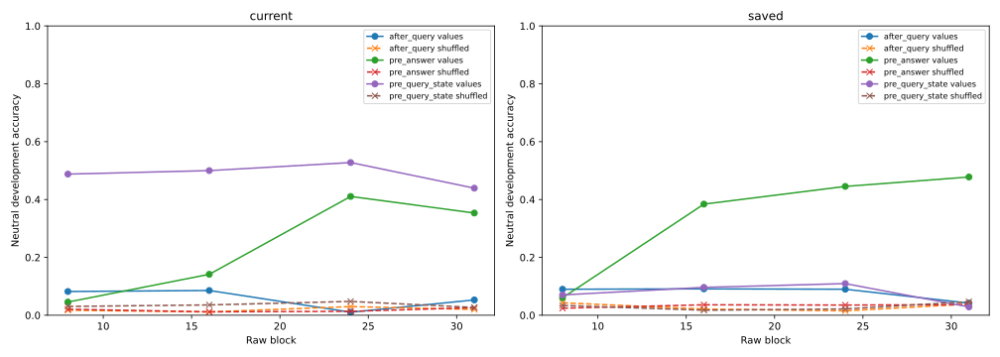

# Frequency-matched grouped probe controls

These are post-hoc measurement controls on the already-audited discovery capture bank. Ordinary weighted ridge heads predict oracle values and shuffled labels with equal feature/head capacity and the same training preprocessing. Joint current/saved label pairs are permuted across numeric base programs within each split/template; all related variants share the mapping. No final outcomes or language-model training are used.

All 45 fits passed saved-weight replay and complete metric audits. Value and shuffled-label class histograms match exactly in every analyzed split/naming/head cell. The original value-head predictions agree on 691,200/691,200 comparisons.

The three fixed seeds vary both positive template fit weights and the shuffle; they are not independent model or dataset replications. Frequency matching repairs the earlier two-label-versus-32-label mismatch, but does not equate all task complexity or prove semantic selectivity. High training shuffle accuracy can reflect memorization. Failed control transfer or successful value decoding does not establish natural causal use.

| Features | Block | Site | Split | Naming | Head | Value | Shuffled | Training prior |
|---|---:|---|---|---|---|---:|---:|---:|
| hidden | 8 | after_query | development | informative | current | 6.34% | 2.13% | 0.00% |
| hidden | 8 | after_query | development | informative | saved | 11.50% | 3.30% | 12.50% |
| hidden | 8 | after_query | development | misleading | current | 5.86% | 1.69% | 0.00% |
| hidden | 8 | after_query | development | misleading | saved | 9.55% | 3.26% | 12.50% |
| hidden | 8 | after_query | development | neutral | current | 8.20% | 1.74% | 0.00% |
| hidden | 8 | after_query | development | neutral | saved | 8.98% | 4.30% | 12.50% |
| hidden | 8 | after_query | train | neutral | current | 99.00% | 95.65% | 6.25% |
| hidden | 8 | after_query | train | neutral | saved | 99.22% | 96.56% | 6.94% |
| hidden | 8 | pre_answer | development | informative | current | 2.39% | 2.73% | 0.00% |
| hidden | 8 | pre_answer | development | informative | saved | 7.90% | 3.82% | 12.50% |
| hidden | 8 | pre_answer | development | misleading | current | 1.74% | 3.47% | 0.00% |
| hidden | 8 | pre_answer | development | misleading | saved | 8.33% | 3.86% | 12.50% |
| hidden | 8 | pre_answer | development | neutral | current | 4.56% | 2.08% | 0.00% |
| hidden | 8 | pre_answer | development | neutral | saved | 6.03% | 2.43% | 12.50% |
| hidden | 8 | pre_answer | train | neutral | current | 99.36% | 97.73% | 6.25% |
| hidden | 8 | pre_answer | train | neutral | saved | 99.38% | 97.28% | 6.94% |
| hidden | 8 | pre_query_state | development | informative | current | 34.81% | 2.08% | 0.00% |
| hidden | 8 | pre_query_state | development | informative | saved | 5.21% | 3.39% | 12.50% |
| hidden | 8 | pre_query_state | development | misleading | current | 27.52% | 2.95% | 0.00% |
| hidden | 8 | pre_query_state | development | misleading | saved | 5.64% | 3.82% | 12.50% |
| hidden | 8 | pre_query_state | development | neutral | current | 48.78% | 3.04% | 0.00% |
| hidden | 8 | pre_query_state | development | neutral | saved | 7.03% | 3.39% | 12.50% |
| hidden | 8 | pre_query_state | train | neutral | current | 95.57% | 91.38% | 6.25% |
| hidden | 8 | pre_query_state | train | neutral | saved | 93.95% | 90.89% | 6.94% |
| hidden | 16 | after_query | development | informative | current | 5.56% | 2.69% | 0.00% |
| hidden | 16 | after_query | development | informative | saved | 3.60% | 2.39% | 12.50% |
| hidden | 16 | after_query | development | misleading | current | 4.21% | 1.48% | 0.00% |
| hidden | 16 | after_query | development | misleading | saved | 4.51% | 2.82% | 12.50% |
| hidden | 16 | after_query | development | neutral | current | 8.55% | 1.13% | 0.00% |
| hidden | 16 | after_query | development | neutral | saved | 9.11% | 2.13% | 12.50% |
| hidden | 16 | after_query | train | neutral | current | 98.83% | 96.63% | 6.25% |
| hidden | 16 | after_query | train | neutral | saved | 98.41% | 96.64% | 6.94% |
| hidden | 16 | pre_answer | development | informative | current | 3.65% | 1.56% | 0.00% |
| hidden | 16 | pre_answer | development | informative | saved | 30.16% | 3.82% | 12.50% |
| hidden | 16 | pre_answer | development | misleading | current | 6.47% | 2.52% | 0.00% |
| hidden | 16 | pre_answer | development | misleading | saved | 28.60% | 4.43% | 12.50% |
| hidden | 16 | pre_answer | development | neutral | current | 14.15% | 1.17% | 0.00% |
| hidden | 16 | pre_answer | development | neutral | saved | 38.41% | 3.60% | 12.50% |
| hidden | 16 | pre_answer | train | neutral | current | 99.51% | 97.87% | 6.25% |
| hidden | 16 | pre_answer | train | neutral | saved | 99.28% | 97.55% | 6.94% |
| hidden | 16 | pre_query_state | development | informative | current | 45.83% | 3.39% | 0.00% |
| hidden | 16 | pre_query_state | development | informative | saved | 6.77% | 1.91% | 12.50% |
| hidden | 16 | pre_query_state | development | misleading | current | 44.97% | 3.30% | 0.00% |
| hidden | 16 | pre_query_state | development | misleading | saved | 5.90% | 2.08% | 12.50% |
| hidden | 16 | pre_query_state | development | neutral | current | 50.00% | 3.56% | 0.00% |
| hidden | 16 | pre_query_state | development | neutral | saved | 9.64% | 1.74% | 12.50% |
| hidden | 16 | pre_query_state | train | neutral | current | 97.60% | 95.34% | 6.25% |
| hidden | 16 | pre_query_state | train | neutral | saved | 96.79% | 95.14% | 6.94% |
| hidden | 24 | after_query | development | informative | current | 1.65% | 3.08% | 0.00% |
| hidden | 24 | after_query | development | informative | saved | 4.51% | 3.04% | 12.50% |
| hidden | 24 | after_query | development | misleading | current | 2.17% | 2.69% | 0.00% |
| hidden | 24 | after_query | development | misleading | saved | 4.73% | 3.82% | 12.50% |
| hidden | 24 | after_query | development | neutral | current | 1.04% | 2.99% | 0.00% |
| hidden | 24 | after_query | development | neutral | saved | 8.98% | 1.52% | 12.50% |
| hidden | 24 | after_query | train | neutral | current | 97.12% | 94.20% | 6.25% |
| hidden | 24 | after_query | train | neutral | saved | 97.35% | 94.07% | 6.94% |
| hidden | 24 | pre_answer | development | informative | current | 35.81% | 2.47% | 0.00% |
| hidden | 24 | pre_answer | development | informative | saved | 33.59% | 5.77% | 12.50% |
| hidden | 24 | pre_answer | development | misleading | current | 36.59% | 2.73% | 0.00% |
| hidden | 24 | pre_answer | development | misleading | saved | 34.51% | 5.16% | 12.50% |
| hidden | 24 | pre_answer | development | neutral | current | 41.06% | 1.35% | 0.00% |
| hidden | 24 | pre_answer | development | neutral | saved | 44.53% | 3.52% | 12.50% |
| hidden | 24 | pre_answer | train | neutral | current | 99.44% | 96.77% | 6.25% |
| hidden | 24 | pre_answer | train | neutral | saved | 99.00% | 96.67% | 6.94% |
| hidden | 24 | pre_query_state | development | informative | current | 48.70% | 3.30% | 0.00% |
| hidden | 24 | pre_query_state | development | informative | saved | 6.42% | 3.82% | 12.50% |
| hidden | 24 | pre_query_state | development | misleading | current | 49.39% | 3.73% | 0.00% |
| hidden | 24 | pre_query_state | development | misleading | saved | 6.16% | 3.65% | 12.50% |
| hidden | 24 | pre_query_state | development | neutral | current | 52.78% | 4.77% | 0.00% |
| hidden | 24 | pre_query_state | development | neutral | saved | 10.94% | 2.17% | 12.50% |
| hidden | 24 | pre_query_state | train | neutral | current | 96.53% | 93.75% | 6.25% |
| hidden | 24 | pre_query_state | train | neutral | saved | 95.86% | 93.29% | 6.94% |
| hidden | 31 | after_query | development | informative | current | 6.73% | 1.56% | 0.00% |
| hidden | 31 | after_query | development | informative | saved | 4.25% | 5.82% | 12.50% |
| hidden | 31 | after_query | development | misleading | current | 6.34% | 1.82% | 0.00% |
| hidden | 31 | after_query | development | misleading | saved | 4.21% | 8.07% | 12.50% |
| hidden | 31 | after_query | development | neutral | current | 5.30% | 2.00% | 0.00% |
| hidden | 31 | after_query | development | neutral | saved | 4.17% | 3.86% | 12.50% |
| hidden | 31 | after_query | train | neutral | current | 98.16% | 94.42% | 6.25% |
| hidden | 31 | after_query | train | neutral | saved | 97.55% | 94.63% | 6.94% |
| hidden | 31 | pre_answer | development | informative | current | 31.08% | 2.73% | 0.00% |
| hidden | 31 | pre_answer | development | informative | saved | 39.15% | 4.90% | 12.50% |
| hidden | 31 | pre_answer | development | misleading | current | 30.60% | 3.73% | 0.00% |
| hidden | 31 | pre_answer | development | misleading | saved | 39.67% | 4.30% | 12.50% |
| hidden | 31 | pre_answer | development | neutral | current | 35.33% | 2.60% | 0.00% |
| hidden | 31 | pre_answer | development | neutral | saved | 47.79% | 3.65% | 12.50% |
| hidden | 31 | pre_answer | train | neutral | current | 99.41% | 97.01% | 6.25% |
| hidden | 31 | pre_answer | train | neutral | saved | 98.71% | 96.76% | 6.94% |
| hidden | 31 | pre_query_state | development | informative | current | 35.94% | 1.74% | 0.00% |
| hidden | 31 | pre_query_state | development | informative | saved | 3.73% | 4.25% | 12.50% |
| hidden | 31 | pre_query_state | development | misleading | current | 37.67% | 1.91% | 0.00% |
| hidden | 31 | pre_query_state | development | misleading | saved | 3.73% | 4.86% | 12.50% |
| hidden | 31 | pre_query_state | development | neutral | current | 43.92% | 2.69% | 0.00% |
| hidden | 31 | pre_query_state | development | neutral | saved | 2.86% | 4.69% | 12.50% |
| hidden | 31 | pre_query_state | train | neutral | current | 97.71% | 94.94% | 6.25% |
| hidden | 31 | pre_query_state | train | neutral | saved | 97.05% | 94.85% | 6.94% |
| surface | -1 | after_query | development | informative | current | 4.99% | 3.17% | 0.00% |
| surface | -1 | after_query | development | informative | saved | 1.39% | 4.64% | 12.50% |
| surface | -1 | after_query | development | misleading | current | 4.43% | 3.12% | 0.00% |
| surface | -1 | after_query | development | misleading | saved | 0.74% | 4.21% | 12.50% |
| surface | -1 | after_query | development | neutral | current | 5.03% | 0.56% | 0.00% |
| surface | -1 | after_query | development | neutral | saved | 3.95% | 6.64% | 12.50% |
| surface | -1 | after_query | train | neutral | current | 96.79% | 90.80% | 6.25% |
| surface | -1 | after_query | train | neutral | saved | 95.52% | 91.06% | 6.94% |
| surface | -1 | pre_answer | development | informative | current | 3.95% | 3.30% | 0.00% |
| surface | -1 | pre_answer | development | informative | saved | 1.26% | 4.82% | 12.50% |
| surface | -1 | pre_answer | development | misleading | current | 4.04% | 3.60% | 0.00% |
| surface | -1 | pre_answer | development | misleading | saved | 0.69% | 4.25% | 12.50% |
| surface | -1 | pre_answer | development | neutral | current | 4.95% | 0.69% | 0.00% |
| surface | -1 | pre_answer | development | neutral | saved | 3.78% | 6.55% | 12.50% |
| surface | -1 | pre_answer | train | neutral | current | 96.79% | 90.80% | 6.25% |
| surface | -1 | pre_answer | train | neutral | saved | 95.52% | 91.03% | 6.94% |
| surface | -1 | pre_query_state | development | informative | current | 4.17% | 4.51% | 0.00% |
| surface | -1 | pre_query_state | development | informative | saved | 1.82% | 4.51% | 12.50% |
| surface | -1 | pre_query_state | development | misleading | current | 3.82% | 4.25% | 0.00% |
| surface | -1 | pre_query_state | development | misleading | saved | 1.65% | 4.69% | 12.50% |
| surface | -1 | pre_query_state | development | neutral | current | 6.25% | 1.04% | 0.00% |
| surface | -1 | pre_query_state | development | neutral | saved | 4.25% | 5.21% | 12.50% |
| surface | -1 | pre_query_state | train | neutral | current | 94.88% | 88.05% | 6.25% |
| surface | -1 | pre_query_state | train | neutral | saved | 94.27% | 88.60% | 6.94% |

