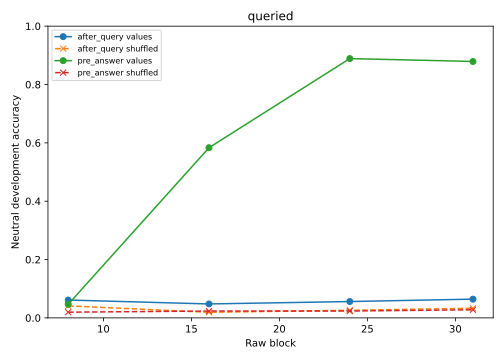

# Frequency-matched grouped probe controls

These are post-hoc measurement controls on the already-audited discovery capture bank. Ordinary weighted ridge heads predict oracle values and shuffled labels with equal feature/head capacity and the same training preprocessing. Joint current/saved label pairs are permuted across numeric base programs within each split/template; all related variants share the mapping. No final outcomes or language-model training are used.

All 30 fits passed saved-weight replay and complete metric audits. Value and shuffled-label class histograms match exactly in every analyzed split/naming/head cell. The original value-head predictions agree on 276,480/276,480 comparisons.

The three fixed seeds vary both positive template fit weights and the shuffle; they are not independent model or dataset replications. Frequency matching repairs the earlier two-label-versus-32-label mismatch, but does not equate all task complexity or prove semantic selectivity. High training shuffle accuracy can reflect memorization. Failed control transfer or successful value decoding does not establish natural causal use.

| Features | Block | Site | Split | Naming | Head | Value | Shuffled | Training prior |
|---|---:|---|---|---|---|---:|---:|---:|
| hidden | 8 | after_query | development | informative | queried | 4.56% | 2.26% | 7.29% |
| hidden | 8 | after_query | development | misleading | queried | 2.00% | 3.34% | 7.29% |
| hidden | 8 | after_query | development | neutral | queried | 6.12% | 4.12% | 7.29% |
| hidden | 8 | after_query | train | neutral | queried | 96.53% | 91.12% | 5.21% |
| hidden | 8 | pre_answer | development | informative | queried | 4.51% | 2.17% | 7.29% |
| hidden | 8 | pre_answer | development | misleading | queried | 4.38% | 2.26% | 7.29% |
| hidden | 8 | pre_answer | development | neutral | queried | 4.64% | 1.95% | 7.29% |
| hidden | 8 | pre_answer | train | neutral | queried | 95.12% | 91.54% | 5.21% |
| hidden | 16 | after_query | development | informative | queried | 3.78% | 2.43% | 7.29% |
| hidden | 16 | after_query | development | misleading | queried | 4.38% | 2.43% | 7.29% |
| hidden | 16 | after_query | development | neutral | queried | 4.77% | 1.91% | 7.29% |
| hidden | 16 | after_query | train | neutral | queried | 97.51% | 93.63% | 5.21% |
| hidden | 16 | pre_answer | development | informative | queried | 39.54% | 2.73% | 7.29% |
| hidden | 16 | pre_answer | development | misleading | queried | 53.65% | 3.26% | 7.29% |
| hidden | 16 | pre_answer | development | neutral | queried | 58.33% | 2.34% | 7.29% |
| hidden | 16 | pre_answer | train | neutral | queried | 99.71% | 96.34% | 5.21% |
| hidden | 24 | after_query | development | informative | queried | 6.34% | 3.04% | 7.29% |
| hidden | 24 | after_query | development | misleading | queried | 5.16% | 2.56% | 7.29% |
| hidden | 24 | after_query | development | neutral | queried | 5.60% | 2.60% | 7.29% |
| hidden | 24 | after_query | train | neutral | queried | 95.67% | 90.62% | 5.21% |
| hidden | 24 | pre_answer | development | informative | queried | 82.12% | 2.52% | 7.29% |
| hidden | 24 | pre_answer | development | misleading | queried | 86.46% | 2.34% | 7.29% |
| hidden | 24 | pre_answer | development | neutral | queried | 88.89% | 2.34% | 7.29% |
| hidden | 24 | pre_answer | train | neutral | queried | 99.99% | 94.94% | 5.21% |
| hidden | 31 | after_query | development | informative | queried | 6.99% | 3.26% | 7.29% |
| hidden | 31 | after_query | development | misleading | queried | 7.12% | 3.30% | 7.29% |
| hidden | 31 | after_query | development | neutral | queried | 6.42% | 3.30% | 7.29% |
| hidden | 31 | after_query | train | neutral | queried | 94.63% | 89.45% | 5.21% |
| hidden | 31 | pre_answer | development | informative | queried | 83.72% | 3.39% | 7.29% |
| hidden | 31 | pre_answer | development | misleading | queried | 87.07% | 3.17% | 7.29% |
| hidden | 31 | pre_answer | development | neutral | queried | 87.89% | 2.78% | 7.29% |
| hidden | 31 | pre_answer | train | neutral | queried | 99.93% | 95.21% | 5.21% |
| surface | -1 | after_query | development | informative | queried | 3.47% | 2.30% | 7.29% |
| surface | -1 | after_query | development | misleading | queried | 4.38% | 2.08% | 7.29% |
| surface | -1 | after_query | development | neutral | queried | 8.98% | 3.08% | 7.29% |
| surface | -1 | after_query | train | neutral | queried | 59.72% | 55.30% | 5.21% |
| surface | -1 | pre_answer | development | informative | queried | 3.34% | 3.47% | 7.29% |
| surface | -1 | pre_answer | development | misleading | queried | 3.69% | 2.91% | 7.29% |
| surface | -1 | pre_answer | development | neutral | queried | 9.07% | 3.21% | 7.29% |
| surface | -1 | pre_answer | train | neutral | queried | 59.71% | 55.34% | 5.21% |

