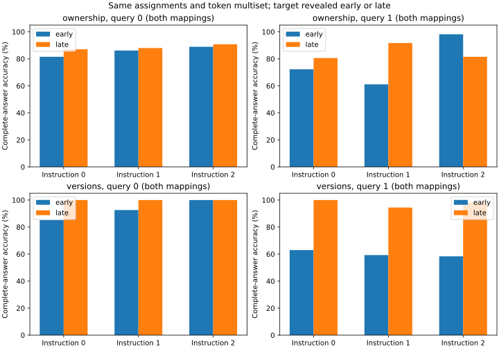

# Query revealed before or after identical assignments

Audited 2,592 complete baseline responses (2223 correct), with 0 intervention forwards. All three instruction variants, two lexical realizations and all registered cases remain included. These are discovery data; final/extrapolation outcomes remain sealed.

| Instruction | Family | Mapping | Query | Form | Correct / n | Invalid |
|---:|---|---:|---:|---|---:|---:|
| 0 | ownership | 0 | 0 | early | 39/54 | 0 |
| 0 | ownership | 0 | 0 | late | 40/54 | 0 |
| 0 | ownership | 0 | 1 | early | 54/54 | 0 |
| 0 | ownership | 0 | 1 | late | 54/54 | 0 |
| 0 | ownership | 1 | 0 | early | 49/54 | 0 |
| 0 | ownership | 1 | 0 | late | 54/54 | 0 |
| 0 | ownership | 1 | 1 | early | 24/54 | 0 |
| 0 | ownership | 1 | 1 | late | 33/54 | 0 |
| 0 | versions | 0 | 0 | early | 54/54 | 0 |
| 0 | versions | 0 | 0 | late | 54/54 | 0 |
| 0 | versions | 0 | 1 | early | 14/54 | 0 |
| 0 | versions | 0 | 1 | late | 54/54 | 0 |
| 0 | versions | 1 | 0 | early | 38/54 | 0 |
| 0 | versions | 1 | 0 | late | 54/54 | 0 |
| 0 | versions | 1 | 1 | early | 54/54 | 0 |
| 0 | versions | 1 | 1 | late | 54/54 | 0 |
| 1 | ownership | 0 | 0 | early | 53/54 | 0 |
| 1 | ownership | 0 | 0 | late | 43/54 | 0 |
| 1 | ownership | 0 | 1 | early | 54/54 | 0 |
| 1 | ownership | 0 | 1 | late | 54/54 | 0 |
| 1 | ownership | 1 | 0 | early | 40/54 | 0 |
| 1 | ownership | 1 | 0 | late | 52/54 | 0 |
| 1 | ownership | 1 | 1 | early | 12/54 | 0 |
| 1 | ownership | 1 | 1 | late | 45/54 | 0 |
| 1 | versions | 0 | 0 | early | 54/54 | 0 |
| 1 | versions | 0 | 0 | late | 54/54 | 0 |
| 1 | versions | 0 | 1 | early | 15/54 | 0 |
| 1 | versions | 0 | 1 | late | 48/54 | 0 |
| 1 | versions | 1 | 0 | early | 46/54 | 0 |
| 1 | versions | 1 | 0 | late | 54/54 | 0 |
| 1 | versions | 1 | 1 | early | 49/54 | 0 |
| 1 | versions | 1 | 1 | late | 54/54 | 0 |
| 2 | ownership | 0 | 0 | early | 43/54 | 0 |
| 2 | ownership | 0 | 0 | late | 44/54 | 0 |
| 2 | ownership | 0 | 1 | early | 54/54 | 0 |
| 2 | ownership | 0 | 1 | late | 54/54 | 0 |
| 2 | ownership | 1 | 0 | early | 53/54 | 0 |
| 2 | ownership | 1 | 0 | late | 54/54 | 0 |
| 2 | ownership | 1 | 1 | early | 52/54 | 0 |
| 2 | ownership | 1 | 1 | late | 34/54 | 0 |
| 2 | versions | 0 | 0 | early | 54/54 | 0 |
| 2 | versions | 0 | 0 | late | 54/54 | 0 |
| 2 | versions | 0 | 1 | early | 9/54 | 0 |
| 2 | versions | 0 | 1 | late | 52/54 | 0 |
| 2 | versions | 1 | 0 | early | 54/54 | 0 |
| 2 | versions | 1 | 0 | late | 54/54 | 0 |
| 2 | versions | 1 | 1 | early | 54/54 | 0 |
| 2 | versions | 1 | 1 | late | 54/54 | 0 |

Paired changes use late-query prompts as the timing reference, and original programs as the copy-study reference.

| Instruction | Family | Mapping | Query | Alternate | n | Both correct | Reference only | Alternate only | Both wrong |
|---:|---|---:|---:|---|---:|---:|---:|---:|---:|
| 0 | ownership | 0 | 0 | early | 54 | 37 | 3 | 2 | 12 |
| 0 | ownership | 0 | 1 | early | 54 | 54 | 0 | 0 | 0 |
| 0 | ownership | 1 | 0 | early | 54 | 49 | 5 | 0 | 0 |
| 0 | ownership | 1 | 1 | early | 54 | 15 | 18 | 9 | 12 |
| 0 | versions | 0 | 0 | early | 54 | 54 | 0 | 0 | 0 |
| 0 | versions | 0 | 1 | early | 54 | 14 | 40 | 0 | 0 |
| 0 | versions | 1 | 0 | early | 54 | 38 | 16 | 0 | 0 |
| 0 | versions | 1 | 1 | early | 54 | 54 | 0 | 0 | 0 |
| 1 | ownership | 0 | 0 | early | 54 | 43 | 0 | 10 | 1 |
| 1 | ownership | 0 | 1 | early | 54 | 54 | 0 | 0 | 0 |
| 1 | ownership | 1 | 0 | early | 54 | 39 | 13 | 1 | 1 |
| 1 | ownership | 1 | 1 | early | 54 | 10 | 35 | 2 | 7 |
| 1 | versions | 0 | 0 | early | 54 | 54 | 0 | 0 | 0 |
| 1 | versions | 0 | 1 | early | 54 | 13 | 35 | 2 | 4 |
| 1 | versions | 1 | 0 | early | 54 | 46 | 8 | 0 | 0 |
| 1 | versions | 1 | 1 | early | 54 | 49 | 5 | 0 | 0 |
| 2 | ownership | 0 | 0 | early | 54 | 38 | 6 | 5 | 5 |
| 2 | ownership | 0 | 1 | early | 54 | 54 | 0 | 0 | 0 |
| 2 | ownership | 1 | 0 | early | 54 | 53 | 1 | 0 | 0 |
| 2 | ownership | 1 | 1 | early | 54 | 34 | 0 | 18 | 2 |
| 2 | versions | 0 | 0 | early | 54 | 54 | 0 | 0 | 0 |
| 2 | versions | 0 | 1 | early | 54 | 9 | 43 | 0 | 2 |
| 2 | versions | 1 | 0 | early | 54 | 54 | 0 | 0 | 0 |
| 2 | versions | 1 | 1 | early | 54 | 54 | 0 | 0 | 0 |

Late-query paired prefixes and all three earlier capture sites are exactly invariant across the two future queries. Early-query representations may differ because the target is already in the context. That difference is not evidence of a particular memory algorithm. No hidden-state interventions or probe fitting were requested in this timing/capture phase.

| Instruction | Timing | Block | Site | Paired states | Exact equals | Mean L2 |
|---:|---|---:|---|---:|---:|---:|
| 0 | early | 0 | answer_prefill | 216 | 0 | 0.0034 |
| 0 | early | 0 | state_end | 216 | 0 | 0.0046 |
| 0 | early | 8 | answer_prefill | 216 | 0 | 0.4201 |
| 0 | early | 8 | state_end | 216 | 0 | 0.5956 |
| 0 | early | 16 | answer_prefill | 216 | 0 | 3.5633 |
| 0 | early | 16 | state_end | 216 | 0 | 1.6527 |
| 0 | early | 24 | answer_prefill | 216 | 0 | 6.7365 |
| 0 | early | 24 | state_end | 216 | 0 | 2.5553 |
| 0 | early | 31 | answer_prefill | 216 | 0 | 19.2621 |
| 0 | early | 31 | state_end | 216 | 0 | 7.0682 |
| 0 | late | 0 | answer_prefill | 216 | 0 | 0.0042 |
| 0 | late | 0 | state_end | 216 | 216 | 0.0000 |
| 0 | late | 8 | answer_prefill | 216 | 0 | 0.5188 |
| 0 | late | 8 | state_end | 216 | 216 | 0.0000 |
| 0 | late | 16 | answer_prefill | 216 | 0 | 5.5076 |
| 0 | late | 16 | state_end | 216 | 216 | 0.0000 |
| 0 | late | 24 | answer_prefill | 216 | 0 | 10.3886 |
| 0 | late | 24 | state_end | 216 | 216 | 0.0000 |
| 0 | late | 31 | answer_prefill | 216 | 0 | 26.0604 |
| 0 | late | 31 | state_end | 216 | 216 | 0.0000 |
| 1 | early | 0 | answer_prefill | 216 | 0 | 0.0030 |
| 1 | early | 0 | state_end | 216 | 0 | 0.0046 |
| 1 | early | 8 | answer_prefill | 216 | 0 | 0.3954 |
| 1 | early | 8 | state_end | 216 | 0 | 0.6075 |
| 1 | early | 16 | answer_prefill | 216 | 0 | 3.2774 |
| 1 | early | 16 | state_end | 216 | 0 | 1.8760 |
| 1 | early | 24 | answer_prefill | 216 | 0 | 6.3781 |
| 1 | early | 24 | state_end | 216 | 0 | 2.8683 |
| 1 | early | 31 | answer_prefill | 216 | 0 | 16.9914 |
| 1 | early | 31 | state_end | 216 | 0 | 8.7259 |
| 1 | late | 0 | answer_prefill | 216 | 0 | 0.0043 |
| 1 | late | 0 | state_end | 216 | 216 | 0.0000 |
| 1 | late | 8 | answer_prefill | 216 | 0 | 0.5276 |
| 1 | late | 8 | state_end | 216 | 216 | 0.0000 |
| 1 | late | 16 | answer_prefill | 216 | 0 | 5.2460 |
| 1 | late | 16 | state_end | 216 | 216 | 0.0000 |
| 1 | late | 24 | answer_prefill | 216 | 0 | 9.6780 |
| 1 | late | 24 | state_end | 216 | 216 | 0.0000 |
| 1 | late | 31 | answer_prefill | 216 | 0 | 23.9520 |
| 1 | late | 31 | state_end | 216 | 216 | 0.0000 |
| 2 | early | 0 | answer_prefill | 216 | 0 | 0.0029 |
| 2 | early | 0 | state_end | 216 | 0 | 0.0046 |
| 2 | early | 8 | answer_prefill | 216 | 0 | 0.4489 |
| 2 | early | 8 | state_end | 216 | 0 | 0.5809 |
| 2 | early | 16 | answer_prefill | 216 | 0 | 3.5857 |
| 2 | early | 16 | state_end | 216 | 0 | 1.6592 |
| 2 | early | 24 | answer_prefill | 216 | 0 | 6.7159 |
| 2 | early | 24 | state_end | 216 | 0 | 2.5213 |
| 2 | early | 31 | answer_prefill | 216 | 0 | 17.7499 |
| 2 | early | 31 | state_end | 216 | 0 | 8.1249 |
| 2 | late | 0 | answer_prefill | 216 | 0 | 0.0042 |
| 2 | late | 0 | state_end | 216 | 216 | 0.0000 |
| 2 | late | 8 | answer_prefill | 216 | 0 | 0.5058 |
| 2 | late | 8 | state_end | 216 | 216 | 0.0000 |
| 2 | late | 16 | answer_prefill | 216 | 0 | 5.1532 |
| 2 | late | 16 | state_end | 216 | 216 | 0.0000 |
| 2 | late | 24 | answer_prefill | 216 | 0 | 9.2444 |
| 2 | late | 24 | state_end | 216 | 216 | 0.0000 |
| 2 | late | 31 | answer_prefill | 216 | 0 | 25.0672 |
| 2 | late | 31 | state_end | 216 | 216 | 0.0000 |

Instruction, numeric and lexical variants are not independent structural replications. Paired counts are descriptive; no confirmatory significance or best-layer claim is made. Query timing can alter attention or task strategy. A successful local patch does not establish natural causal use, a general binding register or a validated explanation-transfer method. No optional language-model training, unlearning or separate-paper project was started.

Audit: `artifacts/binding/timing_and_copy/query_timing/llama31_8b_v1/interventions/audit.json`. [Design](timing_and_copy_plan.md). Reproduce with `PYTHONPATH=src ../envs/probe-cu129/bin/python scripts/113_binding_timing_and_copy.py review configs/binding/competition/query_timing_v1.json`.
