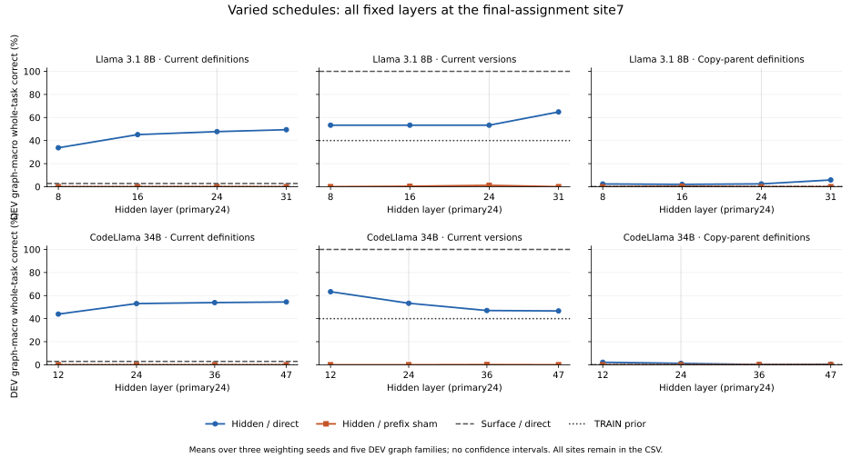

# Varied-schedule definition and relationship decoding

Both checkpoints completed the fixed discovery grid and passed independent saved-parameter, scientific-metric and control-marginal replay audits. This is descriptive decoding, without a behavioral reliability qualification or causal mechanism claim.

Each model uses 2,016 source rows: 1,320 TRAIN rows in ten canonical SSA graph families and 696 DEV rows in five families. The 84 schedule/parent templates include 28 destination schedules and actual assignment versions through 4. All numeric, lexical, query and equivalent-graph relatives retain their original split. There are 45 joint direct/control parameter banks per model.

The primary endpoint was nominated before capture: layer24, final-assignment site7, for both checkpoints. The following two tables average all three fixed weighting seeds17/29/43. No layer, seed or supported-class subset is selected.

Row-weighted DEV whole-task accuracy:

| Model | Backend | Method | Current definitions | Current versions | Copy parents |
|---|---|---|---:|---:|---:|
| Llama 3.1 8B | hidden | direct | 27.395% | 89.655% | 6.513% |
| Llama 3.1 8B | hidden | training_prior | 0.000% | 82.759% | 0.000% |
| Llama 3.1 8B | hidden | random_prefix_control | 0.192% | 0.383% | 0.000% |
| Llama 3.1 8B | surface | direct | 1.916% | 100.000% | 0.000% |
| Llama 3.1 8B | surface | training_prior | 0.000% | 82.759% | 0.000% |
| Llama 3.1 8B | surface | random_prefix_control | 0.383% | 0.383% | 0.000% |
| CodeLlama 34B | hidden | direct | 27.011% | 89.655% | 3.257% |
| CodeLlama 34B | hidden | training_prior | 0.000% | 82.759% | 0.000% |
| CodeLlama 34B | hidden | random_prefix_control | 0.000% | 0.000% | 0.000% |
| CodeLlama 34B | surface | direct | 2.107% | 100.000% | 0.000% |
| CodeLlama 34B | surface | training_prior | 0.000% | 82.759% | 0.000% |
| CodeLlama 34B | surface | random_prefix_control | 0.192% | 0.575% | 0.000% |

Equal-graph DEV whole-task accuracy:

| Model | Backend | Method | Current definitions | Current versions | Copy parents |
|---|---|---|---:|---:|---:|
| Llama 3.1 8B | hidden | direct | 47.755% | 53.333% | 2.431% |
| Llama 3.1 8B | hidden | training_prior | 0.000% | 40.000% | 0.000% |
| Llama 3.1 8B | hidden | random_prefix_control | 0.069% | 1.181% | 0.000% |
| Llama 3.1 8B | surface | direct | 2.778% | 100.000% | 0.000% |
| Llama 3.1 8B | surface | training_prior | 0.000% | 40.000% | 0.000% |
| Llama 3.1 8B | surface | random_prefix_control | 2.222% | 0.208% | 0.000% |
| CodeLlama 34B | hidden | direct | 53.056% | 53.333% | 1.181% |
| CodeLlama 34B | hidden | training_prior | 0.000% | 40.000% | 0.000% |
| CodeLlama 34B | hidden | random_prefix_control | 0.000% | 0.000% | 0.000% |
| CodeLlama 34B | surface | direct | 2.917% | 100.000% | 0.000% |
| CodeLlama 34B | surface | training_prior | 0.000% | 40.000% | 0.000% |
| CodeLlama 34B | surface | random_prefix_control | 1.111% | 0.347% | 0.000% |

The six panels show site7 only: all four hidden layers, direct and prefix-sham curves, with surface-direct and TRAIN-prior references. Each point is the mean of three weighting-seed graph-macro accuracies. No intervals or independent-replication claim are assigned to these dependent relatives. [form_cells_v1.csv](../../artifacts/binding/schedule_decoding/20261028_v1/form_cells_v1.csv) retains all810 model/site/layer/seed/backend/method/task cells, including all class counts, per-graph outcomes and null copy-parent tasks at site3.

At site3 current definitions and version1 are initialization priors; future copies are undefined. At the final site, DEV slot1 has constant version2, so its accuracy cannot establish version discrimination. The three-TRAIN-group class-support diagnostic is prospective to this discovery study and is not a relaxed historical gate. Rare parent classes, absent choices and every defined DEV outcome remain reported.

Definition and parent heads predict statement indices0..7. Mapping a predicted statement to a natural variable@version label using source-derived oracle maps would be an oracle-assisted postmetric; explicit current-version heads separately predict versions1..4. These measurements do not decode every obsolete statement's variable/version identity.

The source character baseline uses the exact visible prefix. Prefix-sham labels are tied across identical canonical visible prefixes and pre-query lexical/query twins. They do not preserve class marginals or necessarily define a lawful joint graph. All nine per-model control marginal descriptions are pinned in the original scientific result; the comparison records their digests and changed-column counts. A direct-minus-sham or hidden-minus-source difference is task-specific descriptive selectivity, not evidence of natural causal use.

The publisher reads only completed JSON receipts, SHA-pinned scientific metadata and frozen profiles. It checks the45-bank parameter inventory by metadata without opening NPZs, raw captures, source/response records, models or tokenizers. No fit, replay, new bootstrap or LM query occurs during publication. [comparison_v1.json](../../artifacts/binding/schedule_decoding/20261028_v1/comparison_v1.json) records all values and input pins; [publication_review_v1.json](../../artifacts/binding/schedule_decoding/20261028_v1/publication_review_v1.json) pins every output.

- Adaptive discovery on 15 canonical SSA graph families: ten TRAIN and five DEV; numeric, lexical and query relatives are dependent.
- The three-TRAIN-group class-support diagnostic is descriptive, not a behavioral reliability gate or scientific qualification.
- All declared heads and classes remain evaluated, including rare, unsupported and constant tasks; no favorable layer, seed or subset is selected.
- At site3 current definitions and versions are initialization constants; future copy-parent targets are undefined.
- The DEV version head for slot1 is constant at2 and cannot demonstrate discrimination among versions.
- Versions3/4 occur only in restricted slots in this source bank; no general all-slot version-recovery claim follows.
- Parent and current-definition heads predict statement indices; converting them to natural v@N labels using oracle maps would be an oracle-assisted postmetric.
- Explicit current-version heads predict versions1..4, but do not decode the complete destination/version identity of every obsolete statement.
- Random-prefix labels form a prefix-consistent sham task; real/control class marginals and task difficulty differ, and the joint labels need not be lawful SSA graphs.
- The character baseline sees exactly the visible text; hidden decoding or a hidden-minus-surface difference does not establish natural causal use.
- Assignment schedules also change definition age, position and dependency depth; no copying, binding or selection mechanism is identified.
- All points average three weighting seeds; five DEV graph families support descriptive group summaries, with no new bootstrap, confidence interval or independent replication claim.
- Sealed final/extrapolation outcomes, historical failed gates and optional training remain unchanged.
