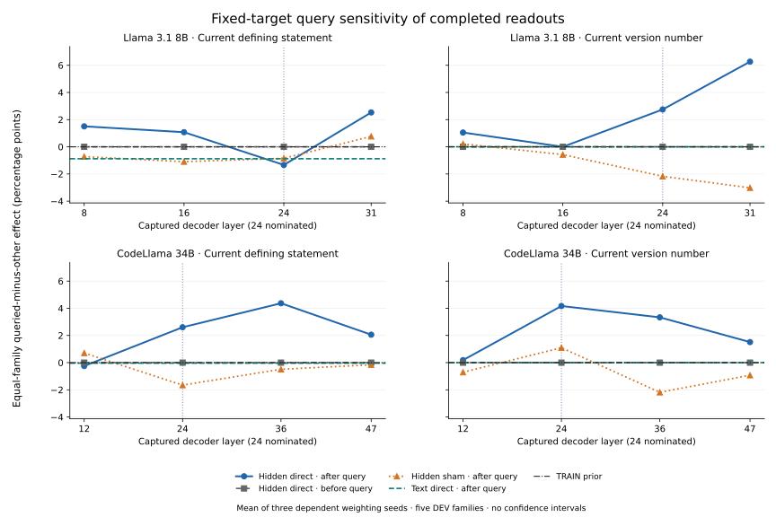

# Fixed-target query sensitivity from completed saved scores

The posthoc saved-score analysis and prediction replay audit completed. Every original score bank reproduced its original scientific metrics. This publication reads only pinned metadata; it performs no score analysis rerun, model query, parameter application or fitting.

Each comparison holds the target slot and its truth fixed across all four final queries on an identical eight-assignment body. Each pooled point uses 174 DEV bodies and 696 body/target comparison units: one query of that target versus its other three queries. Five unequal graph families remain the structural units. This avoids comparing different queried targets, while retaining the dependence among related cases.

The four panels retain all captured layers. Site 7 precedes the query; site 8 observes it. The vertical line marks the previously nominated layer 24. Curves average three weighting seeds; overlapping zero lines remain represented. No confidence interval, bootstrap or favorable layer selection is added.

| Model | Backend | Site | Method | Definition effect: rows / families (pp) | Version effect: rows / families (pp) |
|---|---|---:|---|---:|---:|
| Llama 3.1 8B | hidden | 7 | direct | 0.000 / 0.000 | 0.000 / 0.000 |
| Llama 3.1 8B | hidden | 7 | training_prior | 0.000 / 0.000 | 0.000 / 0.000 |
| Llama 3.1 8B | hidden | 7 | random_prefix_control | 0.000 / 0.000 | 0.000 / 0.000 |
| Llama 3.1 8B | hidden | 8 | direct | 3.975 / -1.335 | 0.782 / 2.747 |
| Llama 3.1 8B | hidden | 8 | training_prior | 0.000 / 0.000 | 0.000 / 0.000 |
| Llama 3.1 8B | hidden | 8 | random_prefix_control | -0.399 / -0.847 | 0.080 / -2.170 |
| Llama 3.1 8B | surface | 7 | direct | 0.000 / 0.000 | 0.000 / 0.000 |
| Llama 3.1 8B | surface | 7 | training_prior | 0.000 / 0.000 | 0.000 / 0.000 |
| Llama 3.1 8B | surface | 7 | random_prefix_control | 0.000 / 0.000 | 0.000 / 0.000 |
| Llama 3.1 8B | surface | 8 | direct | -0.383 / -0.880 | 0.000 / 0.000 |
| Llama 3.1 8B | surface | 8 | training_prior | 0.000 / 0.000 | 0.000 / 0.000 |
| Llama 3.1 8B | surface | 8 | random_prefix_control | 0.367 / 0.679 | 0.383 / -0.557 |
| CodeLlama 34B | hidden | 7 | direct | 0.000 / 0.000 | 0.000 / 0.000 |
| CodeLlama 34B | hidden | 7 | training_prior | 0.000 / 0.000 | 0.000 / 0.000 |
| CodeLlama 34B | hidden | 7 | random_prefix_control | 0.000 / 0.000 | 0.000 / 0.000 |
| CodeLlama 34B | hidden | 8 | direct | 3.991 / 2.604 | 1.102 / 4.167 |
| CodeLlama 34B | hidden | 8 | training_prior | 0.000 / 0.000 | 0.000 / 0.000 |
| CodeLlama 34B | hidden | 8 | random_prefix_control | -0.830 / -1.655 | -0.447 / 1.096 |
| CodeLlama 34B | surface | 7 | direct | 0.000 / 0.000 | 0.000 / 0.000 |
| CodeLlama 34B | surface | 7 | training_prior | 0.000 / 0.000 | 0.000 / 0.000 |
| CodeLlama 34B | surface | 7 | random_prefix_control | 0.000 / 0.000 | 0.000 / 0.000 |
| CodeLlama 34B | surface | 8 | direct | -0.351 / -0.039 | 0.000 / 0.000 |
| CodeLlama 34B | surface | 8 | training_prior | 0.000 / 0.000 | 0.000 / 0.000 |
| CodeLlama 34B | surface | 8 | random_prefix_control | 0.335 / 0.378 | 0.639 / 0.149 |

[query_effects_v1.csv](../../artifacts/binding/schedule_followup/20261028_v1/query_effects_v1.csv) retains all 540 model/backend/layer/site/seed/method/task cells, including site 3, every target-slot comparison and per-graph correctness/denominator counts. The original analysis retains class confusion, joint correctness mass and pre-query prediction/score disagreements. Stored margins are unsigned top-two class-score gaps, not true-target margins.

The source bank still has no final DEV version-3 examples, version 4 only in slot 0, and constant version 2 in slot 1. A nonzero final-boundary effect measures sensitivity of this saved decoder to the queried identifier; it does not establish a natural causal binding or tracking mechanism. Any pre-query disagreement must retain its numerical/padding qualification. Source-keyed sham labels are a different task with different marginals, rather than a matched lawful graph control.

All 90 score banks supplied 181,440 saved-score case rows and 62,640 DEV prediction rows. The CPU audit rederived actual-source truth/visibility and recomputed the diagnostics from prediction-only banks. This publisher opens none of those NPZs, original activations, coefficients or source records. [publication_review_v1.json](../../artifacts/binding/schedule_followup/20261028_v1/publication_review_v1.json) pins the inputs and every new output.

- Posthoc discovery after the aggregate results were known; no untouched confirmation or historical reliability-gate rescue.
- Every fixed target slot is held constant across its exact body’s four queried variables; this is not a comparison between different target slots.
- There are 174 DEV assignment bodies and five graph families. Each pooled point contains 696 dependent body/target units, not 696 independent bodies.
- The three weighting seeds, numeric/lexical/query relatives and source bodies are dependent; no new confidence interval, bootstrap or favorable layer selection is used.
- Site7 precedes the query and is a placebo. Padding or numerical prediction differences there cannot be attributed to unseen query text.
- Site8 observes the queried identifier; a saved-readout effect is decoder-specific query sensitivity, not natural causal use or a state-tracking mechanism.
- Source-keyed sham targets have different class marginals and need not form lawful SSA graphs; their effects are a separate task.
- Stored margins are unsigned top-two class-score gaps, not true-target margins; ridge scores are uncalibrated.
- Version3 is absent from original DEV, version4 appears only in slot0 and slot1 has constant version2; this follow-up does not repair that domain coverage.
- Statement-index definition heads do not decode complete natural variable@version identities.
