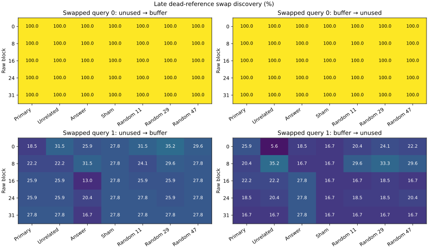

# Late dead-reference swap discovery

All 432 baseline responses are audited (348 correct). The answer-digit boundary and generation-prefill checks passed on every baseline. The registered workload completed 15,120 intervention forwards. All cases are discovery data; generated final/extrapolation outcomes remain sealed.

| Family | Mapping | Query | Reset | Correct / n | Invalid |
|---|---:|---:|---|---:|---:|
| ownership | 0 | 0 | buffer | 54/54 | 0 |
| ownership | 0 | 0 | unused | 54/54 | 0 |
| ownership | 0 | 1 | buffer | 54/54 | 0 |
| ownership | 0 | 1 | unused | 54/54 | 0 |
| ownership | 1 | 0 | buffer | 54/54 | 0 |
| ownership | 1 | 0 | unused | 54/54 | 0 |
| ownership | 1 | 1 | buffer | 15/54 | 0 |
| ownership | 1 | 1 | unused | 9/54 | 0 |

Original anchor replay: 213/216 parsed predictions match (176 previously correct, 177 now correct). Paired reset effects below use the two conditions measured together in this run.

The two prompts differ only in the final, output-irrelevant assignment identifier. All live query values, statement counts, literals and token lengths match. Full final states and the number of distinct identifiers differ; the effect cannot separate lexical cues from resetting a reused temporary. The prior failure cell (swapped mapping, second-variable query) was nominated from earlier discovery results.

Paired baseline changes (unused-only correct denotes improvement after changing the dead identifier):

| Mapping | Query | n | Both correct | Buffer only | Unused only | Both wrong |
|---:|---:|---:|---:|---:|---:|---:|
| 0 | 0 | 54 | 54 | 0 | 0 | 0 |
| 0 | 1 | 54 | 54 | 0 | 0 | 0 |
| 1 | 0 | 54 | 54 | 0 | 0 | 0 |
| 1 | 1 | 54 | 9 | 6 | 0 | 39 |

Intervention targets are the correct digit versus the other binding, not a changed oracle output. Each direction includes every paired case. The corresponding unpatched token accuracy is shown with the patched accuracy; a high patched accuracy alone is not a repair effect.

| Mapping | Query | Donor → recipient | Block | Condition | n | Unpatched correct (%) | Patched correct (%) | Correct-vs-other log-odds change |
|---:|---:|---|---:|---|---:|---:|---:|---:|
| 0 | 0 | unused → buffer | 0 | dead_reference_transfer | 54 | 100.00 | 100.00 | 0.192 |
| 0 | 0 | unused → buffer | 0 | unrelated_position | 54 | 100.00 | 100.00 | -0.613 |
| 0 | 0 | unused → buffer | 0 | answer_vector | 54 | 100.00 | 100.00 | -0.019 |
| 0 | 0 | unused → buffer | 0 | identity_sham | 54 | 100.00 | 100.00 | 0.000 |
| 0 | 0 | unused → buffer | 0 | random_11 | 54 | 100.00 | 100.00 | -0.049 |
| 0 | 0 | unused → buffer | 0 | random_29 | 54 | 100.00 | 100.00 | -0.051 |
| 0 | 0 | unused → buffer | 0 | random_47 | 54 | 100.00 | 100.00 | -0.056 |
| 0 | 0 | unused → buffer | 8 | dead_reference_transfer | 54 | 100.00 | 100.00 | 0.146 |
| 0 | 0 | unused → buffer | 8 | unrelated_position | 54 | 100.00 | 100.00 | 0.005 |
| 0 | 0 | unused → buffer | 8 | answer_vector | 54 | 100.00 | 100.00 | -0.109 |
| 0 | 0 | unused → buffer | 8 | identity_sham | 54 | 100.00 | 100.00 | 0.000 |
| 0 | 0 | unused → buffer | 8 | random_11 | 54 | 100.00 | 100.00 | 0.086 |
| 0 | 0 | unused → buffer | 8 | random_29 | 54 | 100.00 | 100.00 | 0.049 |
| 0 | 0 | unused → buffer | 8 | random_47 | 54 | 100.00 | 100.00 | 0.049 |
| 0 | 0 | unused → buffer | 16 | dead_reference_transfer | 54 | 100.00 | 100.00 | -0.016 |
| 0 | 0 | unused → buffer | 16 | unrelated_position | 54 | 100.00 | 100.00 | -0.058 |
| 0 | 0 | unused → buffer | 16 | answer_vector | 54 | 100.00 | 100.00 | -0.023 |
| 0 | 0 | unused → buffer | 16 | identity_sham | 54 | 100.00 | 100.00 | 0.000 |
| 0 | 0 | unused → buffer | 16 | random_11 | 54 | 100.00 | 100.00 | -0.019 |
| 0 | 0 | unused → buffer | 16 | random_29 | 54 | 100.00 | 100.00 | -0.019 |
| 0 | 0 | unused → buffer | 16 | random_47 | 54 | 100.00 | 100.00 | -0.012 |
| 0 | 0 | unused → buffer | 24 | dead_reference_transfer | 54 | 100.00 | 100.00 | 0.000 |
| 0 | 0 | unused → buffer | 24 | unrelated_position | 54 | 100.00 | 100.00 | 0.002 |
| 0 | 0 | unused → buffer | 24 | answer_vector | 54 | 100.00 | 100.00 | 0.051 |
| 0 | 0 | unused → buffer | 24 | identity_sham | 54 | 100.00 | 100.00 | 0.000 |
| 0 | 0 | unused → buffer | 24 | random_11 | 54 | 100.00 | 100.00 | -0.009 |
| 0 | 0 | unused → buffer | 24 | random_29 | 54 | 100.00 | 100.00 | -0.009 |
| 0 | 0 | unused → buffer | 24 | random_47 | 54 | 100.00 | 100.00 | -0.021 |
| 0 | 0 | unused → buffer | 31 | dead_reference_transfer | 54 | 100.00 | 100.00 | 0.000 |
| 0 | 0 | unused → buffer | 31 | unrelated_position | 54 | 100.00 | 100.00 | 0.000 |
| 0 | 0 | unused → buffer | 31 | answer_vector | 54 | 100.00 | 100.00 | 0.190 |
| 0 | 0 | unused → buffer | 31 | identity_sham | 54 | 100.00 | 100.00 | 0.000 |
| 0 | 0 | unused → buffer | 31 | random_11 | 54 | 100.00 | 100.00 | 0.000 |
| 0 | 0 | unused → buffer | 31 | random_29 | 54 | 100.00 | 100.00 | 0.000 |
| 0 | 0 | unused → buffer | 31 | random_47 | 54 | 100.00 | 100.00 | 0.000 |
| 0 | 0 | buffer → unused | 0 | dead_reference_transfer | 54 | 100.00 | 100.00 | -0.201 |
| 0 | 0 | buffer → unused | 0 | unrelated_position | 54 | 100.00 | 100.00 | -0.155 |
| 0 | 0 | buffer → unused | 0 | answer_vector | 54 | 100.00 | 100.00 | 0.012 |
| 0 | 0 | buffer → unused | 0 | identity_sham | 54 | 100.00 | 100.00 | 0.000 |
| 0 | 0 | buffer → unused | 0 | random_11 | 54 | 100.00 | 100.00 | 0.255 |
| 0 | 0 | buffer → unused | 0 | random_29 | 54 | 100.00 | 100.00 | 0.243 |
| 0 | 0 | buffer → unused | 0 | random_47 | 54 | 100.00 | 100.00 | 0.303 |
| 0 | 0 | buffer → unused | 8 | dead_reference_transfer | 54 | 100.00 | 100.00 | 0.174 |
| 0 | 0 | buffer → unused | 8 | unrelated_position | 54 | 100.00 | 100.00 | -0.069 |
| 0 | 0 | buffer → unused | 8 | answer_vector | 54 | 100.00 | 100.00 | 0.120 |
| 0 | 0 | buffer → unused | 8 | identity_sham | 54 | 100.00 | 100.00 | 0.000 |
| 0 | 0 | buffer → unused | 8 | random_11 | 54 | 100.00 | 100.00 | 0.206 |
| 0 | 0 | buffer → unused | 8 | random_29 | 54 | 100.00 | 100.00 | 0.183 |
| 0 | 0 | buffer → unused | 8 | random_47 | 54 | 100.00 | 100.00 | 0.187 |
| 0 | 0 | buffer → unused | 16 | dead_reference_transfer | 54 | 100.00 | 100.00 | -0.005 |
| 0 | 0 | buffer → unused | 16 | unrelated_position | 54 | 100.00 | 100.00 | -0.097 |
| 0 | 0 | buffer → unused | 16 | answer_vector | 54 | 100.00 | 100.00 | 0.000 |
| 0 | 0 | buffer → unused | 16 | identity_sham | 54 | 100.00 | 100.00 | 0.000 |
| 0 | 0 | buffer → unused | 16 | random_11 | 54 | 100.00 | 100.00 | -0.005 |
| 0 | 0 | buffer → unused | 16 | random_29 | 54 | 100.00 | 100.00 | -0.014 |
| 0 | 0 | buffer → unused | 16 | random_47 | 54 | 100.00 | 100.00 | 0.009 |
| 0 | 0 | buffer → unused | 24 | dead_reference_transfer | 54 | 100.00 | 100.00 | 0.007 |
| 0 | 0 | buffer → unused | 24 | unrelated_position | 54 | 100.00 | 100.00 | -0.002 |
| 0 | 0 | buffer → unused | 24 | answer_vector | 54 | 100.00 | 100.00 | -0.088 |
| 0 | 0 | buffer → unused | 24 | identity_sham | 54 | 100.00 | 100.00 | 0.000 |
| 0 | 0 | buffer → unused | 24 | random_11 | 54 | 100.00 | 100.00 | 0.000 |
| 0 | 0 | buffer → unused | 24 | random_29 | 54 | 100.00 | 100.00 | -0.002 |
| 0 | 0 | buffer → unused | 24 | random_47 | 54 | 100.00 | 100.00 | -0.014 |
| 0 | 0 | buffer → unused | 31 | dead_reference_transfer | 54 | 100.00 | 100.00 | 0.000 |
| 0 | 0 | buffer → unused | 31 | unrelated_position | 54 | 100.00 | 100.00 | 0.000 |
| 0 | 0 | buffer → unused | 31 | answer_vector | 54 | 100.00 | 100.00 | -0.190 |
| 0 | 0 | buffer → unused | 31 | identity_sham | 54 | 100.00 | 100.00 | 0.000 |
| 0 | 0 | buffer → unused | 31 | random_11 | 54 | 100.00 | 100.00 | 0.000 |
| 0 | 0 | buffer → unused | 31 | random_29 | 54 | 100.00 | 100.00 | 0.000 |
| 0 | 0 | buffer → unused | 31 | random_47 | 54 | 100.00 | 100.00 | 0.000 |
| 0 | 1 | unused → buffer | 0 | dead_reference_transfer | 54 | 100.00 | 100.00 | 0.162 |
| 0 | 1 | unused → buffer | 0 | unrelated_position | 54 | 100.00 | 100.00 | 0.204 |
| 0 | 1 | unused → buffer | 0 | answer_vector | 54 | 100.00 | 100.00 | -0.000 |
| 0 | 1 | unused → buffer | 0 | identity_sham | 54 | 100.00 | 100.00 | 0.000 |
| 0 | 1 | unused → buffer | 0 | random_11 | 54 | 100.00 | 100.00 | 0.109 |
| 0 | 1 | unused → buffer | 0 | random_29 | 54 | 100.00 | 100.00 | 0.105 |
| 0 | 1 | unused → buffer | 0 | random_47 | 54 | 100.00 | 100.00 | 0.101 |
| 0 | 1 | unused → buffer | 8 | dead_reference_transfer | 54 | 100.00 | 100.00 | -0.113 |
| 0 | 1 | unused → buffer | 8 | unrelated_position | 54 | 100.00 | 100.00 | 0.110 |
| 0 | 1 | unused → buffer | 8 | answer_vector | 54 | 100.00 | 100.00 | -0.039 |
| 0 | 1 | unused → buffer | 8 | identity_sham | 54 | 100.00 | 100.00 | 0.000 |
| 0 | 1 | unused → buffer | 8 | random_11 | 54 | 100.00 | 100.00 | -0.062 |
| 0 | 1 | unused → buffer | 8 | random_29 | 54 | 100.00 | 100.00 | -0.074 |
| 0 | 1 | unused → buffer | 8 | random_47 | 54 | 100.00 | 100.00 | -0.051 |
| 0 | 1 | unused → buffer | 16 | dead_reference_transfer | 54 | 100.00 | 100.00 | 0.037 |
| 0 | 1 | unused → buffer | 16 | unrelated_position | 54 | 100.00 | 100.00 | 0.046 |
| 0 | 1 | unused → buffer | 16 | answer_vector | 54 | 100.00 | 100.00 | 0.255 |
| 0 | 1 | unused → buffer | 16 | identity_sham | 54 | 100.00 | 100.00 | 0.000 |
| 0 | 1 | unused → buffer | 16 | random_11 | 54 | 100.00 | 100.00 | 0.021 |
| 0 | 1 | unused → buffer | 16 | random_29 | 54 | 100.00 | 100.00 | 0.012 |
| 0 | 1 | unused → buffer | 16 | random_47 | 54 | 100.00 | 100.00 | 0.019 |
| 0 | 1 | unused → buffer | 24 | dead_reference_transfer | 54 | 100.00 | 100.00 | 0.000 |
| 0 | 1 | unused → buffer | 24 | unrelated_position | 54 | 100.00 | 100.00 | 0.051 |
| 0 | 1 | unused → buffer | 24 | answer_vector | 54 | 100.00 | 100.00 | 0.186 |
| 0 | 1 | unused → buffer | 24 | identity_sham | 54 | 100.00 | 100.00 | 0.000 |
| 0 | 1 | unused → buffer | 24 | random_11 | 54 | 100.00 | 100.00 | -0.002 |
| 0 | 1 | unused → buffer | 24 | random_29 | 54 | 100.00 | 100.00 | -0.009 |
| 0 | 1 | unused → buffer | 24 | random_47 | 54 | 100.00 | 100.00 | 0.007 |
| 0 | 1 | unused → buffer | 31 | dead_reference_transfer | 54 | 100.00 | 100.00 | 0.000 |
| 0 | 1 | unused → buffer | 31 | unrelated_position | 54 | 100.00 | 100.00 | 0.000 |
| 0 | 1 | unused → buffer | 31 | answer_vector | 54 | 100.00 | 100.00 | 0.164 |
| 0 | 1 | unused → buffer | 31 | identity_sham | 54 | 100.00 | 100.00 | 0.000 |
| 0 | 1 | unused → buffer | 31 | random_11 | 54 | 100.00 | 100.00 | 0.000 |
| 0 | 1 | unused → buffer | 31 | random_29 | 54 | 100.00 | 100.00 | 0.000 |
| 0 | 1 | unused → buffer | 31 | random_47 | 54 | 100.00 | 100.00 | 0.000 |
| 0 | 1 | buffer → unused | 0 | dead_reference_transfer | 54 | 100.00 | 100.00 | -0.132 |
| 0 | 1 | buffer → unused | 0 | unrelated_position | 54 | 100.00 | 100.00 | -0.034 |
| 0 | 1 | buffer → unused | 0 | answer_vector | 54 | 100.00 | 100.00 | 0.008 |
| 0 | 1 | buffer → unused | 0 | identity_sham | 54 | 100.00 | 100.00 | 0.000 |
| 0 | 1 | buffer → unused | 0 | random_11 | 54 | 100.00 | 100.00 | 0.263 |
| 0 | 1 | buffer → unused | 0 | random_29 | 54 | 100.00 | 100.00 | 0.324 |
| 0 | 1 | buffer → unused | 0 | random_47 | 54 | 100.00 | 100.00 | 0.238 |
| 0 | 1 | buffer → unused | 8 | dead_reference_transfer | 54 | 100.00 | 100.00 | 0.108 |
| 0 | 1 | buffer → unused | 8 | unrelated_position | 54 | 100.00 | 100.00 | 0.022 |
| 0 | 1 | buffer → unused | 8 | answer_vector | 54 | 100.00 | 100.00 | 0.041 |
| 0 | 1 | buffer → unused | 8 | identity_sham | 54 | 100.00 | 100.00 | 0.000 |
| 0 | 1 | buffer → unused | 8 | random_11 | 54 | 100.00 | 100.00 | 0.030 |
| 0 | 1 | buffer → unused | 8 | random_29 | 54 | 100.00 | 100.00 | 0.027 |
| 0 | 1 | buffer → unused | 8 | random_47 | 54 | 100.00 | 100.00 | 0.019 |
| 0 | 1 | buffer → unused | 16 | dead_reference_transfer | 54 | 100.00 | 100.00 | -0.035 |
| 0 | 1 | buffer → unused | 16 | unrelated_position | 54 | 100.00 | 100.00 | -0.093 |
| 0 | 1 | buffer → unused | 16 | answer_vector | 54 | 100.00 | 100.00 | -0.259 |
| 0 | 1 | buffer → unused | 16 | identity_sham | 54 | 100.00 | 100.00 | 0.000 |
| 0 | 1 | buffer → unused | 16 | random_11 | 54 | 100.00 | 100.00 | -0.003 |
| 0 | 1 | buffer → unused | 16 | random_29 | 54 | 100.00 | 100.00 | -0.006 |
| 0 | 1 | buffer → unused | 16 | random_47 | 54 | 100.00 | 100.00 | -0.005 |
| 0 | 1 | buffer → unused | 24 | dead_reference_transfer | 54 | 100.00 | 100.00 | 0.002 |
| 0 | 1 | buffer → unused | 24 | unrelated_position | 54 | 100.00 | 100.00 | -0.013 |
| 0 | 1 | buffer → unused | 24 | answer_vector | 54 | 100.00 | 100.00 | -0.179 |
| 0 | 1 | buffer → unused | 24 | identity_sham | 54 | 100.00 | 100.00 | 0.000 |
| 0 | 1 | buffer → unused | 24 | random_11 | 54 | 100.00 | 100.00 | 0.006 |
| 0 | 1 | buffer → unused | 24 | random_29 | 54 | 100.00 | 100.00 | 0.008 |
| 0 | 1 | buffer → unused | 24 | random_47 | 54 | 100.00 | 100.00 | -0.006 |
| 0 | 1 | buffer → unused | 31 | dead_reference_transfer | 54 | 100.00 | 100.00 | 0.000 |
| 0 | 1 | buffer → unused | 31 | unrelated_position | 54 | 100.00 | 100.00 | 0.000 |
| 0 | 1 | buffer → unused | 31 | answer_vector | 54 | 100.00 | 100.00 | -0.164 |
| 0 | 1 | buffer → unused | 31 | identity_sham | 54 | 100.00 | 100.00 | 0.000 |
| 0 | 1 | buffer → unused | 31 | random_11 | 54 | 100.00 | 100.00 | 0.000 |
| 0 | 1 | buffer → unused | 31 | random_29 | 54 | 100.00 | 100.00 | 0.000 |
| 0 | 1 | buffer → unused | 31 | random_47 | 54 | 100.00 | 100.00 | 0.000 |
| 1 | 0 | unused → buffer | 0 | dead_reference_transfer | 54 | 100.00 | 100.00 | -0.456 |
| 1 | 0 | unused → buffer | 0 | unrelated_position | 54 | 100.00 | 100.00 | 0.343 |
| 1 | 0 | unused → buffer | 0 | answer_vector | 54 | 100.00 | 100.00 | 0.009 |
| 1 | 0 | unused → buffer | 0 | identity_sham | 54 | 100.00 | 100.00 | 0.000 |
| 1 | 0 | unused → buffer | 0 | random_11 | 54 | 100.00 | 100.00 | -0.046 |
| 1 | 0 | unused → buffer | 0 | random_29 | 54 | 100.00 | 100.00 | -0.081 |
| 1 | 0 | unused → buffer | 0 | random_47 | 54 | 100.00 | 100.00 | -0.088 |
| 1 | 0 | unused → buffer | 8 | dead_reference_transfer | 54 | 100.00 | 100.00 | -0.264 |
| 1 | 0 | unused → buffer | 8 | unrelated_position | 54 | 100.00 | 100.00 | 0.005 |
| 1 | 0 | unused → buffer | 8 | answer_vector | 54 | 100.00 | 100.00 | -0.083 |
| 1 | 0 | unused → buffer | 8 | identity_sham | 54 | 100.00 | 100.00 | 0.000 |
| 1 | 0 | unused → buffer | 8 | random_11 | 54 | 100.00 | 100.00 | -0.005 |
| 1 | 0 | unused → buffer | 8 | random_29 | 54 | 100.00 | 100.00 | 0.035 |
| 1 | 0 | unused → buffer | 8 | random_47 | 54 | 100.00 | 100.00 | 0.065 |
| 1 | 0 | unused → buffer | 16 | dead_reference_transfer | 54 | 100.00 | 100.00 | -0.014 |
| 1 | 0 | unused → buffer | 16 | unrelated_position | 54 | 100.00 | 100.00 | 0.009 |
| 1 | 0 | unused → buffer | 16 | answer_vector | 54 | 100.00 | 100.00 | -0.271 |
| 1 | 0 | unused → buffer | 16 | identity_sham | 54 | 100.00 | 100.00 | 0.000 |
| 1 | 0 | unused → buffer | 16 | random_11 | 54 | 100.00 | 100.00 | 0.002 |
| 1 | 0 | unused → buffer | 16 | random_29 | 54 | 100.00 | 100.00 | 0.007 |
| 1 | 0 | unused → buffer | 16 | random_47 | 54 | 100.00 | 100.00 | 0.000 |
| 1 | 0 | unused → buffer | 24 | dead_reference_transfer | 54 | 100.00 | 100.00 | -0.009 |
| 1 | 0 | unused → buffer | 24 | unrelated_position | 54 | 100.00 | 100.00 | 0.035 |
| 1 | 0 | unused → buffer | 24 | answer_vector | 54 | 100.00 | 100.00 | -0.275 |
| 1 | 0 | unused → buffer | 24 | identity_sham | 54 | 100.00 | 100.00 | 0.000 |
| 1 | 0 | unused → buffer | 24 | random_11 | 54 | 100.00 | 100.00 | 0.009 |
| 1 | 0 | unused → buffer | 24 | random_29 | 54 | 100.00 | 100.00 | 0.005 |
| 1 | 0 | unused → buffer | 24 | random_47 | 54 | 100.00 | 100.00 | -0.014 |
| 1 | 0 | unused → buffer | 31 | dead_reference_transfer | 54 | 100.00 | 100.00 | 0.000 |
| 1 | 0 | unused → buffer | 31 | unrelated_position | 54 | 100.00 | 100.00 | 0.000 |
| 1 | 0 | unused → buffer | 31 | answer_vector | 54 | 100.00 | 100.00 | -0.444 |
| 1 | 0 | unused → buffer | 31 | identity_sham | 54 | 100.00 | 100.00 | 0.000 |
| 1 | 0 | unused → buffer | 31 | random_11 | 54 | 100.00 | 100.00 | 0.000 |
| 1 | 0 | unused → buffer | 31 | random_29 | 54 | 100.00 | 100.00 | 0.000 |
| 1 | 0 | unused → buffer | 31 | random_47 | 54 | 100.00 | 100.00 | 0.000 |
| 1 | 0 | buffer → unused | 0 | dead_reference_transfer | 54 | 100.00 | 100.00 | 0.465 |
| 1 | 0 | buffer → unused | 0 | unrelated_position | 54 | 100.00 | 100.00 | 0.051 |
| 1 | 0 | buffer → unused | 0 | answer_vector | 54 | 100.00 | 100.00 | -0.005 |
| 1 | 0 | buffer → unused | 0 | identity_sham | 54 | 100.00 | 100.00 | 0.000 |
| 1 | 0 | buffer → unused | 0 | random_11 | 54 | 100.00 | 100.00 | -0.199 |
| 1 | 0 | buffer → unused | 0 | random_29 | 54 | 100.00 | 100.00 | -0.157 |
| 1 | 0 | buffer → unused | 0 | random_47 | 54 | 100.00 | 100.00 | -0.167 |
| 1 | 0 | buffer → unused | 8 | dead_reference_transfer | 54 | 100.00 | 100.00 | 0.155 |
| 1 | 0 | buffer → unused | 8 | unrelated_position | 54 | 100.00 | 100.00 | 0.019 |
| 1 | 0 | buffer → unused | 8 | answer_vector | 54 | 100.00 | 100.00 | 0.072 |
| 1 | 0 | buffer → unused | 8 | identity_sham | 54 | 100.00 | 100.00 | 0.000 |
| 1 | 0 | buffer → unused | 8 | random_11 | 54 | 100.00 | 100.00 | -0.009 |
| 1 | 0 | buffer → unused | 8 | random_29 | 54 | 100.00 | 100.00 | -0.019 |
| 1 | 0 | buffer → unused | 8 | random_47 | 54 | 100.00 | 100.00 | -0.014 |
| 1 | 0 | buffer → unused | 16 | dead_reference_transfer | 54 | 100.00 | 100.00 | 0.014 |
| 1 | 0 | buffer → unused | 16 | unrelated_position | 54 | 100.00 | 100.00 | -0.104 |
| 1 | 0 | buffer → unused | 16 | answer_vector | 54 | 100.00 | 100.00 | 0.164 |
| 1 | 0 | buffer → unused | 16 | identity_sham | 54 | 100.00 | 100.00 | 0.000 |
| 1 | 0 | buffer → unused | 16 | random_11 | 54 | 100.00 | 100.00 | 0.007 |
| 1 | 0 | buffer → unused | 16 | random_29 | 54 | 100.00 | 100.00 | -0.005 |
| 1 | 0 | buffer → unused | 16 | random_47 | 54 | 100.00 | 100.00 | 0.009 |
| 1 | 0 | buffer → unused | 24 | dead_reference_transfer | 54 | 100.00 | 100.00 | 0.005 |
| 1 | 0 | buffer → unused | 24 | unrelated_position | 54 | 100.00 | 100.00 | -0.021 |
| 1 | 0 | buffer → unused | 24 | answer_vector | 54 | 100.00 | 100.00 | 0.255 |
| 1 | 0 | buffer → unused | 24 | identity_sham | 54 | 100.00 | 100.00 | 0.000 |
| 1 | 0 | buffer → unused | 24 | random_11 | 54 | 100.00 | 100.00 | 0.002 |
| 1 | 0 | buffer → unused | 24 | random_29 | 54 | 100.00 | 100.00 | 0.009 |
| 1 | 0 | buffer → unused | 24 | random_47 | 54 | 100.00 | 100.00 | 0.000 |
| 1 | 0 | buffer → unused | 31 | dead_reference_transfer | 54 | 100.00 | 100.00 | 0.000 |
| 1 | 0 | buffer → unused | 31 | unrelated_position | 54 | 100.00 | 100.00 | 0.000 |
| 1 | 0 | buffer → unused | 31 | answer_vector | 54 | 100.00 | 100.00 | 0.444 |
| 1 | 0 | buffer → unused | 31 | identity_sham | 54 | 100.00 | 100.00 | 0.000 |
| 1 | 0 | buffer → unused | 31 | random_11 | 54 | 100.00 | 100.00 | 0.000 |
| 1 | 0 | buffer → unused | 31 | random_29 | 54 | 100.00 | 100.00 | 0.000 |
| 1 | 0 | buffer → unused | 31 | random_47 | 54 | 100.00 | 100.00 | 0.000 |
| 1 | 1 | unused → buffer | 0 | dead_reference_transfer | 54 | 27.78 | 18.52 | -0.067 |
| 1 | 1 | unused → buffer | 0 | unrelated_position | 54 | 27.78 | 31.48 | -0.053 |
| 1 | 1 | unused → buffer | 0 | answer_vector | 54 | 27.78 | 25.93 | 0.007 |
| 1 | 1 | unused → buffer | 0 | identity_sham | 54 | 27.78 | 27.78 | 0.000 |
| 1 | 1 | unused → buffer | 0 | random_11 | 54 | 27.78 | 31.48 | 0.118 |
| 1 | 1 | unused → buffer | 0 | random_29 | 54 | 27.78 | 35.19 | 0.155 |
| 1 | 1 | unused → buffer | 0 | random_47 | 54 | 27.78 | 29.63 | 0.118 |
| 1 | 1 | unused → buffer | 8 | dead_reference_transfer | 54 | 27.78 | 22.22 | -0.130 |
| 1 | 1 | unused → buffer | 8 | unrelated_position | 54 | 27.78 | 22.22 | -0.243 |
| 1 | 1 | unused → buffer | 8 | answer_vector | 54 | 27.78 | 31.48 | 0.090 |
| 1 | 1 | unused → buffer | 8 | identity_sham | 54 | 27.78 | 27.78 | 0.000 |
| 1 | 1 | unused → buffer | 8 | random_11 | 54 | 27.78 | 24.07 | 0.030 |
| 1 | 1 | unused → buffer | 8 | random_29 | 54 | 27.78 | 29.63 | 0.037 |
| 1 | 1 | unused → buffer | 8 | random_47 | 54 | 27.78 | 27.78 | 0.035 |
| 1 | 1 | unused → buffer | 16 | dead_reference_transfer | 54 | 27.78 | 25.93 | 0.002 |
| 1 | 1 | unused → buffer | 16 | unrelated_position | 54 | 27.78 | 25.93 | 0.023 |
| 1 | 1 | unused → buffer | 16 | answer_vector | 54 | 27.78 | 12.96 | -0.303 |
| 1 | 1 | unused → buffer | 16 | identity_sham | 54 | 27.78 | 27.78 | 0.000 |
| 1 | 1 | unused → buffer | 16 | random_11 | 54 | 27.78 | 25.93 | 0.014 |
| 1 | 1 | unused → buffer | 16 | random_29 | 54 | 27.78 | 25.93 | 0.009 |
| 1 | 1 | unused → buffer | 16 | random_47 | 54 | 27.78 | 27.78 | 0.009 |
| 1 | 1 | unused → buffer | 24 | dead_reference_transfer | 54 | 27.78 | 25.93 | 0.005 |
| 1 | 1 | unused → buffer | 24 | unrelated_position | 54 | 27.78 | 25.93 | -0.005 |
| 1 | 1 | unused → buffer | 24 | answer_vector | 54 | 27.78 | 20.37 | -0.109 |
| 1 | 1 | unused → buffer | 24 | identity_sham | 54 | 27.78 | 27.78 | 0.000 |
| 1 | 1 | unused → buffer | 24 | random_11 | 54 | 27.78 | 27.78 | 0.019 |
| 1 | 1 | unused → buffer | 24 | random_29 | 54 | 27.78 | 25.93 | 0.007 |
| 1 | 1 | unused → buffer | 24 | random_47 | 54 | 27.78 | 27.78 | 0.009 |
| 1 | 1 | unused → buffer | 31 | dead_reference_transfer | 54 | 27.78 | 27.78 | 0.000 |
| 1 | 1 | unused → buffer | 31 | unrelated_position | 54 | 27.78 | 27.78 | 0.000 |
| 1 | 1 | unused → buffer | 31 | answer_vector | 54 | 27.78 | 16.67 | -0.051 |
| 1 | 1 | unused → buffer | 31 | identity_sham | 54 | 27.78 | 27.78 | 0.000 |
| 1 | 1 | unused → buffer | 31 | random_11 | 54 | 27.78 | 27.78 | 0.000 |
| 1 | 1 | unused → buffer | 31 | random_29 | 54 | 27.78 | 27.78 | 0.000 |
| 1 | 1 | unused → buffer | 31 | random_47 | 54 | 27.78 | 27.78 | 0.000 |
| 1 | 1 | buffer → unused | 0 | dead_reference_transfer | 54 | 16.67 | 25.93 | 0.014 |
| 1 | 1 | buffer → unused | 0 | unrelated_position | 54 | 16.67 | 5.56 | -0.329 |
| 1 | 1 | buffer → unused | 0 | answer_vector | 54 | 16.67 | 18.52 | 0.016 |
| 1 | 1 | buffer → unused | 0 | identity_sham | 54 | 16.67 | 16.67 | 0.000 |
| 1 | 1 | buffer → unused | 0 | random_11 | 54 | 16.67 | 20.37 | 0.083 |
| 1 | 1 | buffer → unused | 0 | random_29 | 54 | 16.67 | 24.07 | 0.046 |
| 1 | 1 | buffer → unused | 0 | random_47 | 54 | 16.67 | 22.22 | 0.007 |
| 1 | 1 | buffer → unused | 8 | dead_reference_transfer | 54 | 16.67 | 20.37 | 0.039 |
| 1 | 1 | buffer → unused | 8 | unrelated_position | 54 | 16.67 | 35.19 | 0.250 |
| 1 | 1 | buffer → unused | 8 | answer_vector | 54 | 16.67 | 16.67 | -0.104 |
| 1 | 1 | buffer → unused | 8 | identity_sham | 54 | 16.67 | 16.67 | 0.000 |
| 1 | 1 | buffer → unused | 8 | random_11 | 54 | 16.67 | 29.63 | 0.181 |
| 1 | 1 | buffer → unused | 8 | random_29 | 54 | 16.67 | 33.33 | 0.227 |
| 1 | 1 | buffer → unused | 8 | random_47 | 54 | 16.67 | 29.63 | 0.231 |
| 1 | 1 | buffer → unused | 16 | dead_reference_transfer | 54 | 16.67 | 22.22 | 0.007 |
| 1 | 1 | buffer → unused | 16 | unrelated_position | 54 | 16.67 | 22.22 | -0.076 |
| 1 | 1 | buffer → unused | 16 | answer_vector | 54 | 16.67 | 27.78 | 0.204 |
| 1 | 1 | buffer → unused | 16 | identity_sham | 54 | 16.67 | 16.67 | 0.000 |
| 1 | 1 | buffer → unused | 16 | random_11 | 54 | 16.67 | 16.67 | 0.014 |
| 1 | 1 | buffer → unused | 16 | random_29 | 54 | 16.67 | 18.52 | 0.000 |
| 1 | 1 | buffer → unused | 16 | random_47 | 54 | 16.67 | 16.67 | 0.000 |
| 1 | 1 | buffer → unused | 24 | dead_reference_transfer | 54 | 16.67 | 18.52 | 0.005 |
| 1 | 1 | buffer → unused | 24 | unrelated_position | 54 | 16.67 | 20.37 | 0.009 |
| 1 | 1 | buffer → unused | 24 | answer_vector | 54 | 16.67 | 27.78 | 0.109 |
| 1 | 1 | buffer → unused | 24 | identity_sham | 54 | 16.67 | 16.67 | 0.000 |
| 1 | 1 | buffer → unused | 24 | random_11 | 54 | 16.67 | 18.52 | 0.014 |
| 1 | 1 | buffer → unused | 24 | random_29 | 54 | 16.67 | 18.52 | 0.007 |
| 1 | 1 | buffer → unused | 24 | random_47 | 54 | 16.67 | 20.37 | 0.000 |
| 1 | 1 | buffer → unused | 31 | dead_reference_transfer | 54 | 16.67 | 16.67 | 0.000 |
| 1 | 1 | buffer → unused | 31 | unrelated_position | 54 | 16.67 | 16.67 | 0.000 |
| 1 | 1 | buffer → unused | 31 | answer_vector | 54 | 16.67 | 27.78 | 0.051 |
| 1 | 1 | buffer → unused | 31 | identity_sham | 54 | 16.67 | 16.67 | 0.000 |
| 1 | 1 | buffer → unused | 31 | random_11 | 54 | 16.67 | 16.67 | 0.000 |
| 1 | 1 | buffer → unused | 31 | random_29 | 54 | 16.67 | 16.67 | 0.000 |
| 1 | 1 | buffer → unused | 31 | random_47 | 54 | 16.67 | 16.67 | 0.000 |

Analytic controls passed: 432 final answer-vector donor copies, 2160 final-block earlier-token controls and 2160 identity shams. Maximum relative norm mismatch: 0.0590% (allowed 3%). The final answer-vector condition is an answer-copy software control. These are next-token interventions, not complete-output intervention accuracy. Numeric variants, directions and two lexical realizations are not independent structural replications. No general binding register, computed-value abstraction or held-out error predictor is established.

Audit: `artifacts/binding/routing_extension/swap_reset/llama31_8b_v2/interventions/audit.json`. [Design](routing_extension_plan.md). Reproduce with `PYTHONPATH=src ../envs/probe-cu129/bin/python scripts/112_binding_routing_extension.py review configs/binding/competition/swap_reset_v2.json`.
