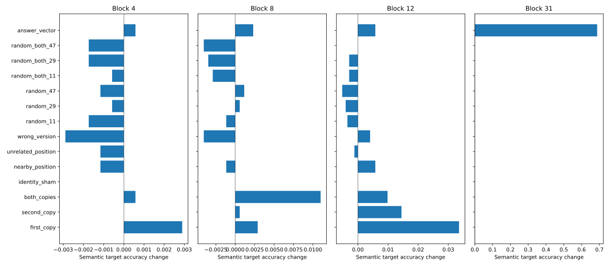

# Fresh numeric value ownership with single and joint copy-site patches

Fresh numeric, familiar-structure ownership controls. Single and joint copy-site patches, spatial, stale-version and norm-matched random controls; no general binding mechanism established.

All 2592 baseline cases retained; 2224 correct. Generated final/extrapolation holdouts remain sealed.

The primary block 8 candidate was selected from the prior study. Blocks 4 and 12 measure sensitivity; block 31 checks software controls. Fresh numbers use familiar templates and do not test structural generalization.

Both-copies transfers preserve the full donor value multiset. Single-copy semantic substitutions change one final variable only. Wrong-version directions are norm matched; their oracle describes a substituted assignment result, not a guaranteed neural representation.

| Block | Condition | Semantic target before → after | Donor answer before → after | Mean donor log-odds change |
|---:|---|---:|---:|---:|
| 4 | answer_vector | 270/1728 → 271/1728 | 270/1728 → 271/1728 | -0.001 |
| 4 | both_copies | 270/1728 → 271/1728 | 270/1728 → 271/1728 | +0.002 |
| 4 | first_copy | 758/1728 → 763/1728 | 270/1728 → 277/1728 | +0.001 |
| 4 | identity_sham | 1458/1728 → 1458/1728 | 270/1728 → 270/1728 | +0.000 |
| 4 | nearby_position | 1458/1728 → 1456/1728 | 270/1728 → 272/1728 | +0.000 |
| 4 | random_11 | 1458/1728 → 1455/1728 | 270/1728 → 273/1728 | +0.001 |
| 4 | random_29 | 1458/1728 → 1457/1728 | 270/1728 → 271/1728 | +0.005 |
| 4 | random_47 | 1458/1728 → 1456/1728 | 270/1728 → 272/1728 | -0.001 |
| 4 | random_both_11 | 1458/1728 → 1457/1728 | 270/1728 → 271/1728 | +0.002 |
| 4 | random_both_29 | 1458/1728 → 1455/1728 | 270/1728 → 273/1728 | +0.002 |
| 4 | random_both_47 | 1458/1728 → 1455/1728 | 270/1728 → 273/1728 | -0.000 |
| 4 | second_copy | 970/1728 → 970/1728 | 270/1728 → 278/1728 | +0.005 |
| 4 | unrelated_position | 1458/1728 → 1456/1728 | 270/1728 → 272/1728 | +0.003 |
| 4 | wrong_version | 1026/1728 → 1021/1728 | 270/1728 → 275/1728 | -0.000 |
| 8 | answer_vector | 270/1728 → 274/1728 | 270/1728 → 274/1728 | +0.001 |
| 8 | both_copies | 270/1728 → 289/1728 | 270/1728 → 289/1728 | +0.082 |
| 8 | first_copy | 758/1728 → 763/1728 | 270/1728 → 289/1728 | +0.058 |
| 8 | identity_sham | 1458/1728 → 1458/1728 | 270/1728 → 270/1728 | +0.000 |
| 8 | nearby_position | 1458/1728 → 1456/1728 | 270/1728 → 272/1728 | -0.007 |
| 8 | random_11 | 1458/1728 → 1456/1728 | 270/1728 → 272/1728 | -0.000 |
| 8 | random_29 | 1458/1728 → 1459/1728 | 270/1728 → 268/1728 | -0.001 |
| 8 | random_47 | 1458/1728 → 1460/1728 | 270/1728 → 268/1728 | +0.001 |
| 8 | random_both_11 | 1458/1728 → 1453/1728 | 270/1728 → 275/1728 | -0.001 |
| 8 | random_both_29 | 1458/1728 → 1452/1728 | 270/1728 → 275/1728 | +0.004 |
| 8 | random_both_47 | 1458/1728 → 1451/1728 | 270/1728 → 277/1728 | +0.007 |
| 8 | second_copy | 970/1728 → 971/1728 | 270/1728 → 277/1728 | +0.027 |
| 8 | unrelated_position | 1458/1728 → 1458/1728 | 270/1728 → 270/1728 | +0.002 |
| 8 | wrong_version | 1026/1728 → 1019/1728 | 270/1728 → 276/1728 | +0.037 |
| 12 | answer_vector | 270/1728 → 280/1728 | 270/1728 → 280/1728 | +0.081 |
| 12 | both_copies | 270/1728 → 287/1728 | 270/1728 → 287/1728 | +0.192 |
| 12 | first_copy | 758/1728 → 816/1728 | 270/1728 → 274/1728 | +0.093 |
| 12 | identity_sham | 1458/1728 → 1458/1728 | 270/1728 → 270/1728 | +0.000 |
| 12 | nearby_position | 1458/1728 → 1468/1728 | 270/1728 → 260/1728 | -0.022 |
| 12 | random_11 | 1458/1728 → 1452/1728 | 270/1728 → 276/1728 | +0.029 |
| 12 | random_29 | 1458/1728 → 1451/1728 | 270/1728 → 276/1728 | +0.025 |
| 12 | random_47 | 1458/1728 → 1449/1728 | 270/1728 → 279/1728 | +0.027 |
| 12 | random_both_11 | 1458/1728 → 1453/1728 | 270/1728 → 275/1728 | +0.043 |
| 12 | random_both_29 | 1458/1728 → 1453/1728 | 270/1728 → 274/1728 | +0.035 |
| 12 | random_both_47 | 1458/1728 → 1458/1728 | 270/1728 → 269/1728 | +0.051 |
| 12 | second_copy | 970/1728 → 995/1728 | 270/1728 → 295/1728 | +0.112 |
| 12 | unrelated_position | 1458/1728 → 1456/1728 | 270/1728 → 272/1728 | +0.005 |
| 12 | wrong_version | 1026/1728 → 1033/1728 | 270/1728 → 262/1728 | +0.049 |
| 31 | answer_vector | 270/1728 → 1458/1728 | 270/1728 → 1458/1728 | +6.562 |
| 31 | both_copies | 270/1728 → 270/1728 | 270/1728 → 270/1728 | +0.000 |
| 31 | first_copy | 758/1728 → 758/1728 | 270/1728 → 270/1728 | +0.000 |
| 31 | identity_sham | 1458/1728 → 1458/1728 | 270/1728 → 270/1728 | +0.000 |
| 31 | nearby_position | 1458/1728 → 1458/1728 | 270/1728 → 270/1728 | +0.000 |
| 31 | random_11 | 1458/1728 → 1458/1728 | 270/1728 → 270/1728 | +0.000 |
| 31 | random_29 | 1458/1728 → 1458/1728 | 270/1728 → 270/1728 | +0.000 |
| 31 | random_47 | 1458/1728 → 1458/1728 | 270/1728 → 270/1728 | +0.000 |
| 31 | random_both_11 | 1458/1728 → 1458/1728 | 270/1728 → 270/1728 | +0.000 |
| 31 | random_both_29 | 1458/1728 → 1458/1728 | 270/1728 → 270/1728 | +0.000 |
| 31 | random_both_47 | 1458/1728 → 1458/1728 | 270/1728 → 270/1728 | +0.000 |
| 31 | second_copy | 970/1728 → 970/1728 | 270/1728 → 270/1728 | +0.000 |
| 31 | unrelated_position | 1458/1728 → 1458/1728 | 270/1728 → 270/1728 | +0.000 |
| 31 | wrong_version | 1026/1728 → 1026/1728 | 270/1728 → 270/1728 | +0.000 |

All instruction/order/mapping/query cells and paired-query output counts are retained in the review artifact. Paired outputs do not identify stored states. Adoption is always compared with unpatched replay to avoid mistaking pre-existing errors for transfer.

96,768 intervention forwards; maximum effective BF16 norm mismatch 0.345% (registered tolerance 3%).

