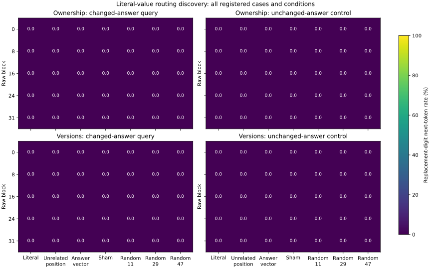

# Literal-value routing discovery results

All 432 complete baseline responses and 20,160 intervention forwards are audited. Baseline literal correctness is 393/432. All 432 generation-prefill checks passed; same-batch forward replays match the generation first token on 576/576 directed pairs. Every identity sham preserves its same-batch replay, and every random/unrelated-position control passes its effective BF16 norm check.

The heatmaps show the replacement digit, including when it is **not** the correct answer for the unchanged-answer query. These are next-token measurements on single-digit literals, not complete-output intervention accuracy. Full answer-vector transfer is an answer-copy software positive control. All cases are included; the audited artifact separately retains the subset where both complete baseline answers were correct, plus both directions, lexical realizations and mappings.

## Ownership

| Block | Condition | n per query type | Replacement, changed query (%) | Replacement, unchanged query (%) | Log-odds change, changed | Log-odds change, unchanged |
|---:|---|---:|---:|---:|---:|---:|
| 0 | literal_transfer | 144/144 | 0.00 | 0.00 | 7.618 | 2.088 |
| 0 | unrelated_position | 144/144 | 0.00 | 0.00 | 0.171 | 0.155 |
| 0 | answer_vector | 144/144 | 0.00 | 0.00 | -0.003 | 0.001 |
| 0 | identity_sham | 144/144 | 0.00 | 0.00 | 0.000 | 0.000 |
| 0 | random_11 | 144/144 | 0.00 | 0.00 | 0.013 | 0.007 |
| 0 | random_29 | 144/144 | 0.00 | 0.00 | 0.024 | 0.010 |
| 0 | random_47 | 144/144 | 0.00 | 0.00 | 0.028 | -0.004 |
| 8 | literal_transfer | 144/144 | 0.00 | 0.00 | 7.700 | 2.243 |
| 8 | unrelated_position | 144/144 | 0.00 | 0.00 | 0.149 | 0.088 |
| 8 | answer_vector | 144/144 | 0.00 | 0.00 | -0.007 | 0.003 |
| 8 | identity_sham | 144/144 | 0.00 | 0.00 | 0.000 | 0.000 |
| 8 | random_11 | 144/144 | 0.00 | 0.00 | 0.059 | -0.048 |
| 8 | random_29 | 144/144 | 0.00 | 0.00 | 0.033 | -0.046 |
| 8 | random_47 | 144/144 | 0.00 | 0.00 | 0.045 | -0.044 |
| 16 | literal_transfer | 144/144 | 0.00 | 0.00 | 6.172 | 2.020 |
| 16 | unrelated_position | 144/144 | 0.00 | 0.00 | 0.164 | 0.132 |
| 16 | answer_vector | 144/144 | 0.00 | 0.00 | 1.262 | 0.108 |
| 16 | identity_sham | 144/144 | 0.00 | 0.00 | 0.000 | 0.000 |
| 16 | random_11 | 144/144 | 0.00 | 0.00 | 0.216 | -0.070 |
| 16 | random_29 | 144/144 | 0.00 | 0.00 | 0.154 | -0.058 |
| 16 | random_47 | 144/144 | 0.00 | 0.00 | 0.147 | -0.056 |
| 24 | literal_transfer | 144/144 | 0.00 | 0.00 | 0.808 | 0.474 |
| 24 | unrelated_position | 144/144 | 0.00 | 0.00 | 0.063 | 0.056 |
| 24 | answer_vector | 144/144 | 0.00 | 0.00 | 5.845 | 1.568 |
| 24 | identity_sham | 144/144 | 0.00 | 0.00 | 0.000 | 0.000 |
| 24 | random_11 | 144/144 | 0.00 | 0.00 | 0.004 | 0.001 |
| 24 | random_29 | 144/144 | 0.00 | 0.00 | 0.015 | -0.006 |
| 24 | random_47 | 144/144 | 0.00 | 0.00 | 0.004 | -0.001 |
| 31 | literal_transfer | 144/144 | 0.00 | 0.00 | 0.000 | 0.000 |
| 31 | unrelated_position | 144/144 | 0.00 | 0.00 | 0.000 | 0.000 |
| 31 | answer_vector | 144/144 | 0.00 | 0.00 | 7.622 | 2.078 |
| 31 | identity_sham | 144/144 | 0.00 | 0.00 | 0.000 | 0.000 |
| 31 | random_11 | 144/144 | 0.00 | 0.00 | 0.000 | 0.000 |
| 31 | random_29 | 144/144 | 0.00 | 0.00 | 0.000 | 0.000 |
| 31 | random_47 | 144/144 | 0.00 | 0.00 | 0.000 | 0.000 |

## Versions

| Block | Condition | n per query type | Replacement, changed query (%) | Replacement, unchanged query (%) | Log-odds change, changed | Log-odds change, unchanged |
|---:|---|---:|---:|---:|---:|---:|
| 0 | literal_transfer | 144/144 | 0.00 | 0.00 | 11.062 | 2.702 |
| 0 | unrelated_position | 144/144 | 0.00 | 0.00 | 0.353 | 0.294 |
| 0 | answer_vector | 144/144 | 0.00 | 0.00 | 0.001 | -0.002 |
| 0 | identity_sham | 144/144 | 0.00 | 0.00 | 0.000 | 0.000 |
| 0 | random_11 | 144/144 | 0.00 | 0.00 | 0.048 | 0.024 |
| 0 | random_29 | 144/144 | 0.00 | 0.00 | 0.045 | 0.038 |
| 0 | random_47 | 144/144 | 0.00 | 0.00 | 0.044 | 0.022 |
| 8 | literal_transfer | 144/144 | 0.00 | 0.00 | 10.721 | 2.889 |
| 8 | unrelated_position | 144/144 | 0.00 | 0.00 | 0.155 | 0.136 |
| 8 | answer_vector | 144/144 | 0.00 | 0.00 | 0.002 | -0.000 |
| 8 | identity_sham | 144/144 | 0.00 | 0.00 | 0.000 | 0.000 |
| 8 | random_11 | 144/144 | 0.00 | 0.00 | 0.048 | 0.038 |
| 8 | random_29 | 144/144 | 0.00 | 0.00 | 0.104 | 0.025 |
| 8 | random_47 | 144/144 | 0.00 | 0.00 | 0.095 | -0.010 |
| 16 | literal_transfer | 144/144 | 0.00 | 0.00 | 9.195 | 2.605 |
| 16 | unrelated_position | 144/144 | 0.00 | 0.00 | 0.185 | 0.157 |
| 16 | answer_vector | 144/144 | 0.00 | 0.00 | 1.243 | 0.070 |
| 16 | identity_sham | 144/144 | 0.00 | 0.00 | 0.000 | 0.000 |
| 16 | random_11 | 144/144 | 0.00 | 0.00 | 0.257 | -0.105 |
| 16 | random_29 | 144/144 | 0.00 | 0.00 | 0.194 | -0.068 |
| 16 | random_47 | 144/144 | 0.00 | 0.00 | 0.258 | -0.083 |
| 24 | literal_transfer | 144/144 | 0.00 | 0.00 | 0.729 | 0.479 |
| 24 | unrelated_position | 144/144 | 0.00 | 0.00 | 0.125 | 0.081 |
| 24 | answer_vector | 144/144 | 0.00 | 0.00 | 7.006 | 1.609 |
| 24 | identity_sham | 144/144 | 0.00 | 0.00 | 0.000 | 0.000 |
| 24 | random_11 | 144/144 | 0.00 | 0.00 | -0.006 | -0.010 |
| 24 | random_29 | 144/144 | 0.00 | 0.00 | 0.001 | -0.005 |
| 24 | random_47 | 144/144 | 0.00 | 0.00 | -0.000 | -0.005 |
| 31 | literal_transfer | 144/144 | 0.00 | 0.00 | 0.000 | 0.000 |
| 31 | unrelated_position | 144/144 | 0.00 | 0.00 | 0.000 | 0.000 |
| 31 | answer_vector | 144/144 | 0.00 | 0.00 | 11.059 | 2.703 |
| 31 | identity_sham | 144/144 | 0.00 | 0.00 | 0.000 | 0.000 |
| 31 | random_11 | 144/144 | 0.00 | 0.00 | 0.000 | 0.000 |
| 31 | random_29 | 144/144 | 0.00 | 0.00 | 0.000 | 0.000 |
| 31 | random_47 | 144/144 | 0.00 | 0.00 | 0.000 | 0.000 |

There are two templates per family, two neutral lexical realizations and nine cyclic numeric triples. No layer was confirmed by held-out selection, and no population-level or multiplicity-adjusted inference is claimed. A successful early literal patch establishes an effect of changing that local activation in this assay; it does not isolate a binding code or explain failures on the earlier competition cohort. Computed-value transport and causal prediction of held-out errors remain untested.

Frozen inference identity: `7896061137670c90f0ef8e31569b26f9f46fc83026b88037bdfa6577c14a2821`. Audit: `artifacts/binding/value_transfer/llama31_8b_v1/interventions/audit.json`. Reproduce with `PYTHONPATH=src ../envs/probe-cu129/bin/python scripts/111_binding_value_transfer_review.py configs/binding/competition/value_transfer_v1.json`. See [the pre-inference design](value_transfer_plan.md). Generated final/extrapolation outcomes remain sealed.
