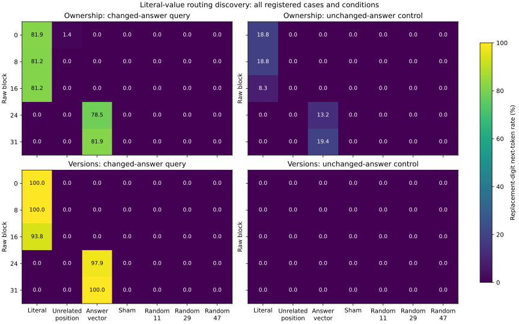

# Literal-value routing discovery results

All 432 complete baseline responses and 20,160 intervention forwards are audited. Baseline literal correctness is 392/432. All 432 generation-prefill checks passed; same-batch forward replays match the generation first token on 576/576 directed pairs. Every identity sham preserves its same-batch replay, and every random/unrelated-position control passes its effective BF16 norm check.
The answer-boundary gate passed on every baseline: the measured first token is the parsed digit, including incorrect predictions. The fixed space prefix matches the formatting token observed in all previous baselines; every new input is exactly the previous input plus that token. See [the boundary correction](value_transfer_boundary_correction.md). An isolated post-block literal patch leaves other positions’ earlier states intact, so failed transfer does not establish missing value information.

The heatmaps show the replacement digit, including when it is **not** the correct answer for the unchanged-answer query. These are next-token measurements on single-digit literals, not complete-output intervention accuracy. Full answer-vector transfer is an answer-copy software positive control. All cases are included; the audited artifact separately retains the subset where both complete baseline answers were correct, plus both directions, lexical realizations and mappings.

## Ownership

| Block | Condition | n per query type | Replacement, changed query (%) | Replacement, unchanged query (%) | Log-odds change, changed | Log-odds change, unchanged |
|---:|---|---:|---:|---:|---:|---:|
| 0 | literal_transfer | 144/144 | 81.94 | 18.75 | 15.477 | 4.662 |
| 0 | unrelated_position | 144/144 | 1.39 | 0.00 | 0.684 | 0.443 |
| 0 | answer_vector | 144/144 | 0.00 | 0.00 | 0.002 | 0.003 |
| 0 | identity_sham | 144/144 | 0.00 | 0.00 | 0.000 | 0.000 |
| 0 | random_11 | 144/144 | 0.00 | 0.00 | -0.008 | -0.033 |
| 0 | random_29 | 144/144 | 0.00 | 0.00 | -0.029 | -0.007 |
| 0 | random_47 | 144/144 | 0.00 | 0.00 | 0.001 | -0.024 |
| 8 | literal_transfer | 144/144 | 81.25 | 18.75 | 15.395 | 4.790 |
| 8 | unrelated_position | 144/144 | 0.00 | 0.00 | 0.524 | 0.345 |
| 8 | answer_vector | 144/144 | 0.00 | 0.00 | 0.001 | -0.009 |
| 8 | identity_sham | 144/144 | 0.00 | 0.00 | 0.000 | 0.000 |
| 8 | random_11 | 144/144 | 0.00 | 0.00 | 0.095 | 0.047 |
| 8 | random_29 | 144/144 | 0.00 | 0.00 | 0.076 | 0.030 |
| 8 | random_47 | 144/144 | 0.00 | 0.00 | 0.072 | 0.039 |
| 16 | literal_transfer | 144/144 | 81.25 | 8.33 | 12.514 | 4.510 |
| 16 | unrelated_position | 144/144 | 0.00 | 0.00 | 0.726 | 0.531 |
| 16 | answer_vector | 144/144 | 0.00 | 0.00 | 2.495 | 0.367 |
| 16 | identity_sham | 144/144 | 0.00 | 0.00 | 0.000 | 0.000 |
| 16 | random_11 | 144/144 | 0.00 | 0.00 | 0.183 | -0.039 |
| 16 | random_29 | 144/144 | 0.00 | 0.00 | 0.150 | -0.019 |
| 16 | random_47 | 144/144 | 0.00 | 0.00 | 0.124 | -0.011 |
| 24 | literal_transfer | 144/144 | 0.00 | 0.00 | 3.026 | 2.234 |
| 24 | unrelated_position | 144/144 | 0.00 | 0.00 | 0.480 | 0.315 |
| 24 | answer_vector | 144/144 | 78.47 | 13.19 | 11.432 | 3.608 |
| 24 | identity_sham | 144/144 | 0.00 | 0.00 | 0.000 | 0.000 |
| 24 | random_11 | 144/144 | 0.00 | 0.00 | 0.004 | -0.000 |
| 24 | random_29 | 144/144 | 0.00 | 0.00 | 0.022 | -0.003 |
| 24 | random_47 | 144/144 | 0.00 | 0.00 | 0.016 | 0.003 |
| 31 | literal_transfer | 144/144 | 0.00 | 0.00 | 0.000 | 0.000 |
| 31 | unrelated_position | 144/144 | 0.00 | 0.00 | 0.000 | 0.000 |
| 31 | answer_vector | 144/144 | 81.94 | 19.44 | 15.475 | 4.644 |
| 31 | identity_sham | 144/144 | 0.00 | 0.00 | 0.000 | 0.000 |
| 31 | random_11 | 144/144 | 0.00 | 0.00 | 0.000 | 0.000 |
| 31 | random_29 | 144/144 | 0.00 | 0.00 | 0.000 | 0.000 |
| 31 | random_47 | 144/144 | 0.00 | 0.00 | 0.000 | 0.000 |

## Versions

| Block | Condition | n per query type | Replacement, changed query (%) | Replacement, unchanged query (%) | Log-odds change, changed | Log-odds change, unchanged |
|---:|---|---:|---:|---:|---:|---:|
| 0 | literal_transfer | 144/144 | 100.00 | 0.00 | 17.634 | 4.311 |
| 0 | unrelated_position | 144/144 | 0.00 | 0.00 | 0.382 | 0.295 |
| 0 | answer_vector | 144/144 | 0.00 | 0.00 | -0.009 | -0.010 |
| 0 | identity_sham | 144/144 | 0.00 | 0.00 | 0.000 | 0.000 |
| 0 | random_11 | 144/144 | 0.00 | 0.00 | -0.009 | -0.025 |
| 0 | random_29 | 144/144 | 0.00 | 0.00 | 0.001 | -0.030 |
| 0 | random_47 | 144/144 | 0.00 | 0.00 | 0.005 | -0.036 |
| 8 | literal_transfer | 144/144 | 100.00 | 0.00 | 17.347 | 4.478 |
| 8 | unrelated_position | 144/144 | 0.00 | 0.00 | 0.239 | 0.202 |
| 8 | answer_vector | 144/144 | 0.00 | 0.00 | 0.005 | -0.003 |
| 8 | identity_sham | 144/144 | 0.00 | 0.00 | 0.000 | 0.000 |
| 8 | random_11 | 144/144 | 0.00 | 0.00 | 0.061 | 0.021 |
| 8 | random_29 | 144/144 | 0.00 | 0.00 | 0.062 | 0.003 |
| 8 | random_47 | 144/144 | 0.00 | 0.00 | 0.082 | -0.011 |
| 16 | literal_transfer | 144/144 | 93.75 | 0.00 | 14.668 | 4.059 |
| 16 | unrelated_position | 144/144 | 0.00 | 0.00 | 0.435 | 0.302 |
| 16 | answer_vector | 144/144 | 0.00 | 0.00 | 2.074 | 0.260 |
| 16 | identity_sham | 144/144 | 0.00 | 0.00 | 0.000 | 0.000 |
| 16 | random_11 | 144/144 | 0.00 | 0.00 | 0.095 | -0.031 |
| 16 | random_29 | 144/144 | 0.00 | 0.00 | 0.088 | -0.016 |
| 16 | random_47 | 144/144 | 0.00 | 0.00 | 0.110 | -0.027 |
| 24 | literal_transfer | 144/144 | 0.00 | 0.00 | 2.456 | 1.793 |
| 24 | unrelated_position | 144/144 | 0.00 | 0.00 | 0.532 | 0.236 |
| 24 | answer_vector | 144/144 | 97.92 | 0.00 | 13.125 | 2.877 |
| 24 | identity_sham | 144/144 | 0.00 | 0.00 | 0.000 | 0.000 |
| 24 | random_11 | 144/144 | 0.00 | 0.00 | -0.001 | -0.005 |
| 24 | random_29 | 144/144 | 0.00 | 0.00 | 0.005 | -0.006 |
| 24 | random_47 | 144/144 | 0.00 | 0.00 | 0.003 | -0.002 |
| 31 | literal_transfer | 144/144 | 0.00 | 0.00 | 0.000 | 0.000 |
| 31 | unrelated_position | 144/144 | 0.00 | 0.00 | 0.000 | 0.000 |
| 31 | answer_vector | 144/144 | 100.00 | 0.00 | 17.628 | 4.321 |
| 31 | identity_sham | 144/144 | 0.00 | 0.00 | 0.000 | 0.000 |
| 31 | random_11 | 144/144 | 0.00 | 0.00 | 0.000 | 0.000 |
| 31 | random_29 | 144/144 | 0.00 | 0.00 | 0.000 | 0.000 |
| 31 | random_47 | 144/144 | 0.00 | 0.00 | 0.000 | 0.000 |

There are two templates per family, two neutral lexical realizations and nine cyclic numeric triples. No layer was confirmed by held-out selection, and no population-level or multiplicity-adjusted inference is claimed. A successful early literal patch establishes an effect of changing that local activation in this assay; it does not isolate a binding code or explain failures on the earlier competition cohort. Computed-value transport and causal prediction of held-out errors remain untested.

Frozen inference identity: `d22000581b7d9109648fa016e4ed6d9cb0e26f48fdda920552b18438ccd2b613`. Audit: `artifacts/binding/value_transfer/llama31_8b_v2/interventions/audit.json`. Reproduce with `PYTHONPATH=src ../envs/probe-cu129/bin/python scripts/111_binding_value_transfer_review.py configs/binding/competition/value_transfer_v2.json`. See [the pre-inference design](value_transfer_plan.md). Generated final/extrapolation outcomes remain sealed.
